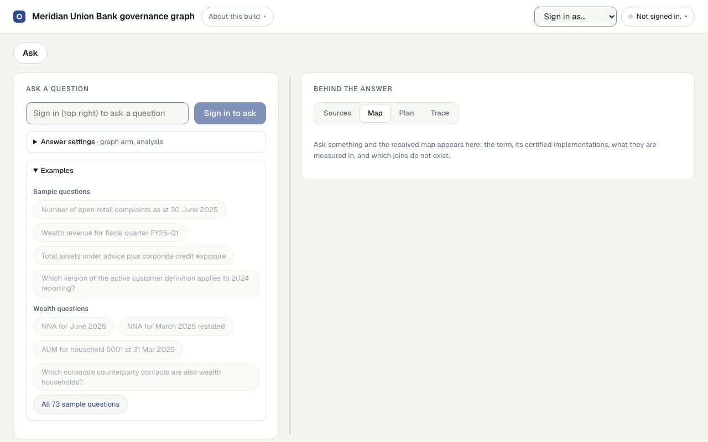
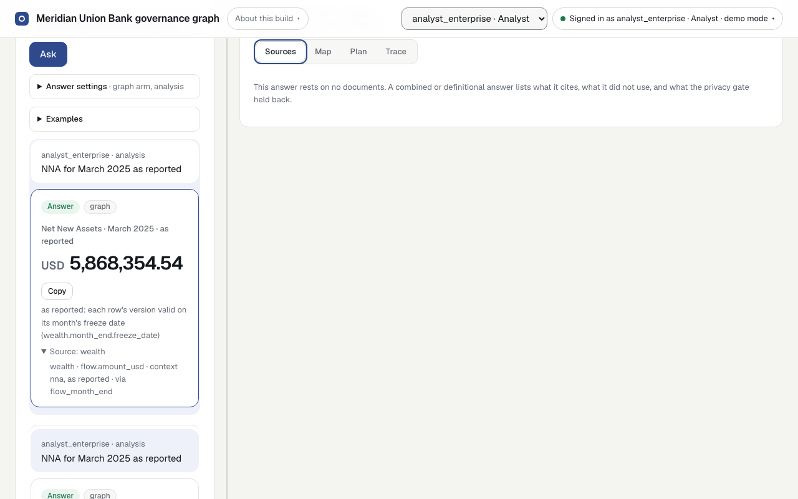
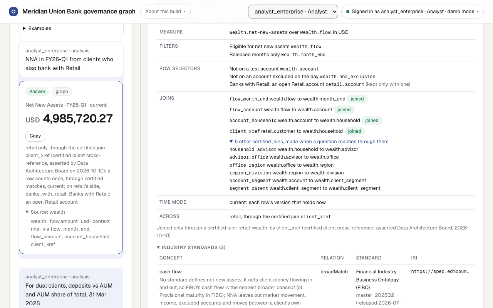
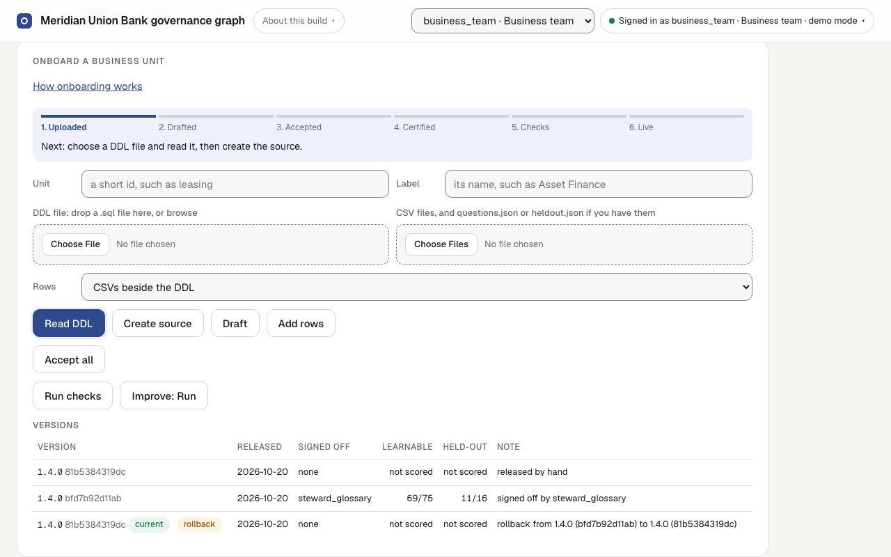

# Local Demo

## Quick start

From `demos/kge`, build the deterministic invented estate and open the page:

```sh
python3 -m venv .venv && . .venv/bin/activate && pip install -r requirements.txt -c constraints.txt && pip install --no-deps -e .
kge graph pipeline
kge serve DEMO_MODE=1
```

`kge` is the demo's own command, which `pip install -e .` installs: it needs Python alone, so it runs as written on Windows (activate with `.venv\Scripts\activate`, or put `uv run` before each command), Linux and macOS, and takes the same `NAME=value` settings as the Makefile's targets. Where `make` exists, `make graph pipeline`, `make serve DEMO_MODE=1` and every other `make <command>` still work, each the matching `kge` command; the developer's targets below that `kge` does not take (the tests, the kit, parity) are make's alone.

Open http://127.0.0.1:8000, choose `analyst_enterprise`, and ask the golden question *NNA for March 2025 as reported*. The answer is 5,868,354.54; its **Trace** tab lists the stages it ran as a timeline, the raw JSON behind a toggle. The **SQL check** box, under **Tools**, checks a query against the SQL gate as the signed-in principal and never runs it; a table may be named bare or as `<unit>.<table>`, such as `retail.monthly_revenue`, and is checked in that unit's warehouse; a table the principal may not read is not available, said the same way whether or not it exists, so the box never shows which tables there are. The page shows each role the workspaces it can use and opens on its task: an analyst on **Ask**, a steward on the **Review queue**, the business team on **Onboard**; `pipeline_tagger`, which may not query, has none, and the page says so; **Quality** holds the golden set and the A/B, and **About this build**, in the header, the release, the artifact and how to run the A/B. Stop the server with Ctrl-C. `make screenshots` runs the full browser walkthrough and, with its fixed data and 1280-pixel viewport, rewrites these views:

Select an earlier question or answer in the thread to see that exchange's sources, map, plan and trace again.

| Sign in | Ask and answer |
|---|---|
|  |  |
| **Map** | **Onboard** |
|  |  |

A laptop-sized working model of the knowledge graph use case. It exists to show the mechanism the scenarios in the parent folder describe, on invented data, with nothing from a cloud account. It is not a benchmark and claims nothing about scale, latency or calibrated thresholds.

## What it shows

1. **The resolved map.** An analyst asks for a figure. The graph resolves the term to its certified columns, finds the join path within a warehouse, refuses any join across warehouses, derives whether the parts can be summed, and returns the parts with the reason where they cannot. This is the curated warehouse baseline scenario in the [folder index](../../docs/use-cases/kge/README.md#scenarios), live.
2. **Tagging with a gate.** Documents on two shelves go through the same pipeline. Chunks get tags with a generator and a confidence. A chunk carrying personal data never reaches the encoder. A steward's correction retires an automatic tag with a supersedes edge, and is journaled in the client's graph store, so it outlives a rebuilt graph. This is [PII detection before embedding](../../docs/use-cases/kge/pii-detection-before-embedding.md) and [override capture](../../docs/use-cases/kge/hitl-override-capture.md).
3. **Certified over uncertified.** Where a draft, an email or an old wiki page disagrees with a published definition, the answer cites the published one and shows the disagreement without using it. Where a definition exists only on the uncertified shelf, the graph routes it to a steward rather than answering. This is [business metric recovery](../../docs/use-cases/kge/business-metric-definition-recovery.md).
4. **The control.** The golden set runs three ways and is scored apart, within a warehouse and across them.
5. **One governed answer.** A question that needs figures and the documents behind them gets both at once: counts and measures from the warehouse, the certified definition each figure rests on, what was shown and not used, and what the privacy gate held back. See [the combined answer](#the-combined-answer).
6. **Tiers from upstream certification.** A stand-in for the AI certification that runs before the graph grades every document AI-ready or not, and gold, silver or bronze, in a store of its own, and lands everything it certified, masked, in a landing zone. The graph ingests from the landing zone and nothing else, and never writes back; the tier rule retrieves only what is AI-ready and cites by tier. See [AI certification and tiers](#ai-certification-and-tiers).
7. **The reference agent.** One text-to-SQL agent, run with the graph off and with it on: the same model, prompts and seed, only the context differs, and everything after the context is shared. See [the reference agent](#the-reference-agent).
8. **The A/B harness.** Every arm on the question sets the profile's pack names (Meridian's golden and held-out sets, and golden_wealth_v1 since issue #39), several times over, with a record and a run trace per question and a side-by-side report, which the page links. See [the A/B harness](#the-ab-harness).
9. **Query semantics and the certified join.** A term the pack gives a context, such as net new assets, is answered from what the context declares: its filters, row selectors, declared joins, time mode and release rule, not the question's words. Retail and Wealth join only through the certified client cross-reference, for a principal who reads both. See [answering from a context](#answering-from-a-context).
10. **A profile per client, one platform.** Each client's pack, in its own folder (`clients/<client>/`), is compiled into an artifact of its own, loaded into the client's graph store as a candidate and served once its `current` pointer is swapped to it; the steward decisions outlive every rebuild. One platform build serves two clients side by side, a process each, chosen at deployment, with no data access between them. See [the demo script](#demo-script) and [two profiles](#two-profiles).
11. **The improvement job.** A LangGraph workflow (`kge/improve/flow.py`) learns from the served release's A/B misses, unmatched page questions and onboarded unit schemas, never reading a held-out set (`heldout` or `heldout_<unit>`), proposes allowlisted alias additions with a minor version bump, compiles and tests the candidate beside the served graph, keeps it only when a learnable question improves and none regresses, judges the held-out sets once, and hands the proposal to the business team and steward for acceptance, certification, sign-off and release, with version history and rollback (`GET /versions`).

## Demo script

Issue #39's, issue #40's, DDL onboarding's and issue #55's features, one step at a time; #40's are client onboarding: a pack edit through the onboarding gate (step 4), a failed check that leaves a candidate (step 5), assets under management added later by a pack edit alone (step 6), a new client onboarded from its pack alone (step 9), a business unit added from DDL on the page (step 10), an invented database onboarded as a client (step 11), and the improvement job learning an alias from the onboarded unit's schema and A/B misses (step 13). Run it on a clean checkout once the first four lines of [running it](#running-it) have installed the demo. The figures are the invented data's. Stop the API (Ctrl-C) before any step that runs `kge` or `make`, but for `kge check`, `kge compile load`, `kge margin HASH=`, `kge improve`, `kge sign-off` and `kge release`, which run beside it.

1. **Build and serve.** `kge demo DEMO_MODE=1`, then open http://127.0.0.1:8000. The discovery portal runs beside it on http://127.0.0.1:8090 ([the discovery portal](#the-discovery-portal)); where Node is missing or too old for it, `kge demo` serves the page alone and says why. Certification lands a release in `build/landing/meridian/` ([the landing zone](#the-landing-zone)); the pack is compiled into `build/artifacts/meridian/<model_hash>/`, loaded into the client's graph store and released (`current`). The header names the profile, `meridian`, the landed release the graph was loaded from, by its id and as-of date, and the artifact it serves. In a second terminal, `grep -rhoE '[a-z.*]+@example\.com' build/landing/meridian/current/documents | sort -u` lists the e-mail addresses that landed: each customer's masked (`m********@example.com`), the role mailbox `records@example.com` in clear ([the landing zone](#the-landing-zone) says more of what landed and what was masked).
2. **The Wealth questions.** The sample questions under **Examples** are the golden set's, golden_wealth_v1's and the SAGE set's, sage_v1's; the first few of each are questions graph on answers as expected, and *All 78 sample questions* shows the rest (picking one folds the list back, and the page scrolls to the question and its answer). Pick `analyst_enterprise` and, on the graph arm, ask *NNA for March 2025 as reported* (5,868,354.54) and *NNA for March 2025 restated* (5,920,237.28); *NNA for the latest month* (6,069,905.64, June 2025) and *NNA for July 2025* (not yet released: its figures are released on 2025-08-08); *NNA from BROKERAGE in FY26-Q1* (16,910,957.72). Type *What is NNA?*: no document defines net new assets, so the card gives its definition from the pack's glossary, labelled so (**Glossary definition**, `glossary_definition`), with its steward and its context, and cites nothing; the Sources tab lists what the question retrieved as references, never cited ([a definition no document gives](#a-definition-no-document-gives)). *How many accounts were excluded from NNA at 31 Mar 2025?* (W08) gets no figure: net new assets applies no condition on the exclusion ([answering from a context](#answering-from-a-context)). W08 is one of six Wealth samples that graph on does not answer as the set expects, as the A/B report counts them, and the page marks each of them *known miss*, as the profile's A/B baseline records them, with a note pointing here; leave them out of a demo, or show them as what the graph does not know yet. *How many accounts did household 5001 hold at 31 Dec 2024?* (W11), *Of FY26-Q1 advisory inflows, how much came from the client's own retail accounts?* (XB4) and the one on advisor coverage by office (XB5) get no figure, each with its reason. *How many clients hold both retail deposits and advisory AUM at 31 Mar 2025?* (XB1) and *For dual clients, deposits vs AUM and AUM share of total, 31 Mar 2025* (XB2) ask for a count and a share across the certified join, which the runtime does not compute yet (the owner's Question 23 default): XB1 gets no figure, saying why, and XB2 gives one figure, the dual clients' assets under management, not their deposits beside it and its share, which is not what it asks. The two on assets under management for household 5001 (W16, W17) are answered since the pack added AUM by a pack edit alone (step 6).
3. **Retail and Wealth, Option B.** *NNA in FY26-Q1 from clients who also bank with Retail* is 4,985,720.27, through the certified client cross-reference. Sign in as `analyst_retail` and ask it again: blocked, no figure, no warehouse queried, and the Map tab says there is no map for a refused answer and offers a way forward: the units you may read, or the business team that owns the data, never naming a unit the answer withholds. Back as `analyst_enterprise`, *Which retail customers are also wealth households, and what are their emails?* is refused (restricted personal data), and *Which corporate counterparty contacts are also wealth households?* (no join path). Two more answers are worded from the graph's own facts, with no line of code naming Meridian ([the runtime's domain](#the-runtimes-domain)): from *All 78 sample questions*, *Join retail customers to corporate contacts on customer_id and count the matches* is refused on the no-join fact between Retail Banking and Corporate & Institutional, since the pack declares `corporate.contact.customer_id` not joinable, and *Total bank revenue in GBP for Q2 2025* abstains, saying that certified figures are in EUR and USD and that the only conversion is EUR to USD.
4. **A pack edit through the onboarding gate (steps 4 to 8).** With the API serving, add `- {phrase: takings, term: revenue}` under `- {phrase: revenue, term: revenue}` in `clients/meridian/pack.yaml`. In a second terminal: `kge check` finds nothing and names the new hash. `kge compile load` loads it as a candidate: *Total retail takings for June 2025* still abstains, and the Trace tab's `graph.artifact` is the old hash. `kge release` is refused: not checked, not signed off. `kge margin HASH=<the new hash> REPEATS=1` (on rules the repeats agree) checks it against its pack's gates and passes: every golden question of each kind on graph on (V01), graph on 100 points ahead of graph off on cross and shelf, where the pack asks for 50 (V02), held-out reported (V03), no off-tier citation (V04), and no margin fell beside the baseline; its `GATE` says passed ([the post-load gate](#the-ab-harness)). `kge sign-off PRINCIPAL=analyst_retail` is refused (no certification); `kge sign-off PRINCIPAL=steward_glossary` signs it off. `kge release`, restart the API: the new hash is served, and the question is answered as revenue, 13,287.67. Put the pack back (`git checkout clients/meridian/pack.yaml`), `kge release HASH=<the old hash>` (released before: no new sign-off), restart: the old graph again ([releasing a graph](#running-it)).
5. **A failed check leaves a candidate.** In `clients/meridian/pack.yaml`, set `certified: false` on the first mapping, `retail.monthly_revenue.total_revenue_usd`, then `kge compile load`. `kge margin HASH=<the new hash> REPEATS=1` fails: graph on now misses five golden questions, each named, and its `GATE` says failed. `kge sign-off PRINCIPAL=steward_glossary` and `kge release` are refused: it stays a candidate. On the page, *Total retail revenue for June 2025*, one of the five, is still 13,287.67. Put the pack back.
6. **AUM, added later by a pack edit alone.** Onboarding's step 9, the plan's Phase 3 test: assets under management was added to Meridian's pack after the rest (pack 1.3.0) and released through steps 4 to 8, as step 4's edit is, with no platform change. As `analyst_enterprise` on the graph arm, neither of its two sample questions is marked known miss: *AUM for household 5001 at 31 Mar 2025* (W16) is 7,641,422.24, from the context `aum`, and the Map tab names its measure, `wealth.assets-under-management` over `wealth.AUM_MNTH_END_FACT_1` (business name `aum_month_end`); *AUM plus AUA for household 5001 at 31 Mar 2025* (W17) is refused, two measures not added. Type *What is AUM?*: no document defines it, so the card gives the pack's glossary definition, labelled so, with its context, and cites nothing ([a definition no document gives](#a-definition-no-document-gives)). In a terminal, `grep -niw aum clients/meridian/pack.yaml` lists the change, and `grep -rliw aum --exclude-dir=estate kge ui meta-model.yaml Makefile` prints nothing.
7. **The overlay survives a rebuild.** Ask *What was the Digital Engagement Score for June 2025?*: not a glossary term, routed to the steward queue. As `steward_glossary`, accept *Digital Engagement Score* in the **Review queue** (type any definition in its row), and ask again: a glossary term now, with no certified implementation. Stop the API, run `kge graph`, which rebuilds the graph from scratch, and serve again: the term is still accepted, so the answer is the same and the queue does not list it ([the runtime overlay](#the-runtime-overlay)). Stop the API and run `kge reset-overlay graph` to set the decision aside: the question is routed to the steward again.
8. **Two profiles side by side.** Keep Meridian serving and, in a second terminal, run `kge demo PROFILE=thornbury PORT=8001 DEMO_MODE=1`, then open http://127.0.0.1:8001 (its portal is on 8091): Thornbury Mutual Casualty's page, its own title and sample questions. As `actuary`, *Gross written premium for June 2025* is 37,646.14, and *Total retail revenue for June 2025*, Meridian's question, abstains ([two profiles](#two-profiles)). Thornbury's certified figures are in USD alone, so *Gross written premium in EUR for June 2025* abstains, saying so: the rule behind Meridian's GBP abstention, read from Thornbury's own measures.
9. **A new client, onboarded from its pack alone.** Fellmoor Regional Transit, an invented regional bus operator, goes through onboarding's steps 1 to 8 with no platform change. `ls clients/fellmoor deploy/fellmoor`: a pack written for it (`pack.yaml`: two warehouses, ticketing and fleet, with a no-join fact and a column declared not joinable between them; two certified measures; its gates, the template's), its lock (`pack.lock`), a fixture of a schema, CSVs, four Markdown documents, ten golden questions and three held-out paraphrases of them, and its identities; no Python. With the other pages still serving, run each step for it: `kge estate PROFILE=fellmoor` builds its estate from the fixture and certifies it; `kge lock PROFILE=fellmoor` writes nothing (`git status clients/fellmoor` stays clean); `kge check PROFILE=fellmoor` finds nothing; `kge compile PROFILE=fellmoor`, twice, prints the same path, the second time already compiled, unchanged; `kge load PROFILE=fellmoor` marks it `LOADED`, with nothing current; `kge release PROFILE=fellmoor` is refused, not through the onboarding gate; `kge margin HASH=<the hash> PROFILE=fellmoor` passes against its own pack's gates (every golden question of each kind on graph on, graph on 100 points ahead of graph off on cross and shelf, no off-tier citation) and reports its held-out set, never gated: graph on passes each of the three paraphrases and graph off none (V03); with no fall check, since it names no baseline, and says so; `kge sign-off PRINCIPAL=network_analyst PROFILE=fellmoor` is refused (no certification) and `kge sign-off PRINCIPAL=fares_steward PROFILE=fellmoor` signs it off; `kge release PROFILE=fellmoor`. Then `kge serve PROFILE=fellmoor PORT=8002 DEMO_MODE=1` and open http://127.0.0.1:8002: its own title and sample questions. As `network_analyst`, *Fare revenue for June 2025* is 438.66; *Join journeys to fleet vehicles on vehicle_ref and count the matches* is refused on Fellmoor's own no-join fact, worded from its pack ([the runtime's domain](#the-runtimes-domain)); *Total retail revenue for June 2025*, Meridian's question, abstains; the Trace tab names the profile and the artifact, and the A/B panel lists the gate's run. `grep -rliw fellmoor --exclude-dir=estate kge ui meta-model.yaml Makefile` prints nothing. `.venv/bin/python -m pytest tests/unit/test_onboarding.py -q` runs the same steps on a copy.
10. **A new business unit, from a DDL file and its data, on the page.** Meridian is set up already, so adding a business unit is operational: no pull request, no Terraform, no job started by hand and no restart. With Meridian serving (step 1), pick `knowledge_engineer`, open *Onboard*, enter `leasing` and `Asset Finance`, choose `examples/leasing/unsafe.sql`: it is refused as soon as it is chosen before the statement can read a file. Choose `examples/leasing/schema.sql`, set Rows to *no rows yet: draft only*, and its tables preview automatically. Press *Create source*, then *Draft* on the unit card. The source and term are drafted, with the term's candidate mapping to an industry standard (step 15), but *Lease rentals for the latest month with rows* has no figure. *Run checks* under More actions is refused: the checks need CSVs beside the DDL or invented rows from it, labelled invented. On the unit card, choose the three files under `examples/leasing/data/`, set Rows to *from these CSV files*, and press *Add rows*. The question becomes *Lease rentals for June 2025*, with 1,461.25 computed from those CSV rows. *Run checks* under More actions then fails at V05 until the business team presses *Accept all* and `steward_glossary` presses *Certify all*. Switch to `knowledge_engineer` and run the checks again, then return to `steward_glossary` for *Sign off* and *Release*. As `analyst_enterprise`, *Lease rentals for June 2025* answers 1,461.25; *Total retail revenue for June 2025* remains 13,287.67. The Rows menu also offers *invented from the DDL, labelled invented* when a unit sends no data, beside *from these CSV files* and *no rows yet: draft only*. To reset either row mode, stop the API and run `kge reset-onboard UNIT=leasing`; it restores the original pack, estate and released graph.
11. **Point at an invented database (a new client).** Brackenridge Brewery is invented. Its reviewed DDL and CSVs are under `examples/brackenridge/`; `make brackenridge-db` optionally builds the small, git-ignored `examples/brackenridge/brackenridge.duckdb`, which onboarding opens read-only with external access disabled. The platform team runs once: `kge client CLIENT=brackenridge LABEL="Brackenridge Brewery" DDL=examples/brackenridge/schema.sql CSV=examples/brackenridge/data`. The same command may use `DB=examples/brackenridge/brackenridge.duckdb` instead. The business team runs `kge accept PROFILE=brackenridge UNIT=taproom ITEM=all PRINCIPAL=business_team` and the same for `UNIT=cellar`; the steward runs `kge certify-draft PROFILE=brackenridge UNIT=taproom ITEM=all PRINCIPAL=steward` and the same for `UNIT=cellar`. `kge onboard PROFILE=brackenridge REPEATS=1` prints the candidate hash and passes all five golden questions: three within-unit figures, a refusal to add ingredient cost to takings across the two units, and an abstention from converting a GBP figure to EUR; the graph-on arm is 100 points ahead of graph off on the cross-unit question. Before release, `kge serve PROFILE=brackenridge HASH=<candidate> PORT=8003 DEMO_MODE=1` shows *Candidate <candidate>, not released*; it does not move `current`. Then `kge sign-off PROFILE=brackenridge HASH=<candidate> PRINCIPAL=steward`, `kge release PROFILE=brackenridge HASH=<candidate>`, and `make agent PROFILE=brackenridge PRINCIPAL=analyst AGENT_ARM=treatment Q="Takings for June 2025"` give 91.50. Finally, `kge reset-client CLIENT=brackenridge` removes the client and its own `deploy/profiles.yaml` entry, leaving the file byte for byte as it was if nothing else changed it.
12. **Rich answers, a page switch.** On Meridian's page, as `analyst_enterprise` on the graph arm, *Rich answers*, under **Answer settings**, is off. Turn it on and ask *NNA for FY26-Q1 by division*: a sentence names the source; the figures table reads EAST 12,371,673.22 and WEST 8,831,519.54; the chart has two bars drawn from that table; and the line reads *gate passed · 2 checked queries · SQL by planner · text by template*. *Combined Retail and SME revenue for June 2025* is 334,418.32 and draws its two checked parts. *Total revenue across the bank for the quarter to 30 June 2025* draws no chart or Total row and gives the graph's reason that the parts do not add. Turn *Rich answers* off and ask *NNA for FY26-Q1 by division* again: the ordinary card returns. The switch does not change the answer or its sources, and the A/B harness, eval, margin and parity never send it.
13. **The improvement job.** With `leasing` onboarded on Meridian (step 10), its schema comment on `lease_rentals_usd` notes that the business calls it `lease income`, and its unit files `examples/leasing/questions.json` and `examples/leasing/heldout.json` landed `team_leasing` v1 and `heldout_leasing` v1 beside `golden_leasing` v1. As `analyst_enterprise`, ask *Lease income for June 2025*: it abstains, recognising no glossary term, and logs the unmatched question. Pick `knowledge_engineer`, open *Onboard* and press *Improve: Run* (or run `kge improve` in a terminal). The LangGraph job reads the latest A/B run on the served release and the unmatched question log, drops every held-out record (`heldout` and `heldout_leasing`) before diagnosis, diagnoses the missing alias `lease income` for `lease-rentals` from the column description, bumps the candidate pack version from `1.5.0` to `1.6.0`, loads the candidate beside `current`, runs the A/B check (`team_leasing` moves from `1/2` to `2/2`), judges the held-out sets (`heldout_leasing` moves from `1/2` to `2/2`), and writes `clients/meridian/proposals/open/proposal.yaml`, while recording the six Wealth misses as steward notes and platform requests. While the proposal is drafted, *Lease income for June 2025* still abstains on the page and *Release* is refused at V05. As `business_team`, press *Accept all* on the proposal; as `steward_glossary`, press *Certify all*. Switch to `knowledge_engineer` for *Run checks*, then return to `steward_glossary` for *Sign off* and *Release*. The page serves the `1.6.0` candidate, *Versions* lists `1.5.0` and `1.6.0` (`current`, with `13/18` on the held-out sets), and *Lease income for June 2025* answers 1,461.25. Still as `steward_glossary`, press *Release again* on `1.5.0` in *Versions*: the release rolls back to `1.5.0`, restoring its kept pack, and *Lease income for June 2025* abstains again while *Lease rentals for June 2025* remains 1,461.25.
14. **A new business unit, from semantic files, documents and client figures.** Stop the API. Run `kge source UNIT=bancassurance LABEL=Bancassurance SEMANTIC=examples/bancassurance-osi PRINCIPAL=knowledge_engineer`, then `kge draft UNIT=bancassurance PRINCIPAL=knowledge_engineer`. The OSI YAML model drafts its four datasets and relationships, active-policy written premium as a filtered context, and in-force premium at month end as a point-in-time context. `golden/board-report.yaml` supplies three client questions: the two whose reference SQL agrees with the loaded rows, and whose wording the agent reads as one of the unit's terms, are drafted with `from: client`; the stated 1,250.00 does not agree with its SQL's 1,200.00 and remains not drafted. `kge onboard-status` shows the open request to check either figure. Its `OR` recipe and ratio also remain under `not_drafted`, with an open request for each recipe that needs clarification. Run `kge accept UNIT=bancassurance ITEM=all PRINCIPAL=business_team`, then `kge certify-draft UNIT=bancassurance ITEM=all PRINCIPAL=steward_glossary`, and `kge onboard REPEATS=1`. Use its hash with `kge sign-off HASH=<candidate> PRINCIPAL=steward_glossary`, then `kge release HASH=<candidate>`. `make agent PRINCIPAL=analyst_enterprise AGENT_ARM=treatment Q="Gross written premium for June 2025"` answers 1,200; the drafted in-force-premium golden question holds 2,000.00 at the latest June month end, not a sum over both snapshots. Bancassurance's measures are in GBP, but an onboarded unit's currency answers only its own terms: `Q="Total bank revenue in GBP for Q2 2025"` still abstains, as it did before. Onboarding is continuous: the business team updates the live unit by sending its sources again, with the same command and a second folder, `kge source UNIT=bancassurance LABEL=Bancassurance SEMANTIC=examples/bancassurance-osi-v2 PRINCIPAL=knowledge_engineer`, then `kge draft UNIT=bancassurance PRINCIPAL=knowledge_engineer`. The second folder widens written premium's recipe to active and lapsed policies, adds a commission measure on a new `premium.commission_amount` column, drops the in-force-premium metric (and the client figure that rested on it), and adds a June premium on a lapsed policy. The update is staged and drafted beside the live unit, and compared with it item by item: `kge onboard-status` shows `bancassurance v2 (update): 4 changed, 3 added, 4 removed — awaiting acceptance; v1 stays live`, then what changed in each item (the new term and the removed one each bring their candidate mapping to an industry standard, step 15), among them the recipe, the new column, and the drafted golden figure moving from 1,200.00 to 1,650.00. *Commission for June 2025* is new at 245.05. The in-force term and its two released golden questions are proposed removals, and each of the two questions is an open request until the steward certifies its removal. Run `kge accept UNIT=bancassurance ITEM=all PRINCIPAL=business_team` and `kge certify-draft UNIT=bancassurance ITEM=all PRINCIPAL=steward_glossary` again (an item the update leaves unchanged keeps its acceptance and certification), then `kge onboard REPEATS=1`: its first step lands v2 in a warehouse of its own, beside v1's, and the checks gate the candidate on v2's rows as they gated v1. Until its release, the released graph answers with v1's definitions on v1's rows: `make agent PRINCIPAL=analyst_enterprise AGENT_ARM=treatment Q="Gross written premium for June 2025"` still answers 1,200, and `Q="In force premium for June 2025"` still 2,000, although the second folder's snapshot file adds a second 30 June snapshot that would make it 3,950 on v2's rows. Sign off and release its hash as before: *Gross written premium for June 2025* answers 1,650. Roll back with `kge release HASH=<the first candidate>`: that hash names v1's warehouse, so *Gross written premium for June 2025* answers 1,200 and *In force premium for June 2025* 2,000 again, v1's definitions on v1's rows. Finally run `kge reset-onboard UNIT=bancassurance`; this restores the pack, lock, documents, warehouses and released graph inputs. `examples/bancassurance-osi-json` is the original unfiltered OSI model in JSON; this reader implements the [Apache Ossie 0.2.0.dev0 core specification](https://github.com/apache/ossie/blob/53418ba/core-spec/spec.md). `examples/bancassurance-markdown` is Markdown, which no code reader reads: it goes through the drafting flow (`kge/estate/draftflow.py`), whose steps read, tables, recipes, definitions and golden each ask the onboarding model, check its reply with the same code checks as the other formats, send a refused reply back with the checker's error at most `ONBOARD_MODEL_RETRIES` times (default 2), and otherwise fall back to rules, recording why; on the pilot's cloud path (any of `WAREHOUSE_BACKEND`, `RETRIEVAL_BACKEND` or `APP_STATE_BACKEND` set to `bigquery`) a model that was asked and failed stops the step instead, as the tagger and the answer's model calls do there. The model never writes reference SQL or a figure. With the API stopped, `MODEL_PROVIDER=mock kge source UNIT=bancassurance LABEL=Bancassurance SEMANTIC=examples/bancassurance-markdown PRINCIPAL=business_team`, then `MODEL_PROVIDER=mock kge draft UNIT=bancassurance PRINCIPAL=business_team`, uses the labelled offline stand-in: it proposes the refunds recipe on a misnamed column, the recipes step refuses it, and the retry corrects it, so `clients/meridian/units/bancassurance/history.jsonl` and the unit card's History record `draft-recipes` with `tries: 2`, and `draft.yaml` marks the source, the term, *Gross written premium for June 2025* (2,000.50) and the term's mapping to an industry standard `made_by: model`, `model: mock:mock`; the standards step's first reply names an IRI the platform does not preload, which its check refuses, so `draft-standards` records `tries: 2` too. Run `kge reset-onboard UNIT=bancassurance`, then the same two commands with `MODEL_PROVIDER=none`: rules read only tables under a `## <table>` heading whose header is exactly `| column | type | description | key |`, so only the source is drafted, `made_by: rules`, and `kge onboard-status` shows two open requests, to restate the skipped prose and to *Define written_premium as plain conditions*. Reset again with `kge reset-onboard UNIT=bancassurance`. Structured formats pass through the same steps with no model call. A run that stops part-way resumes from its last completed step when retried in the same API process; each `kge` command starts afresh, and the checked proposal kept with the unit's inputs means drafting and build never need a live model. `examples/bancassurance` is the dbt form, with the two draftable recipes mirrored minimally. `examples/bancassurance-lookml` is the LookML form. `examples/bancassurance-dictionary` is the data-dictionary form. LookML accepts only `sql_table_name`, allowlisted dimension types, bare-column SQL, `sum` measures, equality joins, `filters: [field: "value"]` (`NULL` and `-NULL` are `IS NULL` and `IS NOT NULL`, `%` is `LIKE`; a `-value` filter stays undrafted, since Looker keeps its NULL rows, an `OR`), and `value_format_name: gbp|usd|eur`; other SQL is never executed. The dictionary is YAML or JSON named `data-dictionary.*`, shaped as `tables: [{name, description, columns: [{name, type, description, key: primary, measure: {term, label, currency, period_column, grain, filters: [{column, op, value}]}}]}]`, with `key`, `measure`, `grain`, and `filters` optional. Recipe conditions allow typed literals with `=`, `!=`, `<`, `<=`, `>`, `>=`, `LIKE`, `NOT LIKE`, `IN`, `NOT IN`, `IS NULL`, and `IS NOT NULL`, joined only by `AND`; functions, subqueries, and `OR` are left for review. The dictionary's `filters` objects take the same operators but `LIKE` and `NOT LIKE`.
15. **Industry standards and data policies.** The platform preloads a fixed, versioned set of industry standards' concepts, and Meridian's pack maps net new assets and assets under management to them ([industry standards](#industry-standards)); a new unit's terms are mapped to the same concepts as it is drafted. With the API stopped, run `kge source UNIT=bancassurance LABEL=Bancassurance SEMANTIC=examples/bancassurance-osi PRINCIPAL=knowledge_engineer`, then `kge draft UNIT=bancassurance PRINCIPAL=knowledge_engineer`. Beside its terms and questions, `clients/meridian/units/bancassurance/draft.yaml` holds a candidate mapping for each term, `ontology-written_premium-fibo-monetary-amount` and `ontology-in_force_premium-fibo-monetary-amount`, each `broadMatch` FIBO's monetary amount (a figure in GBP is an amount of money), and a candidate policy, `policy-policyholder-name`, restricting `bancassurance.policyholder.name` as personal data, mapped `broadMatch` to DPV's personal data; no key, status, date or amount is flagged. No preloaded concept matches a premium by name, so `kge onboard-status` asks *Confirm there's no industry equivalent for Written Premium, or name the nearest.*, and the same for In Force Premium. Run `kge accept UNIT=bancassurance ITEM=all PRINCIPAL=business_team` and `kge certify-draft UNIT=bancassurance ITEM=all PRINCIPAL=steward_glossary`: both requests close, the steward having certified a mapping for each term, and the certified policy joins the SQL gate's restricted columns once the unit is onboarded. Run `kge serve DEMO_MODE=1` and sign in as `business_team`: the Bancassurance card's progress by sub-graph counts two industry-ontology items and one governance item, each accepted and certified. Sign in as `analyst_enterprise` and, on the graph arm, type *What is NNA?*: the Map tab's industry standards list cash flow and monetary amount, each `broadMatch` in FIBO master_2026Q2, and MoneyTransfer, `relatedMatch` in schema.org 30.1, each with its IRI as plain text. Ask *AUM for household 5001 at 31 Mar 2025* (7,641,422.24): its Map tab lists market value and monetary amount (`broadMatch`) and holding (`relatedMatch`). The answers are the ones step 2 and step 6 give: mappings reach no answer. Stop the API and run `kge reset-onboard UNIT=bancassurance`.

A semantic upload may include `golden/*.yaml` or `golden/*.json`. Each file is a list of `{id, question, expect, sql, source}` objects. `expect` contains either `figure` or `behaviour: abstain|refuse`; a figure requires reference `sql` and may add a non-negative top-level `tolerance`, while a behaviour carries no SQL. `source` is the client's reference, such as `Q2 board report`. The reader accepts at most 10 golden files and 100 items, applies the semantic folder's file limits and identifier rules, and refuses YAML aliases, anchors and templates.

After step 14's draft, `kge onboard-status` prints the unit's one-line progress and each open request.

`make demo-script` runs the steps above end to end in a browser (`tests/e2e/demo_script.cjs`, Playwright for Node in Chromium; not part of `make test`): each step's commands as above, each click on the page, and a check of what each step says the audience sees, Meridian on `PORT` (8000), Thornbury beside it on `PORT2` (8001) and Fellmoor on `PORT3` (8002), which it builds from scratch each run, as on a clean checkout. It needs Node 18 or later; unless Node already has Playwright, its first run installs it into `build/node` and downloads its Chromium. Start it with the API stopped and a fresh queue (`kge reset-overlay graph pipeline` after a walkthrough). It takes a few minutes on a built demo, more on a clean checkout, and leaves the pack, the release and the queue as it found them; `HEADED=1` shows the browser as it goes, and a failure names the step and what it saw, with a screenshot in `build/demo-script/`.

## The estate

Everything is generated by `kge/estate/generate.py` from a fixed seed, 7, which it records in `build/summary.json`. No warehouse and no document it generates is committed. Ten generated records are, and each holds results or structure, never a warehouse row: the three A/B baselines, #38's (`clients/meridian/baselines/issue-38.json`), taken before #39 changed anything, #39's (`clients/meridian/baselines/issue-39.json`), and #40's (`clients/meridian/baselines/issue-40.json`), which runs are put beside (see [the A/B harness](#the-ab-harness)), each of which holds question ids and pass rates; the parity snapshot (`clients/meridian/baselines/parity-4d9d5c9.json`; see [the control](#the-control)), which holds each preset's result on each question, figures and ids only; the estate snapshot (`clients/meridian/baselines/estate-4d9d5c9.json`; see [the Wealth expansion](#the-wealth-expansion) below), which holds each table's columns, row count and a checksum of its rows; the pack's lock (`clients/meridian/pack.lock`; see [the graph](#the-graph)), which holds the tables, columns and keys of the units' catalogues; and the control's inputs, frozen before the runtime read its domain from the graph (`tests/fixtures/control_6c897ba.json`; see [the runtime's domain](#the-runtimes-domain)), which holds the reference agent's control's plan inputs and SQL prompts on every golden and held-out question, quoting the opening of each landed, masked chunk it retrieved; and the reference agent's context packages, frozen before they were built on LangGraph (`tests/fixtures/context_f75605a.json`; see [the context service](#the-context-service)), which holds a digest of each package on every golden, held-out and golden_wealth_v1 question, by its question's id, never the package itself; and the reference agent's answers, frozen before its loop ran on LangGraph (`tests/fixtures/agent_f75605a.json`; see [the reference agent](#the-reference-agent)), which holds a digest of each answer with its run trace, by its question's id, arm and mode, never the answer itself; and Wealth's part of the pack's lock as develop held it at 36bc02f, before pack 1.5.0 gave Wealth its physical names (`tests/fixtures/wealth-lock-36bc02f.json`), which holds Wealth's tables, columns and keys under the names they had before, for the tests that compile a pack written before 1.5.0. The other files in `tests/fixtures/` are earlier versions of the pack and the meta-model, and the values `kge/estate/spec.py` held at 4d9d5c9, which the tests compare today's with. Beside them is one record written by hand, not generated: the changes the owner stated to the parity snapshot (`clients/meridian/baselines/parity-stated.json`; see [the control](#the-control)), each result that moves, what it moves to and why.

What is the client's own is kept as data, apart from the code. Meridian's pack, `clients/meridian/pack.yaml`, is plain YAML: its four units with their labels and customer keys, the glossary, the certified mappings and their measure metadata, the no-join facts, the restricted columns, the role templates with what each may read, write and do, and the names of its question sets. Beside it, `clients/meridian/pack.lock` freezes the tables, columns and keys of those units as certification landed them (see [the graph](#the-graph)). The deployment binds its principals to those roles in `deploy/meridian/identities.yaml`. `kge/estate/spec.py` reads the pack and the identities, and `make estate` builds the estate from them; only the warehouses' DDL, the simulated client's own systems, stays in code there. The pack also holds, ported from `kge/services/ask/engine/core.py`, the phrases the question parser reads, the calendars and which column carries each table's period, and, since pack 1.2.0, the rest of the parser's vocabulary and the role mailboxes (see [the runtime's domain](#the-runtimes-domain)). The runtime reads those, and the units, their labels and customer keys and the restricted columns, from the graph the compiled pack is loaded into, never from code (see [the runtime's domain](#the-runtimes-domain)). `tests/unit/test_spec_port.py` holds the pack to the values the estate and that code had before issue #39.

| Layer | Contents |
|---|---|
| Warehouses | Four DuckDB files, one per business unit, with primary and foreign keys declared. No key joins across them, by design. A fifth, `xref.duckdb`, holds the certified client cross-reference, which links a Retail customer to the Wealth household member who is the same client: the one link between two units, curated, and no unit's (see [the Wealth expansion](#the-wealth-expansion)). With `WAREHOUSE_BACKEND=bigquery` the same warehouses are tables of the client's BigQuery dataset instead, and no DuckDB file is made ([the warehouses on BigQuery](#the-warehouses-on-bigquery)). |
| Glossary | Forty-eight terms with a steward each, eight of them the Wealth expansion's. Twenty-four columns certified to a term, one in eight before the Wealth expansion added its tables, which no term certifies yet, and one in ten since. |
| Measure metadata | Grain, currency, calendar and conversion on each certified measure. Commensurability across units is derived from this by rule. |
| No-join facts | Five curated assertions, one per pair of units but Retail and Wealth, that no join path exists. Curated once, never inferred. Retail and Wealth have a certified join fact instead, the client cross-reference. |
| Certified shelf | Twenty-eight published documents: data dictionaries, metric definitions, policies and standards, each with an owner, a version and a date. One is superseded. One carries personal data by mistake. Each also has a last review date, kept as metadata and never printed in the document; three reviews are overdue. |
| Uncertified shelf | Forty drafts, emails, meeting notes, exports and wiki pages. Two carry planted personal data. Several disagree with the certified shelf on purpose. |
| Golden set | Forty-five questions with answers computed from the generated data: twenty within a unit, ten across units, ten that turn on the shelf, five that call for abstention. This is golden v2: v1 with retail-wealth dropped from two questions' refused joins, as the certified client cross-reference has it (see [golden v2](#the-ab-harness)). |
| Wealth golden set | Thirty questions, `golden_wealth_v1`: the owner's twenty on the Wealth expansion, in the owner's categories; the owner's six across Retail and Wealth; and the four refusals the owner names beside them. Each carries the reference SQL its figure comes from, run on the generated data, and no figure equals a naive reading of its question (see [golden_wealth_v1](#the-ab-harness)). |
| SAGE question set | Five questions, `sage_v1` (`kge/estate/golden_sage.py`): net new assets asked through SAGE's physical column names, which pack 1.5.0 keeps (`NNA_IN`, `ACCT_SRCE_SYS_ID`, `BRCH_CD`), and two refusals of the SAGE tables' restricted personal data (`ACCT_NM`, `EMAIL_ADDR_TX`). A further set: no baseline ran it, so `make margin` reports it as new. |
| AI certification | One row per document, graded by `kge/estate/certify.py` from the documents alone: AI-ready or not, and a tier. Its run record stays in its own store, in the client's estate, `<estate>/certification/<client>/runs/`: for Meridian, whose estate is `build/`, `build/certification/meridian/runs/`. See [AI certification and tiers](#ai-certification-and-tiers). |
| Landing zone | What certification certified, one release for each distinct content it lands, in `build/landing/<client>/releases/<release_id>/`, with `current` pointing at the latest: the rows, every document and chunk masked, each warehouse's catalogue, never its rows, and the cross-reference's matches a steward must decide, as ids only. The graph and the pipeline read nothing else. See [the landing zone](#the-landing-zone). |

*Revenue* is the worked example. It is certified in all four warehouses, at two grains, on two calendars, one of them converted from another currency at a period-end rate. Summing the four columns produces a number no warehouse can vouch for. The graph is there to say so.

### The Wealth expansion

Issue #39 adds the owner's Wealth schema and the certified client cross-reference to the estate, schema only: every row is still generated here, and nothing is copied from the public datasets the schema is patterned on. The Wealth warehouse gains twelve tables after its eight: `flow`, the net new assets fact, and `account`, the accounts flows are booked to, both keeping their history (`valid_from`, `valid_to`, `is_current`); `nna_exclusion`, effective-dated; `month_end`, which says when each month was frozen and released (July 2025 is booked but not yet released); the `office`, `region` and `division` hierarchy that `advisor.office_code` rolls up through, and `client_segment` with its parents; the references `ref_source_system` and `ref_flow_type`; `household_member`; and `aum_month_end`, assets under management, which is the households' holdings at market value at each quarter end. An account number stands on both source systems, BANK and BROKERAGE, so a join on `account_id` alone counts twice; one office row closed before the data window, so a join without `is_current` counts its flows twice; test accounts carry round deposits; and March 2025 was restated after its freeze, so the month as reported and as restated differ. These are what the owner's golden Wealth questions turn on. `retail.transaction` gains `counterparty_bank` and `counterparty_account`, filled only on existing debits that are transfers to the same client's Wealth account, each mirrored by a Wealth inflow (`INT_TRF`) that is not new money, so it is never eligible for net new assets. The cross-reference, `client_xref` in `build/warehouses/xref.duckdb`, has the owner's columns: mostly certified matches, some proposed or rejected, a few ended. The data dictionaries of Retail and Wealth say it joins them, and Wealth's describes its new tables after the ones it had; no document is added. The pack's lock takes in the new tables, and Meridian's pack 1.1.0 gives them their meaning: terms, contexts, filters and declared joins ([the query-semantics layer](#the-query-semantics-layer)).

The expansion only adds. Its rows come from three streams of their own, each seeded by the estate's seed and its own name, drawn after every draw the four units take, so no row the estate had moves. `make check-estate` (`kge/estate/check_estate.py`) proves it on the build: each of the 35 tables 4d9d5c9 generated, over the columns it had then, holds the same rows, by a checksum frozen in `clients/meridian/baselines/estate-4d9d5c9.json`; `build/heldout.json` is the file #38's A/B baseline (`clients/meridian/baselines/issue-38.json`) ran, by sha256, and so is golden v1, which golden v2 names. It lists the tables and columns added since and fails naming any table or set that moved. `make parity` reports the 183 unchanged, and `make margin` passes, beside #40's baseline and beside #38's (`make margin BASELINE=clients/meridian/baselines/issue-38.json`). `.venv/bin/python -m pytest tests/integration/test_estate_wealth.py -q` holds all of this: the tables and columns appended in the owner's names, the streams seeded (the same seed gives every table again, another seed other accounts, flows, exclusions, members, matches and transfer legs and the 35 tables unchanged), and each property of the data above.

Meridian's Wealth estate also includes the seventeen SAGE brokerage products represented in the reference catalogue, not the four unrelated retail sample tables. Since pack 1.5.0 every Wealth table has a physical name and a business name, as a warehouse and its catalogue do. SAGE keeps its physical names: its seventeen tables are held as SAGE has them, under SAGE's names (`ACCT_DIM2_1`, `TRAN_FACT_1`, `MONTH_DIM_1`, `BRCH_DIM_1`, `SRCE_SYS_1` and twelve more), every column as SAGE spells it. Meridian's `account`, `flow`, `month_end`, `office` and `ref_source_system` tables are gone: their names are the business names of those five SAGE tables, and the twelve others keep the Meridian names they had as business names (`account_segment`, `nna_reference`, ...). Wealth's fifteen other tables are Meridian's, with their rows, under physical names in SAGE's style (`household` is `HSHLD_DIM_1`, keyed `HSHLD_DK` as `ACCT_DIM2_1` keys it; `aum_month_end` is `AUM_MNTH_END_FACT_1`), and their names are business names. `kge/estate/names.py` holds every Wealth table's and column's physical and business name in one place. The pack carries the business names in its curated layer: an entity each table represents, labelled with its name, and an alias of each column (`household.household_id` is `HSHLD_DIM_1.HSHLD_DK`), so a question worded the business way resolves, its SQL runs on the physical names, and an answer names its columns by their business names. What SAGE holds no column for is read from SAGE's: a flow's signed amount is `TRAN_AM` signed by `DW_TRAN_DIRCTN_CD`, a month is released once it is no longer SAGE's open month (`DW_BRKRG_MNTH_FRM_TODAY_CT`), as reported is as at its release date (`FIN_MTRC_RLSE_DT`), and whether a client directed a flow is SAGE's net new assets extract's (`F_NNA_FIN.CLIENT_DIRECTED_NNA_IN`). Rows are deterministic invented records, derived from Meridian's account and transaction keys and the reference's published sample value sets in `kge/estate/sage.json`, drawn from a separate `seed:sage` stream, preserving the original figures. The SAGE tiers, ownership and Client & Account, Finance & Insurance and Reference communities are in `clients/meridian/catalogue.yaml`, which lists every Wealth product under its physical table, titled by its business name. The portal's two-level navigation folds the reference's third domain level into its community label. Sensitive names, taxpayer identifiers, addresses and birth dates are restricted by the pack and excluded from preview and query.

### An estate from files

A client whose folder holds a fixture, `clients/<client>/fixture/`, has its estate built from those files, not generated, by `kge/estate/from_files.py`, with no Python of the client's. The fixture holds data alone: a schema file, `schema.yaml` (each warehouse's label and tables, each table's columns with their types and descriptions, its primary key and its foreign keys); a CSV of rows per table, `data/<warehouse>/<table>.csv` (a header naming the columns in order; an empty field is NULL); Markdown documents on the certified and the uncertified shelf, `docs/<shelf>/<id>.md`, each with its title, kind, unit, owner, version and dates as front matter; and the golden set, `golden.json`. A document may also carry `certification: {ai_ready, tier, policy_id, policy_version, effective_from, effective_to, evidence}`. The first five keys are required, the last two optional; `tier` is gold, silver or bronze when `ai_ready` is `"yes"`, and null when it is `"no"`. Quote `yes`, `no`, versions and ISO dates so YAML keeps them as strings. A complete valid block supplies the certification row and skips the local grade. With no block, or with a partial or invalid block, the stand-in grades the document exactly as one without a block; this includes an AI-ready assertion on the uncertified shelf and YAML booleans. Prohibited personal data also makes an asserted block fall to the stand-in, whose grade is not AI-ready. Masking at landing remains defence in depth. The landing manifest and `certification-paths.json` record `upstream` or `stand-in`; an ignored block also carries one short reason. It writes into the profile's estate what `kge/estate/generate.py` writes for Meridian: the warehouses, each table with its keys and its columns' descriptions, then its rows; the documents, each with its title and metadata table at its head as the generator writes one, and their index, `documents.json`; the golden set; and `summary.json`. So `kge/estate/certify.py` lands it, `make lock` freezes it and the graph loads it as it does Meridian's. The same fixture gives the same estate, and so the same landed release. A fixture it cannot read stops it with exit 2, naming what is wrong (a CSV whose header is not its table's columns, a column with no description, a document with no front matter, no golden set, a row that does not load), and nothing is written. `make estate`, `make golden` and the build `make demo` starts with run it for a client with a fixture, and `kge/estate/generate.py` for Meridian, whose folder holds none. `.venv/bin/python -m pytest tests/unit/test_from_files.py -q` holds all of this, on a small fixture of its own.

## The graph

`kge/graph/schema.py` declares the property graph in Cypher, built from the platform's meta-model, `meta-model.yaml` (version 1.3.0, which the pack names as the one it was written for; 1.1.0 only adds to 1.0.0, the query-semantics layer below, 1.2.0 to 1.1.0, the rest of the question parser's vocabulary and the pack's title (see [the runtime's domain](#the-runtimes-domain)), and 1.3.0 to 1.2.0, the industry standards' reference concepts and the mappings to them: see [industry standards](#industry-standards)). The meta-model names no client. Each type has a logical name, the name it is loaded under, a key, a layer, where its rows come from, and typed properties. The graph keeps the names and keys it had (`Unit`, `Tbl`, `Col`, and `Term` keyed by its name, with an `id` slug declared beside it for the pack's glossary id), so every query reads it as before; it also declares the types a pack's measures, calendars, aliases and policies load into, and, since 1.1.0, its curated sources, contexts, filters, row selectors, declared joins, acronyms, entities, relations, ontology concepts and golden questions, and since 1.2.0 its `Vocabulary`. Term's id and those types are filled from the compiled pack, and so is each source's, alias's and restricted column's place in the pack's list (`ordinal`), which the runtime reads the pack's order from. `make graph` fills the graph from Meridian's compiled pack and one landed release, and never opens a warehouse or a raw document (see [loading the compiled pack](#loading-the-compiled-pack) below). Physical elements come from each warehouse's own catalogue as certification landed it, frozen in the pack's lock, so schema, keys and join paths are regenerable. Terms, mappings, measures, calendars, aliases, the restricted columns, the no-join facts and the query-semantics layer come from the pack. Document containers are loaded from the release's document index, with their shelf and with what upstream AI certification landed for them, and a `Release` node names the release the graph was loaded from. Chunks, mentions, tags and embeddings arrive from the pipeline.

**The pack's lock.** `clients/meridian/pack.lock` freezes what the graph's physical layer is built from. `make lock` (`kge/compiler/lock.py`) reads the sources the pack harvests, then its curated sources (`curated_sources`: since pack 1.1.0, the client cross-reference), and the catalogue certification landed for each in the current release, never a warehouse, and writes, per source, its tables, each with its columns (name, type, description and position), its primary key and its foreign keys, every column of a composite key kept. It is canonical JSON (sorted keys, a trailing newline) with no timestamp and no hash, committed with the pack: the same estate gives the same bytes, so on a fresh estate `make lock` leaves `git diff` empty. `make graph`, and `make demo` or `make pipeline` when they load a missing graph, check the lock before loading anything. If the landed catalogue has moved since the lock was taken, the load stops with "pack.lock is stale: run make lock", naming each table, column and key that moved, and the graph on disk stays as it was. The check reads the release already landed, never a warehouse, so a change to a warehouse's schema reaches it only once certification lands it: `make certify`, or `make estate`, which regenerates the warehouses and certifies them. To see it, add a column to a warehouse, `.venv/bin/python -c "import duckdb; duckdb.connect('build/warehouses/wealth.duckdb').execute('ALTER TABLE HSHLD_DIM_1 ADD COLUMN SEGMT_CD VARCHAR')"`, then run `make certify` and `make graph`: the load stops, naming `wealth.HSHLD_DIM_1.SEGMT_CD`. `make estate` puts the warehouses back. If a change is meant, run `make lock` and commit the new lock with the change. The graph's physical layer is the compiled lock's, which the check has just found equal to the landed catalogue. `.venv/bin/python -m pytest tests/integration/test_pack_lock.py -q` holds all of this, a composite foreign key from a warehouse through the landing into the lock included.

**The compiler.** `make compile` (`kge/compiler/compile.py`) compiles the client's pack into a graph artifact. It reads the platform's meta-model, `meta-model.yaml`, Meridian's pack, `clients/meridian/pack.yaml` (with any files its manifest includes), and its lock, `clients/meridian/pack.lock`, and nothing else: no landing, no warehouse and no graph, so it runs on a fresh checkout. It checks the pack first, against the meta-model and the lock: the client id, a lower-case letter, then lower-case letters, digits and hyphens, 16 characters at most and the folder's name, and the meta-model version the pack was written for (S00); each section's shape (S01); ids (S02); that the meta-model and the compiler are in the ranges the manifest names, such as `meta_model: "^1.3"` (S03); that extensions only add, and are namespaced `x_meridian_` (S04); the lock's foreign keys, a composite one only where a declared join covers it (S05); the no-join facts (S06); that every mapping, measure, period binding and restricted column names a column in the lock, and a term or a calendar the pack declares (S07, S08, S09 and S22), and that a phrase a restricted-attribute policy gives for a column is for one it restricts, given once (S22); that each measure's expression is one read-only aggregate over the rows of the measure's own table, as sqlglot reads it, built only of that table's columns and of aggregates, operators, `FILTER`, `CASE`, `IF`, `CAST`, `COALESCE` and `NULLIF`, so it reads no file and no other table (S08); currency codes (S10); aliases (S11); roles (S14); and, since meta-model 1.1, the query-semantics sections: each declared join's tables are in the lock and its condition is a conjunction of read-only conditions on their columns that equates a column of the one with a column of the other, never on a restricted column, and a join between two sources is a cross-reference through a curated source's table (S23); filters and row selectors are read-only conditions on their tables' columns, their conflicts declared both ways (S24); a context names a declared term and a measure on its fact table, each join it renders follows from the fact or a join before it, each filter is on a table it always reaches, and its golden questions are items of a set the pack names (S25); acronyms, entities, relations, lineage and columns not joinable name what the pack declares and the lock holds (S26); a certified join fact names two sources that are no no-join pair, through a cross-reference between them, and every cross-reference has one (S27); and each time policy's table and columns are in the lock (S28); and, since meta-model 1.2, the rest of the parser's vocabulary: a value vocabulary's and a predicate's column is in the lock and not restricted, a value vocabulary gives values or a pattern the platform knows, a predicate a value where its operator takes one, each intent its phrases once, and each functional mailbox is a mailbox's local part (S29); and, since meta-model 1.3, that each of the pack's `ontology_mappings` maps one declared term, entity or restricted-data policy to a concept the platform preloads, by its IRI, with a SKOS relation, certified by a steward, once (S30): a mapping to an IRI the preload does not hold is refused, since widening the preload is a platform update. On any finding it prints each one as `<rule> <path>: <message>`, such as `S07 pack.yaml:mappings[22].column: retail.complaint.nope is not a column in pack.lock (source.table.column)`, then exits 2 and writes nothing. A section whose shape does not hold, or a lock that does not, stops only the checks that read it, so a stray field in the manifest hides no mapping's finding. The checks it cannot make it prints as not checked here: S12, the documents, which land at load and are checked there; S13 and S15, which wait for the questions themselves to be in the pack; and S16 to S21, tiers and readiness (the plan's Phase 4). Otherwise it writes `build/artifacts/meridian/<model_hash>/` and prints that path. On stderr it also says how many of the foreign keys the lock harvested no declared join covers: these are join candidates, listed in `graph-model.yaml` (`join_candidates`), which harvest proposes and the pack declares or not; they still load as join paths, as before. It holds `graph-model.yaml`, the schema, with each type's logical and loaded names, its properties and its rows; `ddl/kuzu.cypher`; one CSV per node type and per edge, `data/nodes/<Type>.csv` and `data/edges/<EDGE>__<From>__<To>.csv`, under the names the graph loads them by; `access/roles.json`, the role templates the deployment's identities are bound to at load; and `manifest.json`, which names the client, the pack and the meta-model, the hashes of the lock and of every file, the counts, and the order to load the files in. The model hash is the sha256 over every other file's path and hash, so the same pack, lock and compiler give the same hash and the same bytes: compile again and it prints the same path and writes nothing. A folder already under that hash must hold exactly those bytes, or the compile stops. Rows are sorted by key, NULL is `\N` in a text column and an empty field in any other, and no file carries a timestamp or an absolute path. `make graph` compiles the pack this way and loads the artifact, as below. To see a finding, compile a copy of the pack with one mapping pointed at a column that does not exist: `mkdir -p build/scratch && cp -R clients/meridian build/scratch/ && sed -i.bak 's/column: retail.complaint.complaint_id/column: retail.complaint.nope/' build/scratch/meridian/pack.yaml && python3 -m kge.compiler.compile --client meridian --clients build/scratch --out build/scratch/artifacts`: it names S07, exits 2 and writes nothing. `.venv/bin/python -m pytest tests/unit/test_compiler.py -q` holds all of this, with one changed pack for each check.

The local stack's graph store is embedded, chosen because it needs no server and speaks the same graph query language the production design assumes: Ladybug, a maintained fork of Kuzu with the same Python API and Cypher (Kuzu, archived upstream after its last release, 0.11.3, was removed on 20 Oct 2026). `kge/adapters/graphstore/ladybug.py` is the only module that imports it. The pilot's is BigQuery (`GRAPH_STORE=bigquery`, `kge/adapters/graphstore/bigquery.py`): the same node and edge tables, made from the same compiled model (`kge/compiler/emit.py` `bigquery_ddl`), and a property graph over them, in the client's graph dataset, `<prefix>_<client>_graph`, under a prefix per load of a model hash, a generation (`g<first 16 of the hash>_<8 hex>_Unit`, ..., `g<hash>_<gen>_graph`), so a load, even of the hash being served, never replaces the tables a served graph reads, a release or a rollback names a generation, and once a release is made the generations nothing names are dropped (`prune`): a release's identity is its hash, its graph generation and its chunks table, the release ledger (`served.json` in the client's graph store, carried in the job's work) keeps the one just released and the one before it, and a service follows each release, the same hash at a new generation too, on its next status poll or a restart, so it never loses what it reads as long as it follows before the release after next. Writes reach it in batches (`GraphStore.batch`): Ladybug runs each as it is made, BigQuery sends a batch as one script of set-based statements, so a load is about 17 BigQuery jobs and a pipeline run about 11. The code asks either store the same Cypher; BigQuery's store runs each query's BigQuery form, GQL in `GRAPH_TABLE` for a read and DML on the tables for a write (`kge/adapters/graphstore/gql.py`), and the graph store's folder keeps `graph.bigquery`, a pointer to the tables, and no Ladybug file. `GRAPH_STORE` is `ladybug` unset; the checks run on Ladybug, and the BigQuery store is tested against a twin of BigQuery's REST API that answers each query with Ladybug's rows for its Cypher (`tests/graphtwin.py`), since no BigQuery is reachable offline. The graph sits in the client's graph store, in the folder of the artifact it was loaded from: `build/stores/meridian/<model_hash>/graph.ladybug`. Ladybug publishes wheels for Python 3.10 to 3.14 on Linux, Windows and macOS 15 or later; the demo needs 3.12 or later (`requires-python` in `pyproject.toml`), and is checked on 3.12 and 3.13. **A Mac older than macOS 15 cannot run the local stack**: `requirements.txt` leaves Ladybug out there, and the demo stops with "this platform has no ladybug wheel (a Mac needs macOS 15 or later): run the local stack on Linux, in a container, or with the kit's Compose". Use one of those three instead. The same declarations, give or take type names, define the graph over BigQuery tables or in Spanner Graph.

### Loading the compiled pack

`make graph` checks the lock, then compiles the pack (`make compile`), then runs `kge/graph/load.py --artifact` on the folder the compile printed, then the pipeline on the graph it loaded, and releases it ([releasing a graph](#running-it)). The loader checks the artifact whole before it touches the graph: each file's sha256 against `manifest.json`, no file the manifest does not list, the model hash over them, its format, a meta-model version this platform loads (its own major, and no newer than its own), the encoder's embedding dimension (128), and the client, which must be the profile's ([the profile](#running-it)) and the landing's. Anything wrong stops it, exit 2, naming what, and the graph on disk stays as it was; so does a release it cannot load, identities that are not the client's or name a role the pack lacks, and the API holding the graph. Then it builds a fresh graph of the artifact's own, in the folder of the client's graph store its model hash names, `build/stores/meridian/<model_hash>/`, never opening another artifact's:

1. the artifact's DDL, `ddl/kuzu.cypher`;
2. each node file, then each edge file, by `COPY`, in the order the manifest gives, with `null_strings` set to `\N`, so a text field keeps an empty value apart from NULL (without it every empty field reads as NULL);
3. the landed documents, with what certification landed for each, failing closed as before, and the `DEFINES` edges the pack declares (each term's `defined_by`) for the documents that landed. A document the pack names that never landed is S12, which the compiler cannot check: the load warns on stderr, naming it, and leaves the edge out;
4. the access mirror: the deployment's principals, `deploy/meridian/identities.yaml`, bound to the artifact's role templates, `access/roles.json`, with the platform's processes. The same principals are written to `build/stores/meridian/run/principals.json`, in the profile's run state, which `kge/services/identity/service.py` reads;
5. the `Release` node, and a `GraphModel` node naming the artifact by its model hash, with the client, the pack's version and the meta-model's, which the run trace reports as `artifact`, and the pack's title, which the API and the page show.

It prints the counts it always printed (units, the units' tables and columns, joins, terms, mappings, no-join facts, principals, documents, AI-ready documents and definitions), then the curated source's tables, the contexts, the declared joins and the cross-reference's matches held for a steward's review (`matches_for_review`), then the release, the client and the model hash. The graph is the one the loader it replaced built row by row from the files the estate writes into the build: that loader is kept as `kge/graph/legacy.py`, the parity oracle. `.venv/bin/python -m pytest tests/integration/test_parity.py -q` builds a graph with each on the same build, on the store the run is on, and finds every row of the 9 node tables and 16 relationship tables the graph had before #39 equal, every property, an empty value told apart from NULL, as loaded and again once the pipeline has run on each; the curated source's tables aside, which that loader never had; the two graphs' legacy model digests are one, and, the Wealth expansion's tables, columns and terms left out and the retail-wealth no-join fact pack 1.1.0 replaced put back (`tests/before.py`), #38's A/B baseline's model hash (`clients/meridian/baselines/issue-38.json`). `.venv/bin/python -m pytest tests/integration/test_artifact_load.py -q` holds the loader's checks.

### The query-semantics layer

Meta-model 1.1.0 adds what a figure is built of, so a runtime can build its query from the graph rather than from a question's words, and Meridian's pack 1.1.0 (`clients/meridian/pack.yaml`) fills it for the Wealth expansion. A term resolves to its contexts, the metric variants it may mean: `Net New Assets` to `nna`, and `Client-Directed NNA` to `nna_client_directed`. A context names the measure it specialises (net new assets, `sum(flow.amount_usd)`) and its fact table, `wealth.flow`; the filters it always applies (`eligible`, `released`, and for the client-directed variant `client_directed`); the row selectors that leave a fact row out when another table's row matches it (`not_test_account`, and `not_excluded`, an effective-dated exclusion that conflicts with `eligible` and wins), and one on Retail's side of the certified join (`banks_with_retail`: a client who banks with Retail holds an open Retail account, `mode: include`), which applies only across it; and the declared joins it renders, always (the month-end calendar rollup) or to reach a dimension or an entity (account, household, advisor, office, region and division; segment and parent; the cross-reference). Joins are typed and declared, loaded as `JoinRule` (JOIN is a keyword to both stores' Cypher), with `JOIN_FROM` and `JOIN_TO` for their ends: a composite key (`flow_account`, on the account number and its source system), a calendar rollup, a hierarchy, and the certified client cross-reference, `client_xref`, from `retail.customer` to `wealth.household` through `xref.client_xref`, on certified matches only, never on a date of birth or an email. Time semantics are policies: `scd2` on the six tables that keep their history, and `release_driver` on `wealth.month_end`. The pack also declares acronyms (`NNA`, `AUA`, and the spellings `NNA_ELIG_FLG`, `SRC_SYS_CD` and `CLNT_DIR_IND`, each to its columns), the units' customers and the Wealth account as entities, the relation the cross-reference implements, the lineage of `aum_month_end` from `holding`, the one column not joinable (`corporate.contact.customer_id` to `retail.customer`), eight Wealth terms, and phrases for the variants, the time modes (as reported, restated), the latest month, the group-bys and the entity ids. Each context names the golden questions that certify it, by id only (a `Golden` node holds no question, figure or SQL), from `golden_wealth` v1, whose file `make estate` writes with the other sets (see [golden_wealth_v1](#the-ab-harness)). Assets under management was left out of 1.1.0, for issue #40's pack-only onboarding test (the owner's Question 1), and pack 1.3.0 adds it by a pack edit alone, with no platform change: the term, *aum* and *assets under management* as its phrases and `AUM` as its acronym; a measure, `sum(aum_month_end.aum_usd)` at the quarter end in USD, on its snapshot binding; a calendar rollup to the month end and a key join to the household; and the context `aum`, which W16 certifies. It adds *deposits* as a word for Retail, so a question that pairs deposits with AUM names both units.

The cross-reference is a curated source (`curated_sources`), with its own table edge, so no query of the units sees it and no principal reads it on its own. Retail-wealth's no-join fact is replaced by a certified join fact (asserted by the Data Architecture Board on 2026-10-10, "certified client cross-reference"), and the pack says what it replaced; the other five pairs keep theirs. Harvested foreign keys still load as join paths, and the compiler lists the 38 of 43 no declared join covers as join candidates. The 1.0.0 pack still compiles against today's meta-model, 1.3.0, and today's pack holds every row 1.0.0 held but the replaced fact, the flow amount and AUM's column, which the new measures are on, and the restricted attributes' policy, which now gives the phrases people use for its columns. The runtime answers from this layer as the next section says. To see the layer, `make graph` prints `"curated_tables": 1, "contexts": 3, "declared_joins": 12` among its counts, and, with the API stopped, `.venv/bin/python -c "from pathlib import Path; from api.core import Graph; from pipeline.profile import resolve; g = Graph(resolve()); print(g.q('MATCH (t:Term)-[:RESOLVES_TO]->(c:Context)-[r:REQUIRES_JOIN]->(j:JoinRule) RETURN t.name AS term, c.id AS context, j.id AS joins, r.required AS always ORDER BY context, r.ordinal')); g.close()"` lists each context's joins in the order it renders them. `.venv/bin/python -m pytest tests/unit/test_query_semantics.py -q` holds all of this, with one changed pack for each new check.

### Answering from a context

On the graph arm, and on the reference agent's treatment, a question whose term resolves to a context is answered from the context (`kge/semantics/query.py`); every other term, and every other arm, plans as before. The query is the context's: its measure over its fact table; the joins it requires (the month-end calendar rollup), and those it reaches a dimension, an entity or another unit through, only when the question asks for one; its filters; and its row selectors, as `NOT EXISTS`. The period is applied through the calendar rollup, a month-end at a time. A table that keeps its history, the fact among them, is read at its current version, or, asked *as reported*, at the version valid on its month's freeze date (*restated* is the current version). The release rule reads the release driver first: a month asked that is not released yet, or not booked, is `abstain_with_reason`, which says when it is released, and *the latest month* is the latest released one. A dimension is grouped by through the declared joins (*by division*, *by region*, *by parent segment*, or *by* an acronym such as `SRC_SYS_CD`, by the column it spells); an entity named by its id (*household 5001*) filters on its key; and *how many households* counts them, *how many accounts* the account's whole key, its number and its source system together (BANK and BROKERAGE share numbers), as the flow carries it. A value the question names from the pack's value vocabularies filters on its column, on the fact or on the first table of that column's unit the declared joins reach that has it: *NNA from BROKERAGE in FY26-Q1* on the flow's source system (since pack 1.5.0 a predicate on SAGE's id for it, 100, and *from BANK* or *on BANK* on 200, so the word *bank* alone never is one), *NNA in FY26-Q1 for households with a GROWTH risk profile* on the household, through the account. The parser reads these phrases from the pack's aliases and vocabularies, and a date may abbreviate its month (*31 Mar 2025*). What the context cannot apply gets no figure, and no query runs, rather than the figure of another question: a value on no table it reaches (*NNA for June 2025 on Premier Current*, a Retail product, and *NNA for June 2025 in region NE*, a Retail region's code), a code the question writes in capitals that nothing it read accounts for (*NNA for June 2025 in region NORTHEAST*, *NNA for June 2025 for HNW clients*: no vocabulary of the pack's gives a Wealth region or segment), a count of nothing the pack declares an entity, and a certified term the question names that the context applies no condition on: *How many accounts were excluded from NNA at 31 Mar 2025?* and *NNA for June 2025 for test accounts* ask for the very rows net new assets leaves out, and *NNA for FY26-Q1 in the EAST division* for a division it does not group by. A term the query does apply (a dimension it groups by, a value's table, an entity it names or counts, a variant's own) is no reason. A period the question says that the parser cannot place (*NNA for 2025*, *NNA for Q1 FY26*, *NNA for June* with no year) is `abstain_with_reason`, naming the forms it reads (*June 2025*, *31 Mar 2025*, *Q2 2025*, *FY26-Q1*, *in 2025*, *the latest month*), never every month's figure; a question that names no period at all reads every month the filters keep, and says so. Such an abstention, like a figure, is given only to a principal who may read every unit the question reads; a refusal the graph decides stands for anyone. A grouped answer is its rows, a table on the page. Every such answer names its context, and its trace has a `context` step.

Retail and Wealth join only through the certified join. A question that names the other unit, or one of its entities by id, is answered through the certified join the context reaches: a semi-join through the cross-reference's certified matches, current now (or valid on the freeze date, as reported), so each flow counts once, as in *NNA in FY26-Q1 from clients who also bank with Retail*. A row selector of the context's on the other unit's table selects that unit's side, inside the semi-join and nowhere else: `banks_with_retail` keeps a match only where the Retail customer holds an open Retail account, as the owner's XB3 has it, so XB3 is $4,985,720.27, where every certified match would count $5,358,442.00; a question within Wealth reads no Retail table. The two units are read in one session that attaches both warehouses and the cross-reference, read-only (`Warehouses.attached`), opened only once the principal is found to read both: `analyst_retail` and `advisor_wealth` are refused, with no figure and no warehouse queried, and the cross-reference is readable by no one on its own. On the graph context (`/answer`, and `/ask` for anything but a customer group) a question that names Retail and Wealth needs both readable before anything else is resolved, so the owner's cross-unit questions are refused to a principal who reads one of them. A unit a no-join fact keeps apart is refused as before (*NNA for SME clients who are also wealth households*). *Which retail customers are also wealth households?* counts them through the certified join, each once. A question across the certified join that asks for restricted personal data by name is refused before anything is queried, under the policy that governs the column (POL-DATA-CLASS), whatever the join would count, as the owner's cross-unit questions have it: *Which retail customers are also wealth households, and what are their emails?*, *Which retail customers are also wealth households? Show their dates of birth* and *NNA in FY26-Q1 from clients who also bank with Retail, with their email* are refused, with no figure, on the graph arm and on the reference agent's treatment, and on the mock the code holds the refusal whatever the reply. The parser reads those names from the graph's restricted columns, not from code: a column's words apart or joined, each singular or plural (*email*, *emails*, *dates of birth*), its initials where it has three words or more (*DOB*), an acronym the pack says spells it, or a phrase the pack's policy gives for it, each of its words the same way: Meridian's gives *e-mail* for the email; *birth*, *birthdate*, *birthday*, *born*, *age*, *aged*, *older than* and *younger than* for the date of birth, since a condition on it asks for it too; and *customer name*, *client name* and *their name* for the first name (a phrase asks for one column), so *Which retail customers are also wealth households? List their e-mail addresses*, *... Give their birthdates*, *... Show their names* and *NNA in FY26-Q1 from retail clients born before 1970* are refused too. So is a question that names both units and matches on such a column or lists it, whatever path it would take, a definitional one too (*Match retail customers to wealth household members on email: how many match?*, *List the dates of birth of retail customers who are also wealth households*, *Can retail customers be matched to wealth households by email?*), and a join on a key's name between them (*Can retail customers be joined to wealth households on customer_id?*) is refused saying they are joined only through the certified join: the Retail and Corporate refusal answers only a question about that pair. Wherever the runtime lists the joins it refuses, it lists only pairs with a no-join fact: G021 and G030 no longer list retail-wealth, the owner's stated change, which `make parity` names (`clients/meridian/baselines/parity-stated.json`); G024, G028, G029 and the corporate-wealth cross-unit question are refused as before. On `/ask` a customer group across Retail and Wealth is still built within one unit, so it abstains, saying that the certified join exists, and a term's map on the page lists the five no-join facts and the certified join. The pack adds one phrase for this, *advisory* for Wealth, so the owner's questions about advisory assets and inflows name both units.

The context's query goes through the gate on the context's own allowlist: the columns its pack declares, its joins' column pairs, and its other declared predicates (`last_day(...) = ...`, a date between two others, a version valid on a freeze date), each allowed as written. Such a predicate joins two tables only beside the rest of the declared join or row selector it comes from: the calendar rollup's is the whole join, and an exclusion's date range joins nothing without the account keys beside it. A version's window joins nothing at all: it is a condition on a table its keys reach already, so a table joined on its window alone is refused, as one no declared join reaches. Tables meet by inner joins only, since an outer, semi or anti join keeps the rows its condition does not match, or only those, and a declared condition in its `ON` would then select nothing. The certified join may be used only with its own conditions, the certification filter and the window of the cross-reference, current or valid on a date, on the alias of the cross-reference the match goes through: a second alias that carries them does not count for the one that does not. The window is read by its shape, not its text: the current version (`is_current`), or `valid_from <= X AND (valid_to IS NULL OR valid_to >= X)` for one value X, a date or another table's column, so a window with something always true ORed into it (`... OR TRUE`), which reads every version, closed matches too, is refused as no window is. A key-name join (a customer id equal to a household id), a date of birth as a match key (restricted personal data, in every query), a table the session does not hold and a table not named `<unit>.<table>` are refused, and so is `ATTACH` in SQL, as before: the runtime attaches, SQL never does. For a figure, an `EXISTS` or `NOT EXISTS` whose every condition the context declared is the one subquery allowed.

Certification lands the cross-reference's matches that it did not certify, those proposed or below its confidence floor (0.9), in the release as `review/<source>.json`: each match's id, method, confidence and certification status, never the customer or household it matches. The loader makes each a tag of family `xref_match`, on no chunk, saying whether upstream proposed or rejected it (four of the nine on the demo estate are rejected upstream, held for their low confidence), and the steward queue shows them to a certification identity who reads both units (`steward`, `steward_glossary` and `admin`). A decision takes the steward's path, a human tag that supersedes the match's, and is never written back: a figure moves only when the cross-reference certifies the match upstream and lands again.

The reference agent's contract is `agent-sql-v3`: a query reads one unit's warehouse only, or two, through a declared certified join, naming each table with its unit, and a reply may be `abstain_with_reason`. The treatment's package gains a Contexts section: the context and its query in parts, the certified join's ends, or what the graph decided (a refusal, a month not yet released), which the code holds whatever the reply; never a golden question, its figure or its SQL. On rules the treatment answers as `Engine.answer` does, and the control is unchanged. On the mock the treatment writes the cross-unit query from the context's join, and five new adversaries are each refused by the gate, the retry careful: `key_name_match`, `missing_certification`, `birth_date_match`, `outer_join_match` and `second_alias_match`. The run trace's model hash now covers the curated types the runtime reads its answers from, and the matches landed for review.

To see it, run `make serve DEMO_MODE=1`, sign in as `analyst_enterprise`, and ask on the graph arm: *NNA for June 2025* (a figure from the context `nna`); *NNA for March 2025 as reported*, then *NNA for March 2025 restated* (two figures: the month was restated after its freeze); *NNA in FY26-Q1 by division* (a row per division); *NNA for the latest month* (June 2025), then *NNA for July 2025* (not yet released); *NNA in FY26-Q1 from clients who also bank with Retail* ($4,985,720.27, through the certified join, from clients with an open Retail account); *Which retail customers are also wealth households?*; and *Which retail customers are also wealth households, and what are their emails?* (refused: restricted personal data). Signed in as `analyst_retail`, the cross-unit question is blocked; as `steward`, the queue lists the cross-reference's matches. With the API stopped, `make agent PRINCIPAL=analyst_enterprise Q="NNA in FY26-Q1 from clients who also bank with Retail"` gives the treatment's figure, and with `PRINCIPAL=analyst_retail` or `PRINCIPAL=advisor_wealth` it is refused. `.venv/bin/python -m pytest tests/integration/test_semantics.py tests/integration/test_cross_unit.py tests/integration/test_agent_contexts.py -q` holds all of this: each figure beside a query written by hand on the warehouses, one test per join kind, filter, row selector, time mode and the release rule; the gate's refusals; the access rule on the owner's cross-unit questions; the refusal of restricted personal data across the certified join; the steward queue; and the mock's adversaries.

### A definition no document gives

No document defines net new assets, assets under management or the other Wealth terms the pack adds, nor 29 of the forty before them, such as *Dormant Account*: the pack's glossary does. Asked what such a term means (*What is NNA?*, *What is a test account?*, *What is the month-end freeze?*, and *What is AUM?* since pack 1.3.0), the graph arm, `/ask` and the reference agent's graph on answer `glossary_definition` (`Engine.from_glossary`): the term's definition and steward as the pack's glossary gives them, labelled so, with the context it is certified through, if any, and nothing cited. What the question retrieved is listed as references, never as the term's definition or as the authority (before, *What is net new assets?* cited MD-CUSTOMER-ATTRITION and MD-REVENUE, as gold on graph on). On the mock the code holds that answer whatever the reply. Unchanged: a term a document defines is cited by it (*What is the definition of an active customer?* cites MD-ACTIVE-CUSTOMER); a question that resolves no term is answered from what it retrieves (*What makes a column certified?* cites POL-METRIC-CERT); and graph off still cites what search returned, and says so. The pack names *Month-End Release / Freeze* by either half of its name (*month-end release*, *month-end freeze*), since no question says the whole. `.venv/bin/python -m pytest tests/integration/test_definitions.py -q` holds all of this.

### The runtime's domain

The runtime reads the client's domain from the graph: one process serves one client, chosen at deployment. When the engine starts, `Graph.domain()` reads it, once, as the compiled pack loaded it: the units in the pack's order, with their labels and customer keys; the restricted columns; the question parser's phrases, each an `Alias` of a term, a unit or a candidate term not yet in the glossary; the calendars; and each table's period binding. The engine holds them as `UNIT_ORDER`, `UNIT_LABEL`, `UNIT_KEY`, `RESTRICTED_COLUMNS`, `ALIASES` and `UNIT_WORDS`, with the calendars and bindings beside them, and nothing in `kge/app.py`, `kge/services/`, `kge/semantics/`, `kge/eval/`, `kge/graph/` or `kge/pipeline/` imports from `kge/estate/`. The pack's order is kept where it means something: a source's fixes the pairs' names, and an alias's settles a tie between two phrases of one length. What each arm sees does not change. The units, labels, keys and restricted columns serve every arm as before, the restricted columns as a guardrail; the aliases serve only a run config that resolves terms; and the period bindings serve only the graph context, while the schema and catalog arms and the agent's control still find a table's period column by its name, so the control is handed no curated metadata. A quarter is read on the calendar a binding names, by the month its year starts in. `.venv/bin/python -m pytest tests/integration/test_domain.py -q` holds all of this: the control's plan inputs and SQL prompt on every golden and held-out question are byte-equal to those frozen before the change, with the aliases and bindings taken away too, once what the Wealth expansion added to the warehouses is taken out (the control reads each warehouse's own schema, so it sees the new tables, and nothing else it sees moved); the graph context's period clause, read from the bindings, is what the name heuristic gave it on every table the estate had before the expansion, period and aggregate; and a copy of the pack with one more alias, compiled and loaded, answers with it.

No platform code names the client otherwise. The rest of the question parser's vocabulary is the pack's too, since pack 1.2.0, in the slots the pack template gives it, and meta-model 1.2.0 loads it as `Vocabulary` nodes: the phrases that mark a question's intent (`intents`: the openings of a definitional question, and the words of a count or an average), the values a question filters a column on (`value_vocabularies`: the listed values, as written, or a code of a pattern the platform knows, after a phrase such as *region* or before one such as *risk profile*), the conditions a phrase sets on a column (`predicates`: *unresolved* or *open* complaints, *escalated*, *more than 30 days past due*, *in covenant breach*), and the mailboxes that name a function, not a person (`functional_mailboxes`). The engine reads them with the rest of the domain, as `INTENTS`, `FILTERS` and `MAILBOXES` (`kge/semantics/vocabulary.py` turns them into the patterns the parser reads, a phrase always as written, never a pattern of the pack's); every arm reads them, as every arm read them in code, and on every golden, held-out and golden_wealth question the parser finds what the code found. The pack's title is the API's and the page's, and the page's sample questions are the profile's golden questions (`GET /golden`, the question text alone). The agent's SQL prompt names the graph's units, and the mock reads them from the prompt; the policy a refusal of restricted data cites is the pack's, and a refusal to sum two measures says they are in different currencies only where the graph's certified columns are. Since issue #40 no platform line names a client: the two answers `kge/services/ask/engine/core.py` wrote out for Meridian's questions are read from facts the graph already holds (`Graph.domain` reads them; the engine holds them as `NOT_JOINABLE`, `CURRENCIES` and `CONVERSIONS`), and worded from them, the owner's Question 18 default until the owner answers; every arm's parser reads them, as every arm read the code, and only the graph context acts on them. A question that says *join* and names a column the pack declares not joinable (`not_joinable`, loaded as `NOT_JOINABLE_TO`: Meridian's is `corporate.contact.customer_id`, to `retail.customer`) is refused on the no-join fact between the column's unit and the table's, worded from the units' labels and the fact's note, and a definitional one cites the two units' data dictionaries, which the graph finds by their units (`Graph.data_dictionaries`: DD-CORPORATE and DD-RETAIL); a pack with no such column never refuses so. A figure asked in a currency, its ISO 4217 code typed in capitals (*in all units* names none), abstains where no certified measure is in that currency or converts from it, saying which are and what converts (Meridian's measures are in EUR and USD, and EUR converts to USD at the period-end rate); a pack that declares no measure never abstains so. A refusal to add figures across units no longer names Finance's reconciliation process, and the mock's pattern for a personal column's name keeps only its generic words. What the platform still reads by a name is no client's, the owner's Question 19 default: the schema and catalog arms and the agent's control find a table's period column by its name, the naive reader the control is meant to be, and *bank*, *group* and *enterprise* mean every unit. `tests/unit/test_client_nouns.py` fails if any platform file names a client on any line, or holds a pack's filter values, phrases or mailboxes, and if the meta-model, the compiler or the landing zone names the client at all, or its schema: an acronym, a table's column or a table whose name is no plain word. `.venv/bin/python -m pytest tests/integration/test_vocabulary.py -q` holds the vocabulary to the code it replaced. A build made before pack 1.2.0 holds a graph with no vocabulary, which the API refuses to start on, naming `make graph`: run it once.

To see a pack edit change an answer, with no code change: stop the API, then add a phrase to Meridian's aliases in `clients/meridian/pack.yaml`, under `- {phrase: revenue, term: revenue}`:

```
    - {phrase: takings, term: revenue}
```

Run `make graph pipeline`, then `make serve DEMO_MODE=1`, sign in on the page and ask *Total retail takings for June 2025* on the graph arm: it is answered as revenue, 13,287.67 from `monthly_revenue.total_revenue_usd`, where without the phrase it abstains, recognising no glossary term. Stop the API, put the pack back (`git checkout clients/meridian/pack.yaml`) and run `make graph pipeline` again. Like any `make graph`, each load rebuilds the graph from scratch, and the steward decisions come back from [the runtime overlay](#the-runtime-overlay), under the ids they had.

### Industry standards

The industry-ontology sub-graph is not one ontology. The platform preloads a fixed, versioned set of external standards' concepts, `standards/preload.yaml` (version 1.0.0): 23 concepts from FIBO, BIAN, schema.org, SKOS, PROV-O, DCAT, DPV and DCMI Terms across the six sub-graphs, each with its IRI, its standard's version and licence, and the file it was verified from, and Apache Ossie named as a format with no concept. ISO 20022 is left out, since its terms do not plainly allow its text to ship under the platform's licence. The compiler loads them into every client's graph as `OntologyConcept` nodes, Thornbury's and Fellmoor's too, and a pack only maps to them: Meridian's pack 1.4.0 maps net new assets, assets under management and five other terms, the Wealth account and its restricted personal data (`ontology_mappings`, 13 mappings, each certified by its steward), as `MAPPED_TO` edges carrying the SKOS relation and a note. No standard defines NNA, AUM or AUA, so none is an `exactMatch`: NNA is `broadMatch` FIBO's cash flow and monetary amount and `relatedMatch` schema.org's money transfer; AUM is `broadMatch` FIBO's market value and monetary amount and `relatedMatch` FIBO's holding; AUA shares AUM's broader market value but no exact or close match, since the two are never added. A mapping to an IRI the preload does not hold is refused (S30); widening the preload is a platform update, never part of an upload, and onboarding drafts mappings to it for a new unit ([onboarding a business unit](#onboarding-a-business-unit)). The licence notice each standard asks for is in `standards/NOTICES.md`, which ships with the preload in the image. On the page, ask *What is NNA?* or *AUM for household 5001 at 31 Mar 2025*: the Map tab lists the term's industry standards, each concept with its relation, standard and version, and its IRI as plain text. Mappings never reach an answer, a context package or the A/B harness: `make parity` is unchanged.

## The pipeline

`kge/pipeline/run.py` reads the chunks of every document on both shelves as certification landed them, from the release the graph's `Release` node names: cut on the raw text, so their ids and bounds are as before, then masked. It proposes tags in the repository's families, derives AI readiness from classification and privacy, embeds only what the gate allows, and writes chunks, tags, mentions and candidate terms to the graph. Readiness fails closed: a chunk with no classification is not ready, and a chunk that landed without what certification found in it is Restricted. A chunk the gate prohibits has no vector, so it is unretrievable by construction rather than filtered out later. The glossary terms it looks for are the graph's. At its end it replays the steward decisions journaled for the client ([the runtime overlay](#the-runtime-overlay)).

The default tagger is rule-based and explainable, and wrong in the ways rules are wrong. That is on purpose: the steward queue exists because tags are proposals. A model tagger can be switched on with the variables in `.env.example`; it proposes the same families through the same interface and records its model and prompt version on every tag, so a swap is visible in the graph rather than hidden by it. Privacy stays with the rules either way, because a pattern that says "card number" is evidence and a model that says so is a claim: what certification found on the raw text lands with each chunk, and the pipeline takes it as the privacy family, beside its own detectors run on the masked text, with the evidence kept redacted (`kge/pipeline/privacy.py`).

## The API and the page

`kge/app.py` serves the endpoints the PoC brief names and two that answer a question end to end: `/answer`, and `/ask`, which adds the documents behind the figures; `/agent` runs [the reference agent](#the-reference-agent) on one arm; `/context` gives the context package that agent's prompt carries, and `/mcp` serves it as an MCP server ([the context service](#the-context-service)); `GET /ab` lists the runs of [the A/B harness](#the-ab-harness) and `/ab/<run_id>/report.html` serves each one's report. `/answer` and `/ask` take an arm and, optionally, an override of single stages (see [the run config](#the-run-config)); `GET /presets` lists the arms. `GET /profile` says whom the process serves: the profile, its client, the pack's title, the client's units, the artifact whose graph it serves and the landed release that graph was loaded from (its id and as-of date), which the page's header names; `GET /golden` gives the profile's golden sets' questions, the text alone, never an expectation, a figure or SQL, and never the held-out set, and each set's samples, the questions the page shows first, and its misses, the questions the profile's A/B baseline records the page's default arm failing, which the page marks known misses. Every answer returns the queries it ran, a trace of each step, the versions of what produced it, and its run trace (see [the run trace](#the-run-trace)). The API serves requests on several threads at once, all on one engine. Each warehouse query, the gate's dry run too, runs on a DuckDB cursor of its own, and each graph read on a connection of its own to the graph store, so no request reads another's result and reads run side by side; graph writes share one connection, since the store allows one write transaction at a time (Ladybug, unless its `enable_multi_writes` is set, which the demo leaves off). `tests/integration/test_concurrent.py` asks the same questions one at a time and from 16 threads at once and requires the same answers, with steward writes landing among the graph's reads, and requires that no graph query waits for a slow read. `ui/index.html` is the assistant page. It names no client: its title is the pack's, beside the profile and the artifact it serves (`GET /profile`), and its sample questions are the profile's golden questions (`GET /golden`), a few from each set, spread across its samples, the questions the page's default arm, graph, answered as expected in the profile's A/B baseline (every question, for a profile with none, as Thornbury's), so none of the few it shows first is one graph on abstains on, with every one a click away (*All 78 sample questions* on Meridian's: its golden set's 45, golden_wealth_v1's 28 and sage_v1's 5), and each the baseline records graph failing marked *known miss*, with a note pointing to the Demo script (no question or id is written into the page). Its arm list holds the three presets of the control and the reference agent's two arms, graph off and graph on, which it sends to `/agent`; an agent's answer names its arm by its side, graph off or graph on, and says what ran it (`rules`, `mock` or `model`), with the run config's full label as the arm's tooltip, and each figure links to the source it is bound to, across units in the parts table's Source column. On the mock or a model, the treatment's parts carry the grain and calendar its context gave for each column; the control's stay blank, since graph off nothing gives them. Below its figures the card names each document they are bound to and how it is cited, so the two arms differ on the card when their figures agree: on *Total retail revenue for June 2025* the treatment's reads MD-REVENUE v1.3, gold, the authority, and the control's EM-002, found by search, with no tier rule. The Sources tab adds why the tier rule cites each one: the certified definition of the term, or retrieved by the question. The page shows each question with its answer and figures below it, the newest first, and beside them the panel behind one answer: the sources (what the answer cites, what it was shown and did not use, what the privacy gate held back), the resolved map (for a term certified through a context, such as net new assets, which maps to no column, the context: its measure over its fact table, its filters, row selectors and joins by label, and what the answer used of them, the joins it made, its time mode and the certified join it crossed; an answer that did not run, blocked, refused or abstaining, made no join and crossed to no unit, and the map says so and why), the plan with its SQL, and the trace, which opens with the run trace. The panel describes the latest answer, or the one whose citation marker, such as [2], was clicked, on every tab, with that source highlighted; it names the answer by its question, its arm (an agent's by its side, graph off or graph on, and what ran it) and who asked it, and the thread marks that answer's card. Citations are numbered in the order the answer reads them, so the same question gets the same markers every time. A definition asked on the schema or catalog arm, which cannot tell the shelves apart, lists what it cites there too, each marked with its shelf, so the uncertified ones it cited show. A definition from the pack's glossary, of a term no document defines, says so on its card, and its Sources tab gives the glossary as what defines it and lists what the question retrieved as not used; the Map tab says the pack's glossary defines it. A question that fails, a 403 for instance, clears that panel rather than leaving the last answer's sources beside it, and so does signing in as another principal: the map says what the principal signed in may read, so an earlier principal's answer, opened from its marker, shows no map. Below that, the steward queue, which shows the outcome of each decision above the queue, and the control: *Run the golden set* scores the three presets as the principal signed in and names it, and below it the latest A/B run, what ran each arm, and a link to its report. The harness itself runs from the command line (`make ab`, with the API stopped). `tests/unit/test_page.py` reads the page itself, with the standard library only (no browser), and pins each of these: the question above its answer, a failed question or another principal clearing the panel, a citation marker showing its own answer on every tab and the panel naming that answer, the steward's outcome in the queue panel, a label on every select, a cited answer never shown as resting on no documents, the agent's arms sent to `/agent`, each part of an agent's answer across units linked to its source, the card naming the documents its figures are bound to, an agent's arm named in words with its run config as the tooltip, its parts' grain and calendar, the panel naming whom it scored as, the first sample questions spread over a set's samples and the known misses marked, the Map tab of an answer from a context showing the context, and no join made by one that did not run, and the link to the latest A/B report.

The question parser is rule-based and tuned to the demo's vocabulary. In production a model does that step, and nothing after it changes: the graph advises, the model phrases, the warehouse answers.

## The public API

The external API is grouped under three audience tags in OpenAPI and MCP tool metadata:

| Tag | HTTP endpoints |
|---|---|
| `external: knowledge` | `POST /context`, `POST /retrieve`, `GET /map/{term}`, `GET /catalogue`, `POST /search` |
| `external: query` | `POST /ask`, `POST /data/preview`, `POST /data/export`, `POST /data/query` |
| `external: identity` | `POST /session`, `POST /session/token`, `DELETE /session`, `GET /whoami`, `GET /readable-units` |

Tags describe the audience; they do not change authentication or role checks. `GET /catalogue/release` is internal platform and requires the trusted portal service. Internal endpoints use `internal: onboarding`, `internal: governance`, `internal: quality` or `internal: platform`; their descriptions begin `Internal:`.

The six answering, knowledge and data capabilities below are public, for any app or agent to call, each over HTTP and MCP. Each runs as the caller: a bearer token over HTTP or MCP (or a session on the page), never a principal named in the request, and a querying identity, or a 403.

| Capability | What the platform does | HTTP | MCP server |
|---|---|---|---|
| **Answer** | Computes the figure: the governed answer, its figures, citations and readable `answer_text` | `POST /ask` | `ask` on `/mcp/answer` |
| **Context** | Gives the context, and the caller's agent answers | `POST /context`, `POST /retrieve`, `GET /map/{term}` | `get_context`, `retrieve`, `map_term` on `/mcp` |
| **Search** (knowledge API; `external: knowledge`) | Ranks products, terms, metrics, columns and documents in readable units, with match reasons | `POST /search` | `search` on `/mcp/search` |
| **Data preview** | Returns up to 100 named rows from a product in a readable unit | `POST /data/preview` | `preview_data` on `/mcp/data` |
| **Data export** | Returns a capped product export as CSV over HTTP and rows over MCP | `POST /data/export` | `export_data` on `/mcp/data` |
| **Data query** | Runs one person's read-only SQL in the warehouse dialect, through the unit's table and column allowlist | `POST /data/query` | `query_data` on `/mcp/data` |

Data reads apply the served pack's row selectors and time policies before returning, limiting or aggregating rows. They read current versions and released periods. The estate's certify step lands each warehouse's catalogue; the platform does not grade tables. Data reads require the table to have landed in the release named by the served graph. A table absent from that release is refused with a plain reason. Another landing cannot change the served release's record. Product badges come from catalogue enrichment and do not grant read access. Old releases without the landed-tables record refuse data reads with “this release predates the landed-tables record; release again”. Row selectors follow Ask's context scope: a selector applies to reads within its context's unit and joins, not to every read of the table it names. For example, Meridian's `banks_with_retail` belongs to a Wealth context; it does not filter a Retail analyst's direct read of `retail.customer`. Caller SQL passes the usual gate and reads through governed table expressions; SQL that cannot be safely constrained is refused. Each attempt records its principal, unit, tables, kind, returned row count and refusal status in the run trace and the profile's `run/data-reads.jsonl`, without recording returned row values. HTTP and MCP use the same service, and the portal displays its refusal reason.

A person's data reads have a 5-second time limit and a memory cap. For run-a-query the deadline starts at service entry and covers parsing, qualification, governance and warehouse execution. Before expensive analysis, SQL is limited to 32,768 characters, 4,096 tokens and AST nodes, 128 OR/UNION terms, 32 parenthesis levels and 192 AST levels; excess complexity is refused with HTTP 400 and the matching MCP error. Declared pack joins, including composite keys and aliased self-joins, are accepted. Caller `ON` conditions must be column equalities joined by `AND`; `OR`, constants and other expressions are refused. Declared function predicates can be written in `WHERE`. All units require inner joins because outer joins retain rows that their conditions do not match. CSV exports that reach the row cap carry `X-Export-Capped-At` and `X-Export-Note` headers, also relayed by the portal, to warn that the download may be incomplete. On the pilot, BigQuery enforces them itself (a job timeout and a cap on bytes billed). On the local DuckDB warehouse, which is for development only, they are best effort: some heavy string queries can run past them.

`POST /search` takes `{ "query": "revenue", "kinds": ["product", "term", "metric", "column", "document"], "limit": 20 }`. Only `query` is required (1–2000 characters after trimming); `kinds` defaults to all five, an empty list selects none, and `limit` is 1–100. It returns `{ "hits": [...] }`, each hit with `kind`, `unit`, `id`, `title`, `score` and `why`. The reason has `kind` (`term`, `synonym`, `name`, `description` or `passage`), `text`, and where applicable `term`, `chunk` and the graph path `via`. Products use table ids such as `retail.monthly_revenue`; terms use graph term ids, metrics use measure ids, columns use full column ids, and documents use document ids. A shared term or measure appears separately per readable unit; unscoped documents are omitted. The strongest reason wins for each kind/unit/id. Scores are relevance weights, not probabilities: exact terms 1, synonyms .95, partial phrases .9, metadata .8, one lineage hop .6 times its source, and retrieval passages at most .7. Passages must meet `SEARCH_PASSAGE_MIN_SIMILARITY` (default .2, raw similarity from 0 to 1); zero-score passages are always excluded. Passage reasons include the raw `similarity` and an excerpt centred on matching text when words overlap; semantic-only matches show the opening text. Name and description reasons carry the matching field text. Restricted column hits carry `restricted: true`. Context-derived hits are withheld when any join, filter or selector needs a unit the caller cannot read, even if the fact table itself is readable. Ties sort by kind, unit and id. The capability reuses certified mappings, semantic measures, lineage and governed retrieval for the `analysis` purpose, without a generative model call; `MODEL_PROVIDER=none` works. HTTP and MCP share validation, querying-role checks and service logic.

`POST /answer` is internal: the A/B harness and the control's presets use it, and callers use `/ask`. `POST /agent` is internal: the reference agent, which stands in for a downstream app in the A/B harness. Both may change without notice.

Every `/ask` answer carries `answer_text` and `phrased_by`, whatever its `behaviour`: a figure's text gives its value, currency, term and column, period and `[n]` citation markers; a refusal says what was refused and why, and whom to ask, by role (the data steward, or the business team that owns the data); an abstention says what is missing. The template writes it; a model may reword a combined answer only, and only where every number in its wording is in the result and every `[n]` names a returned citation, else the template stands. No text names a unit the caller may not read. The response models (`kge/services/ask/models.py`: `AskResponse`, `ContextResponse` and the rest) document every field a client relies on, `figures`, `citations`, `not_cited`, `withheld` and the values of `behaviour` among them, and the OpenAPI schema at `/docs` is generated from them.

What every caller of `ask` must do with an answer:

- present `answer_text` and the citations as returned;
- never compute, convert or combine figures itself: ask the platform a new question instead;
- treat refusals and abstentions as answers, never routing around them;
- act as the person's own principal, never a shared identity.

### Mounted routes and MCP servers

The full mounted surface is listed here so operators can distinguish public capabilities from page and job support. Internal routes keep their authentication and process checks.

| Audience | HTTP routes |
|---|---|
| `internal: onboarding` | `GET /onboard`, `POST /onboard/tables`, `POST /onboard/source`, `POST /onboard/rows`, `POST /onboard/draft`, `POST /onboard/run`, `GET /onboard/margin` |
| `internal: governance` | `POST /onboard/accept`, `POST /onboard/certify`, `GET /steward/queue`, `POST /steward/decide` |
| `internal: quality` | `GET /golden`, `GET /ab`, `GET /ab/{run_id}/report.html`, `POST /eval` |
| `internal: platform` | `GET /`, `GET /brand/logo`, `GET /brand/logo.svg`, `GET /onboarding-guide`, `GET /health`, `HEAD /health`, `GET /healthz`, `HEAD /healthz`, `GET /mode`, `GET /presets`, `GET /summary`, `GET /profile`, `GET /versions`, `POST /sql/check`, `GET /principals`, `POST /session/demo`, `POST /answer`, `POST /agent`, `GET /catalogue/portal`, `GET /catalogue/release` |
| Framework documentation (GET and HEAD) | `/openapi.json`, `/docs`, `/docs/oauth2-redirect`, `/redoc` |

| MCP mount | Tools and audience |
|---|---|
| `/mcp` | Context: `get_context`, `retrieve`, `map_term`; external knowledge |
| `/mcp/answer` | `ask`; external query |
| `/mcp/identity` | `readable_units`; external identity |
| `/mcp/catalogue` | `get_catalogue`; external knowledge |
| `/mcp/data` | `preview_data`, `export_data`, `query_data`; external query |
| `/mcp/search` | `search`; external knowledge |
| `/mcp/onboard` | Status, table preview, source and row upload, drafting, checks, improvement and margin; internal onboarding |

All seven mounts use streamable HTTP with bearer authentication (GET, POST and DELETE; HEAD is also registered). They do not accept browser cookies. Accept, certify, sign-off and release have no MCP tools. `GET /health` and `GET /healthz`, and their HEAD forms, need no sign-in and open neither graph nor warehouse; KGE returns status and the running image version. The portal's `/health` is its own liveness check.

HTTP requests and MCP tool calls share a limit of four in flight per signed-in person in each server process; further calls receive 429 until a slot is free. Request bodies remain capped at 4 MiB (4,194,304 bytes). Questions, retrieval queries and purposes are capped at 2,000 characters. Validation errors show field locations and messages without echoing submitted values, and invalid Unicode text is refused with 422. A completed write keeps its result even if its time budget elapsed; late read-only answers are withheld with a route-neutral 503. Changing the person on the page clears the SQL query and result and discards a pending SQL check's old reply.

## The combined answer

`/ask` on the graph arm, which the page uses, answers a question of one shape whole: one customer group, optionally narrowed, and measures over it. The worked example, signed in as `analyst_retail`:

> How many active customers in Retail in June 2025 raised a complaint that month, and what were their average balance and fee income?

| Stage | What happens | Model? |
|---|---|---|
| Understand | Rules find the terms, unit and period. With a model configured, it may add glossary terms the rules missed, never a term outside the glossary. | Optional |
| Retrieve | Vector search over chunks the principal may read for the stated purpose; then the graph: which document defines each term, which are superseded, uncertified, or held back by the privacy gate. | No, the embedding model only |
| Traverse | Graph templates give each term's certified column, the join path to the unit's customer key, and the access check. The planner writes one SQL query; the gate checks it and dry-runs it before it runs. | Only if the planner cannot write the query |
| Answer | Figures and citations are fixed first. A model may phrase them; wording that carries a number not in the result, or cites a source that is not there, is discarded for the template. | Optional |

On the model resolution path, the same understand call proposes terms and an optional structured period. A period read by the rules always wins. The model's period is used only when the parser saw a period-like token it could not read, saw just one such expression, and placed no part of the question's period (for example, “Juni 2025”). A wholly unread period is eligible only if no range or comparison cue appears anywhere in the question: since, from, between, until, through, to, compared with/to, vs or versus, or relative windows such as YTD; and/or/then joining period-like tokens also prevent repair. Ranges and comparisons, multiple period expressions, impossible dates, and partial readings such as “June 2025 and July” keep a rules abstention and reason without a model call. A model period is ignored when the question has no period-like token or asks for a definition; a question without a period keeps its existing all-time answer and “no period asked” note. For an eligible model reading, every four-digit year in the question must agree with the proposed year, a bare year accepts only a year, and a named grain must be preserved: “H1 2025” and “first half of 2025” cannot become a quarter or month. Code checks the date and the unit's calendar grain before planning, then checks available data through the SQL gate (or the context's booked/released-month rule). An invalid, conflicting, missing or unsupported model period then abstains with a reason. Model-proposed ranges and comparisons are not executable, regardless of their endpoint years. The trace records `period_by: rules|model|none`. Offline (`MODEL_PROVIDER=none` or `mock`), no model period is used; range and multiple-period refusals still apply.

The answer on the demo data:

| Figure | Value | Certified column | Source |
|---|---:|---|---|
| Active customers, June 2025 | 176 | `customer_activity.is_active_flag` | MD-ACTIVE-CUSTOMER v2.0 |
| Of those, with a complaint that month | 3 | `complaint.complaint_id` | DD-RETAIL |
| Their average daily balance | 6,400.62 | `daily_balance.ledger_balance` | MD-AVERAGE-BALANCE v1.3 |
| Their fee income | USD 42.64 | `monthly_revenue.fee_income` | MD-FEE-INCOME v1.3 |

Shown and not used: MD-ACTIVE-CUSTOMER-V1 (superseded) and the uncertified drafts, emails and notes that define *active* differently, among them DRAFT-002's version 3. Held back: POL-COMPLAINTS, whose only chunk carries personal data; it is named and never quoted. Asked for SME as `analyst_retail`, the same question is refused before any query runs; asked for Retail and SME together, it is refused because no certified join links the two units' customers. Asked for Retail and Wealth together, it abstains: a customer group is built within one unit, and the certified join between those two, which it names, is used by a context's query, not by a customer group.

**The gate** (`kge/pipeline/sqlguard.py`) checks every query before it runs: the planner's and a model's here, and every query `/answer` plans, in every arm. One statement that only reads; tables from the unit's warehouse only; columns from an allowlist and nothing else; every equality between two tables' columns a declared join; and an `EXPLAIN` dry run. On the graph arm the allowlist is the question's certified columns and filter columns, the declared join keys and the period columns; the schema and catalog arms get the warehouse schema. In every arm, customer personal data (the pack's restricted columns, which the engine reads from the graph as `RESTRICTED_COLUMNS`: each column a restricted-attribute `Policy` `GOVERNS`, under POL-DATA-CLASS) is refused, and so is anything that reads columns without naming them: `SELECT *`, `COLUMNS(...)`, `#n`, a table used as a whole row, or a table whose columns are renamed by position. Names are resolved scope by scope the way the warehouse resolves them, so a different case, an alias or a CTE named after a table does not hide a column. A generated query that fails is sent back once with the reasons, then the answer abstains; a planned one that fails is refused and never runs, unless only the warehouse's own dry run rejects it, which is an abstention.

**What is and is not built.** Here, text to SQL is a fallback behind the planner, off without a model; the [reference agent](#the-reference-agent) is where a model writes every query; text to GQL is not built, because the graph questions this answer needs are a fixed set of templates. Other question shapes go to `/answer` unchanged, with `combined: false`. `tests/integration/test_combined.py` covers the example, the refusals, the gate, and what the code does with a model's output, using a stub model so it runs offline.

## The join-time access rule

A combination across warehouses proceeds only if the requester can read every warehouse in it. The check reads the same `CAN_READ` mirror as retrieval, sits in `Engine.answer` before any warehouse query is planned, and on failure returns `blocked_access` with the `denied_warehouses` and a reason. No warehouse is queried, not even the readable ones. Two principals show it: `admin` reads all four units; `steward` reads Retail and Wealth only. Retail and Wealth, which the certified join links, are read together only by a principal who reads both, before anything else is resolved, and the cross-reference by no one on its own (see [answering from a context](#answering-from-a-context)).

```
.venv/bin/python -m pytest tests -q     # with requirements-dev.txt installed; stop the API first (see the lock, below), and after a walkthrough run make reset-overlay graph pipeline
.venv/bin/python scripts/access_demo.py # both users, three questions
```

Through the API the same two questions need each user's token, because the principal is never taken from the request body:

```
python3 -m kge.services.identity.cli                 # prints one demo token per principal (make tokens)
curl -s -X POST http://127.0.0.1:8000/answer -H 'content-type: application/json' \
     -H "Authorization: Bearer $STEWARD_TOKEN" -d '{"question": "Combined Retail and SME revenue for June 2025"}'
```

The unauthenticated liveness endpoint reports both status and the running image version without opening the graph or a warehouse: `curl -s http://127.0.0.1:8000/healthz` returns `{"status":"ok","version":"dev"}` for a local build, or the kit version in a kit image. `/health` is the same unauthenticated check, including HEAD, on KGE and the portal. Use `/health` for Cloud Run uptime checks; `/healthz` remains available for local container checks.

After changing the principals (`deploy/meridian/identities.yaml`) or their roles (the pack's `access`), `make principals` (`python3 -m kge.graph.load --principals-only`) re-syncs the access mirror without regenerating the estate. Restart the service afterwards so it reads the new roles: a running API reads who may do what once per release and keeps it until it restarts or follows the next release (the command says so). The pilot's job has no `principals` command: there, people and roles change through onboard, sign-off and release, which the service follows.

## The steward walkthrough

Two decisions are scripted, and both are visible in the graph afterwards as a human tag at confidence 1.0 with a supersedes edge to the tag it retires.

1. **Recovery.** The pipeline finds *Digital Engagement Score* defined in an uncertified email and routes it to the queue at low confidence. The assistant, asked for it, abstains and says why. The steward accepts it with a definition. The term now exists, defined by that email, with no certified column, and the assistant's abstention changes from "not a term" to "no certified implementation", which is the honest next state. The golden and held-out sets expect the state before it, so until `make reset-overlay` sets the decision aside (`make graph` and `make pipeline` keep it; see [the runtime overlay](#the-runtime-overlay)), G041 and H014 fail on the graph preset and the agent's treatment: `make eval` scores the graph arm 4 of 5 on abstaining, and `make margin` fails.
2. **A false positive on the gate.** A functional mailbox in a certified policy trips the personal-data rule and the chunk is held back from embedding. The steward rejects the tag. Readiness is re-derived, the chunk is embedded for the first time, and it becomes citable. The gate ran before the encoder; the correction ran after a human looked. The planted personal data in POL-COMPLAINTS waits in the same queue on purpose. The queue shows it redacted, marked as likely personal rather than functional, and a reject there needs a second, different steward to confirm, because a wrong reject would embed it. What it would embed is the text certification landed, which is masked (`m********@example.com`, `date of birth [redacted]`), since no raw personal data reaches the graph; but the gate held the chunk back, and one steward's word does not release it.

The queue also lists, for a steward who reads Retail and Wealth, the client cross-reference's matches that certification did not certify (proposed, or below its confidence floor), by id, method, confidence and what upstream made of it (*proposed upstream* or *rejected upstream*) only. Accepting or rejecting one records a human tag in the graph, as a tag decision does, and writes nothing back: a figure through the certified join moves only when the cross-reference certifies the match upstream and certification lands it again; accepting one upstream rejected says that it counts in no figure until then.

Every steward decision outlives the graph it was made on (see below), so a presentation after a walkthrough, or after any decision made while trying the page, starts from a fresh queue only once `make reset-overlay graph pipeline` has run (with the API stopped). The tests read the demo's graph and expect it with no steward decision, as the golden and held-out sets do, so `make test` after a walkthrough also waits for `make reset-overlay graph pipeline`; `tests/integration/test_overlay.py` alone loads a graph of its own and passes either way.

### The runtime overlay

What stewards decide is the runtime overlay, and it is kept in the client's graph store, not in the graph: each decision, once its graph writes commit, is appended to an append-only journal, `build/stores/meridian/overlay/decisions.jsonl` (`kge/pipeline/overlay.py`), and synced to disk before the API answers. A record is keyed by stable ids, never by the graph's internals, and holds the client and the compiled pack's model hash, who decided and when, and the decision; the human tag it wrote (`<tag>/h<uuid>`), or the reject request that waits for a second steward; a snapshot of the machine tag it decided; the chunk and the sha256 of its masked text; and, for an accepted candidate term, the term and the document that defines it. A cross-reference match's decision is a record too, on no chunk. Nothing the graph gets back by itself is in it: no chunk text or vector (the landing holds them), no certification (read from the landing on every load), no access edge (the access mirror gives them), and no machine tag, mention or readiness (the pipeline derives them again under the same ids). An append that fails is a 500 that says the graph holds the decision and the next `make graph` will not.

Every load replays it. `make graph` builds the graph from scratch, then adds the terms stewards accepted, once the documents have loaded, with their defining document (a term the pack has since taken in keeps the pack's definition, and only the edge is added). `make pipeline` replays the decisions at its end, under the ids they had, and re-derives the chunks they touch; its output's `overlay` block says how many it replayed, how many the graph already held and which were orphans. Replay merges, so running either again changes nothing, and neither writes the journal. A decision whose document, chunk or cross-reference match is gone, or whose chunk's text is not the text it was decided on, is an orphan: never attached, and named on stderr, in `orphans.json` beside the journal and in `pipeline_stats.json`, in the profile's run state (`build/stores/meridian/run/`). A journal that holds another client's records is refused whole, and the graph is left as it was. `make reset-overlay` moves the journal to `overlay/archive/<utc>.jsonl`, kept; the next `make graph` and `make pipeline` then start from a fresh queue, with the 183 results of `make parity` as before and `make margin` passing.

To see it: do the walkthrough on the page (as `steward_glossary`, accept *Digital Engagement Score* and reject POL-RETENTION's privacy tag; as `steward`, reject one of POL-COMPLAINTS's, which then waits for a second steward). Stop the API and run `make pipeline`, which now tags the accepted term where two documents mention it, as any run does once a term exists. Serve the page again, ask any question and note `graph.overlay` in its run trace on the Trace tab. Stop the API, add the alias of [the runtime's domain](#the-runtimes-domain) to the pack and run `make graph pipeline`: the load says it replayed one accepted term, the pipeline that it replayed three decisions, and on the page the same three decisions stand under the same ids: the queue no longer lists the two that were decided, still shows the reject waiting for a second steward, as `steward` asked it, and the run trace shows the same overlay hash, beside a new model hash, which the alias moved. Put the pack back and run `make reset-overlay graph pipeline` for a fresh queue. `.venv/bin/python -m pytest tests/integration/test_overlay.py -q` runs it all on a graph of its own, loaded from the pack into a fresh store with no journal, so it passes whatever the demo's build holds, before the reset or after. The other store and an orphan are among it: a decided document removed from the landing is named in `orphans.json` and on stderr, and nothing of its decision is attached.

## The control

`kge/eval/run_golden.py` runs the golden set through three arms of the same engine and scores each kind apart. The arms are the presets of [the run config](#the-run-config), and the script reads them from there rather than naming them.

| Arm | Has | Within a unit | Across units | Shelf | Abstain |
|---|---|---:|---:|---:|---:|
| Schema | Names, types and declared keys | 7 of 20 | 1 of 10 | 0 of 10 | 2 of 5 |
| Catalog | Plus glossary, descriptions and certified mappings | 15 of 20 | 1 of 10 | 0 of 10 | 3 of 5 |
| Graph | Plus join paths, measure metadata, no-join facts and the shelves | 20 of 20 | 10 of 10 | 10 of 10 | 5 of 5 |

The table is #38's committed baseline, `clients/meridian/baselines/issue-38.json`. Since pack 1.5.0 Wealth's tables and columns hold physical names, which the two weaker arms find a column by, so on this data Schema passes 5 of 20 within a unit and Catalog 13 of 20, as `clients/meridian/baselines/issue-40.json` records; the graph arm is unchanged.

The table is asked as `analyst_enterprise`, who reads all four units, as the golden answers assume: the querying identity Meridian's deployment names for a command that names none (`asker` in `deploy/meridian/identities.yaml`), as `make agent` and `make ab` use it too; `PRINCIPAL=<who>` names another, and the table's title says who it was asked as. The page's *Run the golden set* scores as whoever is signed in and says so: as `analyst_retail`, a question about another unit is refused and counts as a miss, so every arm scores lower.

Within a unit the catalog arm is close, which is what the control scenario predicts: a good catalog already knows most of what the graph knows there. Across units the two weaker arms sum figures that do not sum, because nothing tells them not to. The graph arm's whole advantage there is the asserted absence of a join and the commensurability verdict, which is the claim the scenario makes.

The scorer is strict about what the golden set states: a figure's unit and measure column as well as its value and join path, a cross answer's parts as well as its verdict, no uncertified document among the citations, and the exact abstaining behaviour. The weaker arms score lower under it than under the earlier, looser scorer, mostly because they cite uncertified documents.

**The held-out set.** The parser is rule-based and was tuned against the golden set's wording, so the perfect score says the rules fit those forty-five sentences. Sixteen paraphrases of golden questions (`kge/estate/heldout.py`, `build/heldout.json`) are scored by the same scorer and reported apart, never gated. The graph arm answers 11 of them: 5 of 6 within a unit, 2 of 4 across units, 1 of 3 on the shelf, 3 of 3 abstentions. The misses are the parser's: "active during" is not read as the active-customer term, "match" and "line up" are not read as a join, and "explain" and "is it acceptable" are not read as definitional. Two earlier misses were fixed against this set's wording: "still unresolved" is now read as open, and a request for a customer's date of birth is refused, by the parser and by the gate's restricted columns. Those two items are no longer held out in the strict sense.

**Preset parity.** `make parity` (`kge/eval/parity.py`) runs the three presets on the 45 golden and 16 held-out items, 183 results, and puts each beside a snapshot taken before #39 changed anything: `clients/meridian/baselines/parity-4d9d5c9.json`, recorded on Kuzu 0.11.3 at the merge of #38, figures and ids only. Each result keeps five things: whether the scorer passed it, its behaviour, its figure, its parts across units and the joins it refused. An A/B baseline records passes alone, so it cannot show a figure or a refused join that moved; this check can. Every result that moved is printed, field by field, and the check exits 1, unless the owner stated that change: `--stated` takes a file naming the result, the field, the value it moves to and why, and a stated change that did not happen fails too. `make parity` passes the owner's stated changes, `clients/meridian/baselines/parity-stated.json`: under the #39 Option B update, G021's and G030's refused joins on the graph preset no longer list retail-wealth, which the certified client cross-reference links. It names them as stated, and reports the other 181 unchanged. The snapshot is never edited to absorb a move. The 183 hold on Ladybug, which `make parity` runs on and names. It exits 2 when it cannot check: no snapshot, no estate or graph, a graph the pipeline has not filled, or the API holding the graph.

## The run config

Each arm is a preset of one run config (`RunConfig` in `kge/services/ask/engine/config.py`), which names what each stage of an answer uses. The three presets are the three arms of the control, unchanged:

| Stage | Values | Schema | Catalog | Graph |
|---|---|---|---|---|
| `resolution` | `none`: no term mapping at all. `words`: no term mapping either; the planner guesses a column from the question's own words against the warehouse schema. `names`: the parser's alias list, then a column guessed from its name. `glossary`: glossary terms and the alias list, mapped to certified columns | `names` | `glossary` | `glossary` |
| `context` | `schema`: the warehouse catalogue, and the gate admits the schema. `graph`: join paths, measure metadata, the no-join facts, routing a candidate term to the steward, and the gate admits certified columns | `schema` | `schema` | `graph` |
| `sql_source` | `planner`: rules write the SQL. `model`: the reference agent's model writes every query, through the same gate; only the agent takes it | `planner` | `planner` | `planner` |
| `citation_rule` | `retrieval`: a definition cites what the search returns. `shelves`: the certified, current shelf is cited, the rest shown and not used. `tiers`: only what upstream certification landed as AI-ready is retrieved; gold is cited as the authority, silver with attribution, bronze listed as a reference and never cited (see [AI certification and tiers](#ai-certification-and-tiers)) | `retrieval` | `retrieval` | `shelves` |
| `renderer` | `template`: the structured result, or the combined answer's template | `template` | `template` | `template` |

A value ending in `+model` has the model take part in that stage: `glossary+model` lets it add glossary terms the rules missed, `planner+model` lets it write the SQL the planner cannot, through the same gate, and `template+model` lets it phrase the answer, which is discarded for the template if it carries a number not in the result. Only `/ask` takes them; `/answer` stays the rule-based baseline. With no override, `/ask` uses the model in every stage that can if a model is configured, and in none if not, as before.

`/answer` and `/ask` take an optional `stages` object that overrides one stage or more of the arm's preset, and the answer's `arm` then names what changed, in stage order. Asked as `analyst_enterprise`, with its token from `kge/services/identity/service.py`:

```
curl -s -X POST http://127.0.0.1:8000/answer -H 'content-type: application/json' -H "Authorization: Bearer $ANALYST_TOKEN" \
     -d '{"question": "What is the definition of an active customer?", "arm": "catalog", "stages": {"citation_rule": "shelves"}}'
# "arm": "catalog[citation_rule=shelves]", "behaviour": "cite_certified"
```

A config that cannot run is refused with a 400 that lists why, before anything is asked: a value a stage does not take; a model stage on `/answer`; a model stage with no model configured, which is never answered by the rules instead; `context=graph` without the glossary, since its gate admits certified columns only; `sql_source=model`, which only the reference agent takes; and, on `/ask`, anything but the graph context and the shelves. A stage name that does not exist is a malformed body (422), like any unknown field. `resolution=none` maps no term at all, not even through the parser's own alias list, which is what an arm with no term resolution needs. `GET /presets` lists the presets, the values each stage takes and the endpoints each preset runs on as it is; the page's arm list reads it. The reference agent's two arms are run configs too (`AGENT_ARMS`), not presets; see [the reference agent](#the-reference-agent).

## AI certification and tiers

AI certification runs upstream of the graph, as an application with its own store. `kge/estate/certify.py` stands in for it. It reads the estate's documents and each warehouse's catalogue, never the graph, and grades one row per document: the document's AI readiness (yes or no), its tier, the evidence, the policy and its version, and the window the document was in force. It then lands the rows, with everything else it certified, in [the landing zone](#the-landing-zone), as `certification.json` in the release. `make estate` runs it after generating the estate; `make certify` runs it alone, for the profile's client (`meridian`, by the registry's default profile; [the profile](#running-it)).

| Grade | Rule | Under the tier rule |
|---|---|---|
| Not AI-ready | A chunk carries personal data the gate prohibits (the pipeline's own chunking and detectors), or the title or kind is missing | Never retrieved or cited |
| Gold | Certified shelf, with an owner, a version and a publication date, reviewed within 90 days | Cited as the authority |
| Silver | The same, with the review overdue | Cited with attribution: its owner and version |
| Bronze | Everything else that is AI-ready, the uncertified shelf among it | Listed as a reference for reasoning, never cited |

On the demo estate 64 of the 68 documents are AI-ready: 23 gold, 3 silver (STD-FISCAL-CAL, MD-PERIOD-END-FX-RATE and PROC-STEWARD, whose reviews are overdue) and 38 bronze. The four that are not are POL-COMPLAINTS, POL-RETENTION, EM-006 and XLS-001. POL-RETENTION is the steward walkthrough's false positive: upstream, as in the gate, the role mailbox counts. A steward's reject in the graph embeds its chunk but writes nothing upstream, so the tier rule leaves it out until certification lands it again.

Review dates are metadata (`reviewed_at` in `build/documents.json`), so no document's text changes. A review is judged on the run's date (`--as-of`, by default 2025-07-01, the day after the estate's last month). A superseded document keeps the tier it held while in force: MD-ACTIVE-CUSTOMER-V1 is gold for its window, 2023-06-01 to 2024-12-31, its review judged on its last day in force, and its successor runs from 2025-01-01.

`kge/graph/load.py` reads the landed rows into each document (`ai_ready`, `tier` and the `cert_` fields). It fails closed: a document with no row, or every document if the release lands no rows, loads as not AI-ready, and the loader says so on stderr; with no release at all it stops, names `make certify` and leaves the graph as it was. The graph never writes back, and the run trace's model hash covers what landed and which release it landed in.

**The tier rule.** `Graph.retrieve` takes a `tiers` filter, and so does `/retrieve`: only documents landed as AI-ready, at one of the tiers named. `citation_rule=tiers` in the run config is the treatment's way of citing a definition. It retrieves only AI-ready documents, cites gold as the authority and silver with attribution, lists bronze as references, and cites a document for the period it was in force: the current one always, and a superseded one when the question asks about a period inside its window. That is how G040 cites version 1 for 2024 reporting. The candidate and steward paths are not tier-filtered, so G041 still routes the Digital Engagement Score to the steward, and a term defined only by a bronze source is not answered. A graph fact, such as G032's no join between Retail and Corporate, is cited by the data dictionaries it rests on, but only those of units the principal may read: the others are named as held back, with no title, owner or version, as the agent's package leaves them out. Every golden shelf question passes under the tier rule. The presets keep citing by shelf, so the control's scores do not move.

```
curl -s -X POST http://127.0.0.1:8000/answer -H 'content-type: application/json' -H "Authorization: Bearer $ANALYST_TOKEN" \
     -d '{"question": "Which calendar does Wealth Management report on?", "stages": {"citation_rule": "tiers"}}'
# "arm": "graph[citation_rule=tiers]"; STD-FISCAL-CAL is silver, cited with attribution "Group Finance, version 2.1"; WIKI-002 and EM-005 are bronze references, never cited
```

### The landing zone

Certification is the only reader of raw text. It grades on the raw text, as above, then lands one release in the landing zone (`kge/landing/zone.py`), `build/landing/<client>/releases/<release_id>/`, and points `build/landing/<client>/current` at it:

| File | What it holds |
|---|---|
| `manifest.json` | The client, the release id, the policy and its version, the as-of date, each file with its sha256, and counts. No timestamps |
| `certification.json` | The rows above, one per document |
| `documents/index.json` | Every document on both shelves: id, title, shelf, kind, unit, owner, version, publication date and successor. Not the golden set's planted expectations, and no source path |
| `documents/<id>.md` | Every document, masked |
| `documents/chunks.jsonl` | One row per chunk, cut on the raw text as the pipeline always cut it, so its id and bounds are as before, then masked: id, document, ordinal, text, and what was found in it (family, value, the evidence redacted, confidence) |
| `structured/<source>.json` | Each warehouse's catalogue, never its rows: tables, columns with type, comment and position, primary key, and foreign keys with every column |
| `review/<source>.json` | The client cross-reference's matches certification did not certify, those proposed or below its confidence floor, for a steward: each match's id, method, confidence and certification status, never the customer or household it matches (see [answering from a context](#answering-from-a-context)) |

Masking (`kge/pipeline/privacy.py`) replaces each match of the five personal-data detectors with what the steward queue has always shown in its place: `m********@example.com`, `date of birth [redacted]`, `[9-digit identifier redacted]`, `[card number redacted]`. A role mailbox is not personal data and stays in clear, so `records@example.com` still lands, and the walkthrough's false positive is still there to reject. Which mailboxes name a function is the client's to say, in its pack (`terminology.functional_mailboxes`): certification reads them there, and the pipeline and the steward queue from the graph; a client that lists none has every address masked. A customer name a document labels as one, EM-006's "Name ..." and XLS-001's `customer_name` column, is masked too, as `[name redacted]`, wherever it stands in the estate, by a rule of certification's own that adds no tag, so the queue and the grades do not move. Staff names in sign-offs and From lines stay in clear, as business contacts, as a role mailbox does, unless a document labels the same name as a customer's: the invented names come from one small pool, and two of XLS-001's customers share their names with the staff who sign EM-003 and EM-005 and send EM-009, so those names land masked there too. Masking and redaction are idempotent, and the queue still redacts what it shows, as a second line. Masking changes the chunks the gate already held back (POL-COMPLAINTS, EM-006 and XLS-001 on the demo estate), which have no vector, and those three emails, which keep their readiness and embed the masked text; every other vector is the raw text's, and the 183 preset results (`make parity`) and the A/B margin (`make margin`) are unchanged.

The release id is the first 16 hex characters of a sha256 over the client and the files' hashes: the same estate lands the same release, and a second `make certify` writes nothing new. A new as-of date, or anything else that changes what lands, is a new release, and `current` swaps to it in one step (`os.replace`). Opening a release checks every file against its manifest, so a file changed after it landed is refused, and so is an id or a path outside the client's releases. Certification's own run record, `<estate>/certification/<client>/runs/<release_id>.json` in the client's estate (`build/certification/meridian/runs/` for Meridian), holds the inputs' hashes, the grades and each finding as its kind and offsets, never the text; nothing in `kge/graph/` or `kge/pipeline/` reads it.

`kge/graph/load.py` reads one release, `current` unless `--release` names another, and nothing else of the estate: never a warehouse, a raw document or the certification store. The physical and curated layers come from the compiled pack, whose lock is the landed catalogue, and the principals from the deployment's identities, so it reads none of the files the estate writes beside the warehouses either. With no release it stops, naming `make certify`. The pipeline reads the chunks of the release the graph was loaded from, not whatever has landed since, and the A/B harness the tiers of that release. So with `build/warehouses`, `build/docs`, `build/documents.json` and `build/certification` moved aside, `make graph pipeline` still succeed; the golden set needs the warehouses back to answer. The run trace's model hash covers the release; its legacy model digest leaves it out, and, with the Wealth expansion's tables, columns and terms left out too and the replaced retail-wealth fact put back, is #38's A/B baseline's model hash (`clients/meridian/baselines/issue-38.json`); the overlay differs from that baseline's only by the masked text, the two data dictionaries' first chunks that name the client cross-reference, the chunks the expansion added, and the mentions and tags of pack 1.1.0's Wealth terms. Beside #40's baseline (`clients/meridian/baselines/issue-40.json`), which `make ab` and `make margin` use unless `BASELINE` names another, and which was recorded on a build that landed all of this, every hash the graph records is the baseline's ([the run trace](#the-run-trace)). To see it, after `make demo` (or `make estate`), stop the API and run `make certify`: it prints the release it landed, its id, `"new": false` (the same estate lands the same release, so nothing is written) and `masked_chunks`, the chunks masking changed; the page's header names the same release, the one the graph was loaded from. `ls build/landing/meridian/current/` lists the files in the table above. `grep -rhoE '[a-z.]+@example\.com' build/docs | sort -u` finds the invented personal addresses in the raw documents beside the role mailbox, and `grep -rhoE '[a-z.*]+@example\.com' build/landing/meridian/current/documents | sort -u` finds each personal one only masked, as `m********@example.com` and the like, and `records@example.com` in clear. `grep -c 'name redacted' build/landing/meridian/current/documents/chunks.jsonl` counts the chunks in which a labelled customer name landed masked. `.venv/bin/python -m pytest tests/integration/test_landing.py -q` holds all of this: it collects every detector match and labelled customer name from the raw shelves and finds none of them in any landed file, chunk text or tag evidence, builds the graph and the pipeline with the estate moved away, and checks each landed chunk against its raw chunk masked, and every vector against the raw text's, but those of the three emails above, which are the masked text's.

## The run trace

Every `/answer` and `/ask` response carries `run_trace` (`kge/services/ask/engine/runtrace.py`): what the run rested on, what each stage took, what it read and asked a model, and what each figure is bound to. It holds ids, hashes, timings and counts, never chunk text or a prompt.

| Field | What it holds |
|---|---|
| `profile` | The profile the process serves, chosen at deployment and never per request: `PROFILE`, else the registry's default ([the profile](#running-it)). The run config carries it, set by the process, so a `stages` override that names it is a 400 |
| `graph` | `model`: a sha256 of the graph schema's DDL and its curated layers (units, tables, columns, joins, terms, mappings, no-join facts, access, documents and the certification each landed with, definitions, supersession, and the landed release), read in a fixed order. `legacy_model`: the same over the DDL and layers as they were before #39 added the release and the meta-model's newer types, the digest #38's A/B baseline (`clients/meridian/baselines/issue-38.json`) recorded as its model hash. `artifact`: the model hash of the compiled pack the graph was loaded from, which names every file it was loaded from (`build/artifacts/meridian/<model_hash>/`). Beside #38's baseline, the full `model` hash differs from the baseline's, by what #39 added (the landed release and the meta-model's newer types), and the A/B report says whether `legacy_model` is the baseline's model hash, which is how it would show that what the graph holds has not moved: since the Wealth expansion added tables, columns and terms and Option B replaced the retail-wealth no-join fact it is not, and the report says so (`tests/before.py` takes the additions out again, puts the fact back and gets #38's model hash back; see [the A/B harness](#the-ab-harness)). Beside #40's baseline (`clients/meridian/baselines/issue-40.json`), which `make ab` and `make margin` use unless `BASELINE` names another, a fresh build's `model`, `legacy_model`, `artifact` and `overlay` are each the baseline's, on either store, and the report says "This run's graph model is the same." Since #39 item 7d the model hash also covers the curated types the runtime reads its answers from (the measures, aliases, calendars, period bindings and policies, and the query-semantics layer: contexts, their conditions and joins, the declared joins, acronyms, entities, relations, certified joins, columns not joinable, lineage and golden ids) and the cross-reference's matches landed for review, and since item 11 the parser's vocabulary the pack gives (its value vocabularies, predicates and intents, and the mailboxes that name a function). `overlay`: a sha256 of what the pipeline and the stewards add on top (chunks, tags, mentions, decisions); the decisions are journaled in the client's graph store and replayed after every load, so `make graph pipeline` gives the same overlay hash back ([the runtime overlay](#the-runtime-overlay)). A steward's reject changes the overlay only; accepting a candidate term changes the model too, because the vocabulary changed. `store`: the graph store the run read, its engine, its version as the database reports it, and its storage version; the hashes are the same on either store |
| `llm` | The model: provider, model, temperature, seed (on Vertex AI, its region too) and a hash of those settings, never the key. Null when the run used no model |
| `config` | The run config the answer ran on, with its label |
| `stages` | Milliseconds, model calls and tokens for each stage the run passed through: `understand`, `resolve`, `access`, `plan`, `gate`, `execute`, `retrieve`, `bind`, `judge`, `render` |
| `llm_calls` | Each model call: its stage, the model asked for, the model that served it, tokens in and out, milliseconds. A count the provider does not report is null, never estimated. A failed call has `ok` false and its error's type; a refused one (a `stop_reason` of `refusal`), `error` `refused`, with the tokens it took. For the reference agent, also the prompt's version and its hashes: for an SQL call, of the prompt less its context block (`prompt_hash`) and of the block alone (`context_hash`); for the phrase call, which has no context block, of the prompt alone |
| `agent` | For the reference agent: its arm, whether rules, a model or the mock ran it (`mode`: `rules`, `model` or `mock`), and its prompt versions. Null for `/answer` and `/ask` |
| `retrieved` | Each chunk the run read: document, chunk, how it was found (`vector:certified` or `vector:uncertified` for a vector search over that one shelf, `vector` for one over every shelf, held to AI-ready tiers under the tier rule, `definition`, `mention`, `uncertified_mention`, and `rests_on` for a data dictionary the reference agent's package offers because a no-join fact rests on it), the tier and AI readiness its document landed with, and score |
| `citations`, `bound` | What the answer cites, by number, document and chunk, and the document and chunk each figure is bound to |
| `number_check` | Whether a model's wording passed the number check, with the count of numbers not in the result and of citation markers that name nothing, and, on the agent, of documents it names that its context did not give or said not to use; null when no model wording was checked |

Every model call is sent at temperature 0, with the seed `MODEL_SEED` (default 7) where the provider takes one: Gemini (with a key or on Vertex AI), OpenAI and Ollama do, Claude (with a key or on Vertex AI) does not, and its `llm.seed` is then null. Claude's newer models, Claude Haiku 5.5 among them, take no sampling parameter: none is sent to them, and their `llm.temperature` is null. The trace is kept per request, so two requests served at once never write into each other's. The page shows it on the Trace tab.

## The reference agent

`kge/services/ask/engine/agent.py` is the text-to-SQL agent the A/B test runs: ours, built for the sample text-to-SQL use case on the demo's warehouses. It runs on two arms. Both are the same agent with the same model, the same prompt templates and the same seed; only the context block in the prompt differs.

| Arm | The context the agent is given |
|---|---|
| `control`, graph off | The warehouse schema of the units the principal may read, from each warehouse's own catalogue: tables, columns and types, declared keys. A plain vector search over chunks, with no tier filter. No term resolution |
| `treatment`, graph on | The graph's context package: each term with its definition and the documents that define it, by tier; its certified columns by role (measure, filter, period, keys); the declared joins of each unit in play, the only ones that exist; the no-join pairs and whether parts may be added, and that two different measures never are; the scope (the units this principal may read, and those the question needs that it may not); for one customer group with figures over it, what the graph decides; what not to use (restricted columns, definitions not in force for the period, documents not AI-ready); bronze references; provenance |

**On LangGraph, through the context contract.** The agent's loop is a LangGraph `StateGraph` with fixed edges (`loop` in `kge/services/ask/engine/agent.py`), a node per step, each calling the code below: with a model, or the mock, *context*, *plan*, *check* (what the graph decided, access, then the gate and its one retry), *run* and *answer*; on rules, *rules* (the planner) and *evidence*. It gets each arm's package as a downstream app of [the context service](#the-context-service) does, the same way on both arms: `POST /context` with the asking principal's own token, read back from its JSON. With `CONTEXT_URL` unset, the default, that call stays in the agent's own process (the API's, `make agent`'s, or the A/B harness's), through the API's own route, token check and JSON, on the agent's graph; `CONTEXT_URL=<address>` (the environment, or `.env`) sends it to the context service there. The answers are the ones the agent gave before its loop ran on LangGraph, and so are its run traces: `tests/test_agent_loop.py` asks every golden, held-out and golden_wealth_v1 question on both arms, on rules and on the mock (each adversary on a spread of the questions it acts on), and holds each answer and run trace to the digest taken on develop at f75605a (`tests/fixtures/agent_f75605a.json`); then it asks them with `CONTEXT_URL` at a live API, and gets the same answers. Over `CONTEXT_URL` the run trace leaves out what the context service did in its own process, the stages it timed and the chunks it read.

After the context everything is shared, the same code for both arms:

1. **The contract.** One versioned prompt template per task: `agent-sql-v3` writes the plan from the question and the context, `agent-phrase-v1` words the answer from the figures and the citations. A query reads one unit's warehouse only, or two, through a declared certified join, naming each table `<unit>.<table>`. The plan is one JSON object, `{"behaviour", "sql": {unit: query}, "citations": [n], "answer_text"}`, and may add `columns`, `joins_refused` and `reason`. A reply that is not one JSON object, or that breaks the contract, is an abstention and nothing runs.
2. **Access.** A query on a unit the principal may not read is refused before anything is gated or run. Graph on, so is a question that needs one: the package names the units a question needs (those it names, or else every unit its term is certified in), and access is checked on those as well as the units the reply reads, so a principal who cannot read them all gets no partial figure from the units it can, as on `/answer`. Graph off nothing resolves the question's term, so only the units the reply reads are checked.
3. **The gate.** Every query goes through `kge/pipeline/sqlguard.py`, as a figure: its one value must be an aggregate (count, sum, avg, min or max, inside round or not) of a column the arm's context gives as a measure, or `count(*)` of the rows a flag or filter column selects. A constant, arithmetic on an aggregate, an aggregate of an expression, or a round to anything but 0 or more whole places (`round(x, -3)` would report 13,287.67 as 13,000) is refused. So are rows the query changed: the aggregate runs over the warehouse's own tables in one `SELECT`, with no CTE, subquery, `VALUES`, `UNNEST` or `LATERAL` (a cross join with `VALUES (1), (2)` would double the figure, and `IN (SELECT ...)` would narrow it on a key no declared join links), and no sample or `random()`. So a model cannot invent a figure and have it reported as the warehouse's. A refusal goes back to the model once, with the gate's reasons; a second is an abstention. The gate is the same code in both arms; what it admits is the arm's context, the schema or the certified columns, and restricted personal data in neither.
4. **Execute and bind.** The queries run on their units' warehouses. Each figure names the column the gate found it measures. A citation must be a source the context numbered and one it may cite: a bronze reference never is. A reply that answers from the sources (`cite_certified`) with none left it may cite is an abstention, with the code's reason and not the model's wording. Each figure is bound to the citation that defines the term its column is certified for, and of two that do, the one in force for the period asked (a December 2024 count of active customers rests on MD-ACTIVE-CUSTOMER-V1, whatever order the reply cites the versions in); failing that, to one about its unit. Graph on, that is all: a figure that no citation defines or is about the unit of rests on none, and its card names no source, never another term's definition that the question happened to retrieve. No document defines net new assets, so a figure of it rests on none, and the card names the context it was built from. Graph off, where search has no term to bind by, a figure is then bound to one about no unit in particular, then to the first.
5. **Render.** The template always; the model's wording, its reason or its answer, only if every number in it is in the result, every `[n]` names a citation, and every document it names is one its context gave and did not withhold: a definition not in force for the period, or a document not AI-ready, is never named as the answer's source, and nor is one the context did not give (`documents_in` in `kge/services/ask/engine/agent.py`). A number is any run of digits, signed or glued to letters or a hyphen (-3000, USD9999, the 200 of 100-200, .5), except inside a name the answer carries whole: a label of the question's (FY26-Q1), or the id of a document its context named (EM-004). Numbers spelled out in words are not checked.

**One customer group.** A question of `/ask`'s shape, one customer group with figures over it such as [the combined answer](#the-combined-answer)'s worked example, is not one figure. Graph on, the agent decides it as `/ask` does before any query, and gives no figure. In SME, where Average Balance and Complaint are not certified, it abstains: the answer would rest on a guess. In Retail it abstains and names what was asked (how many meet Active Customer, how many of those had a Complaint, and their Average Balance and Fee Income) rather than give one figure for part of the group; `/ask` answers the group whole. In the package each term the question names says which of the named units it is not certified in, not only the term the rules plan on, and the package carries the decision; the code holds it whatever the reply. Graph off, nothing tells the agent the question is a group, and it gives one figure: that gap is part of what the A/B measures.

The run trace names the arm and what ran it (`agent`), and records each model call's prompt version and hashes: for an SQL call, of the prompt less its context block, which on the first SQL call is the same in both arms, and of the block alone; for the phrase call, which has no context block, of the prompt alone. A retry adds the gate's reasons after the question, outside the block, so its first hash matches across arms only when both arms were refused for the same reasons.

**With no model.** No model key is configured for this demo, so the agent runs on rules: the planner and the template, through `Engine.answer`, on the arm's run config (`AGENT_ARMS` in `kge/services/ask/engine/config.py`). The control plans as the schema arm does but with no term resolution at all (`resolution=words`: a column guessed from the question's own words against the warehouse schema, with no alias list and no glossary), and cites what plain retrieval returns. The treatment plans from the graph's certified mappings, joins and query semantics, and cites by tier. Each figure the planner runs, and each part across units, then goes through the evidence step the model path uses: the arm's context is built as a model would be given it, and the figure is bound to the citation that defines its column's term, failing that one about its unit. So on the treatment *Total retail revenue for June 2025* cites MD-REVENUE, gold, the authority, and on the control it cites what plain search returned; the answer lists its citations and the run trace each figure's bound chunk. Every such answer and trace is labelled `rules`, with `sql_source` planner and renderer template: a real run, never presented as a model's. On the golden set, asked as `analyst_enterprise`:

| Arm, on rules | Within a unit | Across units | Shelf | Abstain | Held-out |
|---|---:|---:|---:|---:|---:|
| Control | 7 of 20 | 0 of 10 | 0 of 10 | 2 of 5 | 3 of 16 |
| Treatment | 20 of 20 | 10 of 10 | 10 of 10 | 5 of 5 | 11 of 16 |

Since pack 1.5.0 Wealth's tables and columns hold physical names (kge/estate/names.py), so the control, which finds a column by its name's words and is handed no curated metadata, no longer finds Wealth's revenue or assets under advice columns: G017, G020 and H005 moved from a pass to none, where #38's committed baseline, `clients/meridian/baselines/issue-38.json`, records 9 of 20 within a unit and 4 of 16 held out.

```
make agent Q="Combined Retail and SME revenue for June 2025"   # both arms; AGENT_ARM=control or treatment for one, PRINCIPAL=<who>
curl -s -X POST http://127.0.0.1:8000/agent -H 'content-type: application/json' -H "Authorization: Bearer $ANALYST_TOKEN" \
     -d '{"question": "Total retail revenue for June 2025", "arm": "control"}'
```

**The mock, and a real model.** No real model has been run. The model path is proven offline with the mock model (`kge/adapters/model/mock.py`): deterministic, no network, answering the contract from the prompt alone, so the two arms' replies differ only by their context. Its answers and traces say `mock`: the agent's `mode` is `mock` in the answer and its trace, the trace's `llm` names `mock:mock`, and the answer's `sql_source` and `phrased_by` read `mock:mock`, never `model:`, whatever `MODEL_NAME` is left set to. The trace's run config names the model stages the mock stands in for (`sql_source=model`), so it is the agent's `mode`, not the run config, that tells a mock run from a model's. A mock run proves the seam, not a model's quality.

```
MODEL_PROVIDER=mock make agent Q="Combined Retail and SME revenue for June 2025"                 # the model path, on the mock
MODEL_PROVIDER=openai MODEL_NAME=<model> MODEL_API_KEY=<key> make agent Q="Total retail revenue for June 2025"   # a real model
MODEL_PROVIDER=vertex-claude make agent Q="Total retail revenue for June 2025"   # Claude Haiku 5.5 on Vertex AI, as the service account (Google Cloud)
```

A real model is any of `gemini`, `anthropic`, `openai`, `ollama`, `vertex-claude` or `vertex-gemini` (see Configuration, below); both arms then use it, with the same prompts and seed. Every model, the mock too, is a LangChain chat model that `make_llm()` builds (`kge/adapters/model/providers.py`'s `Chat`, `kge/adapters/model/mock.py`'s `ChatMock`), and the plan node calls the model through it. Of a Claude reply only the text blocks are read: Claude Haiku 5.5 thinks by default, and its thinking comes first. A reply whose `stop_reason` is `refusal` is no answer, and nothing it holds is read: the plan is an abstention ("No answer: the model refused to answer."), the wording the template's, and the trace's call says `refused`. No Vertex AI call has been made yet, for want of a Google Cloud account: `tests/unit/test_model_path.py` holds each provider's request, the service account's token, the refusal and the trace with stand-ins, offline. `MOCK_MODE=<mode>` makes the mock an adversary the seam must catch: `restricted_column`, `undeclared_join` (two tables joined on a key guessed by its name, such as `monthly_revenue.account_id = daily_balance.account_id`), `constant_figure` and `scaled_figure`, and, on a query of two units through the certified join, `key_name_match` (the two units' keys joined on their names), `missing_certification` (the cross-reference without its certification filter), `birth_date_match` (a date of birth as the match key), `outer_join_match` (the other unit's table left-joined to the cross-reference, the certification filter and the window in that join's `ON`, where an outer join keeps the matches they leave out) and `second_alias_match` (the certification filter and the window on a second alias of the cross-reference, the one the match goes through left with none): the gate refuses the first plan and the retry is told why; `malformed_json` (an abstention, nothing runs), `invented_number` (the number check keeps the template) and `bad_marker` (the citation and the marker are rejected); `careful` is the default. The mock answers only the agent's prompts, so the tagger and `/ask` stay on rules under it. `tests/integration/test_agent_mock.py` runs every mode through both arms.

## The context service

The reference agent's context package is a service of its own, for any agent to call; the reference agent stands in for a downstream app. `kge/services/ask/engine/context.py` builds it on LangGraph: a `StateGraph` with fixed edges, a node per step of the package, each calling the agent's code for that step (`kge/services/ask/engine/agent.py`), and no model call. The arm picks the branch at the start: `control`, graph off, is the schema of the units the principal may read, then plain search; `treatment`, graph on, is the scope, the terms, phrases not in the glossary, one customer group, across units through the certified join, columns by role, contexts, declared joins, across units, what not to use, the sources by tier, and provenance, each step adding its section of the block. The package is the one the agent built before it ran on LangGraph, field for field: `tests/test_context.py` builds it again for every golden, held-out and golden_wealth_v1 question on both arms, asked as the deployment's asker (or the question's own principal) and as `analyst_retail`, and holds each to the digest taken on develop at f75605a (`tests/fixtures/context_f75605a.json`).

`POST /context` takes a question, a purpose (default `analysis`) and an arm (default `treatment`) and returns that package as JSON: the block the prompt carries, its numbered sources, the units the principal may read, the certified columns by unit, the documents the block names and those it withholds, the units the question needs, and, graph on, a context's plan by its ids and what the graph decided. It runs as the caller, exactly as `/agent` does: a bearer token or a session, never a principal named in the body (a 422); a querying identity, or a 403; and an arm that is neither is a 400. `/mcp` is the same service as an MCP server, built with the official `mcp` SDK over streamable HTTP and mounted in the app, with three tools, each the endpoint it names: `get_context` (`POST /context`), `retrieve` (`POST /retrieve`) and `map_term` (`GET /map/{term}`). Every tool call runs as the principal whose bearer token the MCP request carries: no token, or a bad one, is the API's 401, and what an endpoint refuses, its tool returns as an error with the same status and words. So `analyst_retail`, asking for *Combined Retail and SME revenue for June 2025*, gets Retail's columns and sources alone, and a block that opens *Scope: you may read retail. The question names retail, sme. You may not read sme: a question that needs it is refused, and no query runs.*; `analyst_enterprise` gets all four units'. With the API serving (`make serve`), `python3 -m kge.services.ask.engine.context` is a second client of the service, in another terminal: it asks the API serving the profile for a question's package as a principal, with that principal's token from the profile's run state, through `/mcp` with the SDK's own client (`--via api` for `POST /context`), and prints the tools the server offers, the units the package lets the principal read, and the block (`--json` for the package whole, `--arm control` for graph off):

### Tokens for an agent

With `SIGNIN=passwords`, a person obtains an agent's bearer token by sending `POST /session/token` to the KGE service over HTTPS, with JSON `{"username":"<username>","password":"<password>"}` and `Content-Type: application/json`. Use that person's assigned sign-in details. This exchange shares the page sign-in's attempt limits: a refusal is 401, and a locked sign-in is 429 with `Retry-After` seconds.

The response is `{"access_token":"<token>","token_type":"Bearer","expires_in":900}`. Give the agent only `access_token`, and send it on every request to `/mcp`, `/mcp/answer`, `/mcp/onboard`, `/mcp/catalogue`, `/mcp/data`, `/mcp/search` or `/mcp/identity` as `Authorization: Bearer <token>` (or `X-KGE-Authorization: Bearer <token>`). On a private Cloud Run service, also send its Google ID token in `X-Serverless-Authorization: Bearer <Google ID token>`; that does not replace KGE sign-in.

The bearer token works on the REST API as well as MCP, using the same `Authorization: Bearer <token>` header as local tokens. It cannot open a browser session through `POST /session`; use password sign-in for that. The bearer token contains the principal and expiry, never the password. It works on instances serving the same profile with the same session secret for 15 minutes. Expired or changed tokens are refused. Exchange credentials again when it expires; browser sign-out does not revoke this separate token. Keep tokens private and out of logs and committed agent configuration. Browser cookies are not MCP credentials; existing local bearer tokens still work. Agents retain the person's existing role and unit permissions.

An MCP client can use the same server. `/mcp` takes a bearer token alone, no session: run `make tokens`, take the principal's token, and put it in place of `<token>` in a config you keep to yourself. For Claude Code, in a project's `.mcp.json` (or `claude mcp add --transport http kge http://127.0.0.1:8000/mcp --header "Authorization: Bearer <token>"`); the page's **Copy MCP config** button copies this object with the page's own origin:

Onboarding is a separate MCP capability at `/mcp/onboard`, with the same bearer header and the onboarding role checks. It offers status, table preview, source and row upload, drafting, checks, improvement and margin tools; human acceptance, certification, sign-off and release remain HTTP-only. MCP uploads are limited to 256 KB and name the HTTP onboarding upload as the route for larger files. The answer capability is at `/mcp/answer`, where `ask` mirrors `POST /ask`.

```json
{
  "mcpServers": {
    "kge": {
      "type": "http",
      "url": "http://127.0.0.1:8000/mcp",
      "headers": {
        "Authorization": "Bearer <token>"
      }
    }
  }
}
```

Claude Desktop's config file starts local servers only; it reaches this one through a bridge such as `mcp-remote`, as `"command": "npx", "args": ["mcp-remote", "http://127.0.0.1:8000/mcp", "--header", "Authorization: Bearer <token>"]`.

```
python3 -m kge.services.ask.engine.context --as analyst_retail "Combined Retail and SME revenue for June 2025"
# MCP server at http://127.0.0.1:8000/mcp: tools get_context, retrieve, map_term
# get_context as analyst_retail, treatment: the units it may read, retail; 7 sources
# Scope: you may read retail. The question names retail, sme. You may not read sme: a question that needs it is refused, ...
python3 -m kge.services.ask.engine.context --as analyst_enterprise --via api "Combined Retail and SME revenue for June 2025"   # all four units'
python3 -m kge.services.ask.engine.context --as pipeline_tagger "Combined Retail and SME revenue for June 2025"   # refused: 403, not a querying identity
```

The reference agent is a client of the service too, on both arms ([the reference agent](#the-reference-agent)): in its own process by default, or, with `CONTEXT_URL` set, at that address, as another app would. The page's agent arms answer the same either way:

```
CONTEXT_URL=http://127.0.0.1:8000 make serve   # the page's /agent posts each arm's /context to the API itself, over HTTP: the same answers
```

`tests/test_context.py` serves the API on a scratch copy of the build (on `TEST_PORT`, else a free port) and calls `/mcp` with the SDK's own client: with `analyst_retail`'s token `get_context` returns only what `analyst_retail` may read, each tool returns what its endpoint does for the same caller, and with no token, or a bad one, the client is refused.

## The A/B harness

`kge/eval/harness.py` runs each arm on each set several times, writes one record per question with its run trace, and then a report. The arms are the three presets of [the control](#the-control) (`schema`, `catalog`, `graph`) and the two of [the reference agent](#the-reference-agent) (`control`, graph off; `treatment`, graph on). The sets are the 45 golden questions, the 16 held-out paraphrases and the 30 questions of `golden_wealth_v1`, the Wealth expansion's, each reported apart. All of it runs offline: the presets are rule-based, and the agent runs on rules unless a model is configured, when both its arms use it.

```
make ab                                       # all five arms, all three sets, REPEATS=3, beside #40's baseline
make ab BASELINE=clients/meridian/baselines/issue-38.json SETS=golden,heldout   # beside #38's baseline, the before: no question's result moved
make ab REPEATS=2 ARMS=control,treatment      # the agent's two arms only; SETS=golden for the gated set alone
make ab SETS=golden_wealth_v1                 # the Wealth golden set alone, by the owner's categories
MODEL_PROVIDER=mock make ab REPEATS=2         # the agent's arms on the mock model; the presets stay on rules
python3 -m kge.eval.report <run_id>               # rebuild a run's report, one of the profile's runs, from its own files alone
make baseline RUN=<run_id>                    # record a finished run as BASELINE (#40's), the baseline later runs sit beside
make margin                                   # after make graph and make pipeline: has the margin held since the baseline?
```

Each run lands in the profile's run state, `build/stores/meridian/run/runs/<run_id>/`:

| File | What it holds |
|---|---|
| `manifest.json` | What ran: the profile; each arm and what ran it (`rules`, `mock` or `model`) with its run config; each set's version, how many of its items ran and the sha256 of its file; the estate's seed; the repeats and principal; the graph's model, legacy model and overlay hashes and its store; the landed release the graph was loaded from, whose tiers the citations are measured by; the model's identity and seed (none on rules); and the prices. The report's header says the same, the prices aside, which its cost tables are reckoned at |
| `records.jsonl` | One record per repeat, arm, set and question: the golden scorer's pass or fail and why, who it was asked as, its category where its set names one, the measures below, the answer's structured result and its run trace (ids, never chunk text or prompts) |
| `report.md`, `report.html` | The arms side by side, per set and per kind: questions passed and each measure, as the mean across repeats with the lowest and highest where they differ; the margin, treatment less control; per category, graph off and graph on, the baseline sets beside the expansion; the questions whose result changed between repeats; and each question's result per arm. Its header says the tiers are the certification stand-in's (`kge/estate/certify.py`) |
| `summary.json` | The report's numbers, with the standard deviation as well |
| `baseline.json` | The baseline the run was put beside, kept with it so its report is rebuilt from its own files |

Pass or fail is the golden scorer's (`kge/eval/run_golden.py`), strict and unchanged; the quality tables give it as a rate too, Passed. The measures sit beside it (`kge/eval/metrics.py`):

| Measure | What it counts |
|---|---|
| Figure correct | The figure, or each part, or each row of a grouped figure (and a ratio beside the parts), equals the agreed one, whatever its path or column |
| Behaviour | The behaviour the item expects, matched exactly and by class, side by side. The classes are four: answer (a figure, a sum, a citation), parts (reported apart, not added), refuse (refused, or blocked by access) and abstain (abstained, said why a month is not released yet, or routed to the steward). A sum of parts that must not be added is an answer, so it is the wrong class where the item expects parts. An abstain item takes refuse or abstain as its class |
| Gate, first try; retries | Every query passed the SQL gate on its first try; the agent's tries after the first, each told the gate's reasons. The planner does not retry |
| Tier-correct citations | Of the documents cited, those upstream certification landed AI-ready as gold or silver |
| Unsupported numbers | Numbers in a model's wording that the number check threw away (caught), and any that reached the reader all the same (shown, which should be none); n/a for a template, which has no wording to check |
| Latency, tokens, cost | Milliseconds, model calls and tokens per question, from the run trace. Cost is the tokens at `MODEL_PRICE_IN` and `MODEL_PRICE_OUT`, in US dollars per million tokens: unknown when a model was called with no price or no token count, and nothing when no model was called |

On rules the repeats agree: the presets score as in [the control](#the-control) and the agent's arms as in [the reference agent](#the-reference-agent), and only the milliseconds vary.

**Several questions at once.** `make ab`, `make margin` (and so the margin check `onboard` and test-drive run), `make eval`, `make parity` and test-drive's golden check ask their questions `EVAL_CONCURRENCY` at a time, 8 unset, through one runner (`kge/eval/asking.py`): on the pilot nearly all of a question's time is spent waiting on BigQuery and Vertex AI, so a margin check of some 95 minutes one at a time is planned at some 20 to 25 (a planning estimate until measured live). The records, scores, verdicts and report are a one-at-a-time run's, in the same order, and `EVAL_CONCURRENCY=1` asks one at a time, as before. A question that meets a rate limit, a 5xx or no answer from BigQuery or Vertex AI is asked again after a back-off, up to four more times, and never scored on such an answer; one that meets it every time stops the run, as `cannot check`, rather than count it wrong.

**The baselines, and sets to come.** Three A/B baselines are committed, and `make ab` and `make margin` put runs beside #40's, `clients/meridian/baselines/issue-40.json` (the profile's baseline in `deploy/profiles.yaml`, the Makefile's `BASELINE`), recorded once issue #40 released assets under management (AUM) by a pack edit alone: `make ab` on a clean build of that commit, as #39's below, then `make baseline RUN=<run_id> BASELINE=clients/meridian/baselines/issue-40.json NAME="of #40, with assets under management"` (the profile still named #39's). Beside #39's, W16 and W17 pass on graph on and no other question's result moved there (on the graph-off presets W17 passes on catalog, and XB1 asked as `analyst_retail` no longer does on schema or catalog, still with no figure), but XB2, a known miss either way, now gives one figure where it gave parts, whose behaviour class had matched its expected one by accident, so the no-fall check beside #39's failed on golden_wealth_v1's cross margins (the behaviour class fell; three scores are no longer measured). The owner stated that XB2's match was accidental and gated that one release on the pack's gates alone, V01 to V04 (`make margin HASH=<hash> BASELINE=`, the no-fall check skipped), before its sign-off and release (option A). `clients/meridian/baselines/issue-39.json` is #39's, kept byte for byte. It holds the three sets on every arm, golden v2, heldout v1 and `golden_wealth_v1`, recorded with `make ab` (three repeats, on rules, as `analyst_enterprise`) on a clean build of this branch on Ladybug, once the Wealth expansion, the certified client cross-reference and the set were in, and then `make baseline RUN=<run_id> NAME="of #39, with the Wealth expansion and golden_wealth_v1"`, which gives it its name (without `NAME` a baseline is named after its file). It was recorded again the same way once #39 item 11 moved the client's words into the pack (meta-model 1.2.0, pack 1.2.0), which changed the graph's model and artifact hashes and nothing it measured: the two hashes, the run and its time are all that moved. It was recorded again the same way in #39's review round, once a context's query applied what a question asks or gave no figure, and XB3 counted the clients who bank with Retail: W05, W06 and XB3 pass on graph on, the graph preset and the agent's treatment, and W08 abstains rather than give another question's figure, which the behaviour class had counted as an answer; no other question's result moved. It was recorded again the same way each time the restricted-attributes policy gave more of the phrases people use for its columns (policy 1.1.0, then 1.2.0), which changed the graph's model and artifact hashes and nothing it measured. It was recorded again the same way once certification landed each cross-reference match held for a steward with its certification status, which changed the landed release, so the graph's model hash, and nothing it measured. It was recorded again the same way in round 2, once the pack named *Month-End Release / Freeze* by either half of its name ([a definition no document gives](#a-definition-no-document-gives)), which changed the graph's model and artifact hashes and nothing it measured. Each names each set's version and sha256, the estate seed 7, the graph's model, legacy model, artifact and overlay hashes and its store, and that no model ran (so no model seed), with each arm's passes per set and kind and per question, and the margin with its spread. None of the hashes depends on the store, so a baseline recorded on Kuzu, before it was removed, is put beside a build on Ladybug. `clients/meridian/baselines/issue-38.json` is #38's, kept byte for byte as the before (it was `eval/baseline.json` until #39 moved the baselines under the client): the 45 golden and 16 held-out questions on every arm, recorded the same way on a clean build of #38's branch (PR #41), before #39 changed anything, with the graph's model and overlay hashes. It was recorded on Kuzu 0.11.3, before runs named their graph store, so a report reads its store as "not recorded (Kuzu 0.11.3)". `make ab BASELINE=clients/meridian/baselines/issue-38.json SETS=golden,heldout` puts a run beside it: no question's result moved, and G021 and G030 are listed apart ([golden v2](#the-ab-harness), below); #39's baseline holds each of the other 59 questions' results, per arm, as #38's did. Since #39 the graph also records the landed release and declares the meta-model's newer types, so a fresh build's model hash differs from #38's, and its legacy model digest, which leaves both out, was #38's model hash until the Wealth expansion added tables to the estate; the report now says it is not. `tests/before.py` takes the expansion's tables, columns and terms out again, puts back the retail-wealth no-join fact pack 1.1.0 replaced, and gets #38's model hash back. The overlay hash differs too, because chunks now hold the landed, masked text and two data dictionaries name the client cross-reference, and `tests/integration/test_store.py` puts each chunk's text from before back, leaves out the chunks the expansion added and the mentions and tags of pack 1.1.0's terms, and gets #38's overlay. `.venv/bin/python -m pytest tests/unit/test_baselines.py -q` holds both baselines to what this paragraph says. `make ab` puts every run beside the baseline (`BASELINE=` for none, `BASELINE=<file>` for another): the passes then and now per set, arm and kind, the quality measures, and, on a set whose file is unchanged, each question whose result moved. Only like with like is put beside it: an arm on the mode the baseline's same arm ran on (rules beside rules), in a run asked as the baseline's principal, on the baseline's profile. A baseline of another profile's is another client's graph and data, so nothing is put beside it. Any other arm reads - in the baseline's place and none of its questions is listed as moved, and the report says why: `MODEL_PROVIDER=mock make ab` puts the presets, on rules, beside the baseline, and the agent's arms, on mock, not. A set whose sha256 differs from the baseline's has changed, and is compared by its counts alone, never question by question, so before and after stay comparable as the sets grow, unless its file declares what it changed since the very file the baseline ran. Each set is versioned, and a run takes the sets the profile's pack names (`tests.sets`), at the versions it names: Meridian's `golden` is v2 and `heldout` v1, and a further set drops in by name, `build/<name>_v<n>.json`, run with `SETS=golden,heldout,<name>_v<n>` and reported apart, as new since a baseline that did not run it. `golden_wealth_v1`, #39's, runs under all as well: #39's baseline ran it, so it is put beside that one question by question and its margin is checked; #38's did not, so beside #38's it is reported as new, with nothing to put beside it ([golden_wealth_v1](#the-ab-harness), below).

**A baseline per graph store.** A baseline is kept per graph store: each records the store it ran on (`graph.store.engine` in its manifest), and `make margin` will not put a run beside a baseline recorded on another (`kge/eval/report.py` `store_apart`). It does not pass then: it cannot check, exit 2, writes no `GATE`, and says to record a baseline for this setup, so a candidate checked that way cannot be released. A baseline that names no store is checked as before. The pilot, on `GRAPH_STORE=bigquery`, records its own once with the image's `baseline` command (`make ab`, then `make baseline` on that run, into the store beside the pack), points the profile at it with the `setup-client ... BASELINE=<file>` line it prints, and the steward signs off the next candidate checked beside it ([kit/INSTALL.md](kit/INSTALL.md)). The committed Meridian baselines are Ladybug's.

**Golden v2.** Issue #39's Option B has Retail and Wealth join through a certified client cross-reference, so retail-wealth is no longer a refused join, and the owner let the expectations change before the runtime does. Golden v2 is v1 with `retail-wealth` dropped from the refused joins that G021 and G030 expect: G021 keeps the other five pairs, and G030 keeps retail-corporate, sme-corporate and sme-wealth. Nothing else changed. Its file, `build/golden.json`, declares the change: `changes_from` names v1, the two items, why, and v1's file by its sha256, which is the file #38's baseline ran. So beside #38's baseline (`BASELINE=clients/meridian/baselines/issue-38.json`) golden is still put question by question on its 43 other questions, and G021 and G030 are listed apart, never as moved; `make margin` beside it checks the margin of the pass rate on them, per kind and overall, the one score a baseline keeps per question. #39's baseline ran v2 itself, so beside it every question and every score of golden is compared. The scorer asks that every refused join an item expects is refused, so v2 passed on the runtime that still refused retail-wealth, and passes on the runtime that reads the certified join and no longer does; `make parity` names G021's and G030's refused joins as the owner's stated change and reports the other 181 unchanged. The held-out set is still v1, byte for byte. A build made before v2 still holds golden v1: `make ab`, `make margin` and `make parity` refuse it, naming `make golden`, which writes the sets again from the warehouses on disk. `.venv/bin/python -m pytest tests/integration/test_golden_v2.py -q` holds this. A mock run is labelled `mock` in every record, in the manifest and at the top of the report, which says that its results prove the seam, not model quality. No real model has been run. Like `make agent`, the harness opens the graph, so the API must be stopped first; once it is running again, the page's control panel names the latest run and links its report.

**golden_wealth_v1.** The owner's #38 addenda, carried into #39, add a set of its own, versioned beside the others: `kge/estate/golden_wealth.py` writes `build/golden_wealth_v1.json` with the estate (`make estate`, or `make golden` alone). It holds thirty questions in the owner's categories: NNA overall and client-directed (W01 to W03), eligibility and test accounts (W04 to W06), exclusions (W07, W08), as of vs current (W09 to W11), freeze and release (W12, W13), hierarchy roll-ups (W14, W15), AUM vs AUA (W16, W17), an acronym (W18), refusal (W19, W20), and across Retail and Wealth through the certified client cross-reference: the owner's XB1 to XB6, and the four refusals the owner names beside them, XB1 as `analyst_retail` and XB3 as `advisor_wealth` (the join-time access rule: refused, with no partial figure), a match on a date of birth, and a question across the units that asks for an email. Each item carries the reference SQL its figure comes from, run on the warehouses just generated, in a session that attaches Retail, Wealth and the cross-reference, read only, for an item across units. Each query is the owner's example's, run on the generated data with its placeholders filled, and a question the owner gives no example for takes the rules of the example for its measure. Where a query departs from the example as written, the departure is a question to the owner with a default, as XB5's threshold is (Question 2, below), and the query keeps the default until the owner answers. Question 8: W01 and W14, and W02, W09, W12 and XB3, which the owner writes as changes to example 1 (examples 2, 3 and 4, and XB3), join office, region and division on their current version, where example 1 as written joins the office on its code alone and so counts a closed office version's flows twice. Question 9: XB2 counts current and savings accounts as deposits, as XB1 does, where XB2 as written counts every retail account, lending and cards among them. Question 10: XB4 classes each inflow once, under the owner's labels `INTERNAL_FROM_RETAIL` and `EXTERNAL`, where XB4 as written left-joins the cross-reference and so counts an inflow to a household with two certified matches once per match. Question 11: a flow counts unless its account is a test account in any of its versions, so the flows of an account closed since count, where example 1 as written joins the account's current version and reads its test flag there, so they drop out; every query on net new assets takes the rule, and on the generated data it moves W07 alone, whose FY25-Q4 holds two flows on accounts closed in 2025. Question 12: W18 reads example 6 as net new assets by source system, every rule applied, the exclusions too, so its BROKERAGE row is W06's figure, and asks it for FY26-Q1, where example 6 as written sums eligible, non-test flows only and names no period. Each example as written is kept beside its item (where the owner writes a change to example 1, example 1 with that change, its division rows summed where the item asks for one figure), and the build stops if its figure equals the default's, since a departure that changes nothing is none. The table below gives both figures for each. When the set is built, each figure is checked against the naive readings of its question (an eligibility filter, a test-account or exclusion rule left out, the current version read for a month asked as reported, one column of the account's two-column key, every version of an account joined, the cross-reference read without its certification filter, the latest month booked rather than the latest released), and a figure equal to one stops the build, naming the item and the reading: none does. XB5's threshold is $8,000, the owner's Question 2 default: no customer averages $250k in June 2025 on the generated data, and $8,000 is about the top decile, twenty customers. The figures are the invented data's: AUM is valued only at quarter ends and retail balances are small beside it, so XB2's AUM share is close to 1 and XB4's inflows from the client's own retail accounts are a few thousand dollars. The scorer reads what the set states beyond the golden set's: a grouped figure's rows, scored like parts; XB2's ratio beside its parts; and, for a refusal, no partial figure (no figure, parts or rows). An item that names its principal is asked as that principal, and its record says so. `make ab` runs it with the others, as it runs every further set the build holds (`build/<name>_v<n>.json`), and `make ab SETS=golden_wealth_v1` alone, and the report's table By category: graph off and graph on puts the baseline sets, by their kinds, beside the expansion, by the owner's categories: each arm's passes, graph off or on, and the margin of the pass rate. On rules, graph on (the graph preset and the agent's treatment) passes twenty-four of the thirty, and the agent's control, graph off, one. W16 and W17, on assets under management, pass since pack 1.3.0 added AUM by a pack edit alone, issue #40's pack-only onboarding test (the owner's Question 1 had left it out of #39's pack); XB1 and XB2 ask for AUM too, as a count and a share across the certified join, which the runtime does not compute yet, and stay known misses (the owner's Question 23 default). Four ask for what the runtime has no semantics for yet: the exclusions in force on a date (W08), which graph on abstains on rather than count the accounts not excluded, an account's version on a date (W11), internal and external inflows (XB4) and advisor coverage by office (XB5). Since the review round a count of accounts counts their two-column key (W05), a source system named as a value filters the flows (W06), and a client who banks with Retail holds an open Retail account, on the far side of the certified join (XB3), and graph on answers all three. A build made before the set has no file for it, so `make ab` and `make margin` run the other two until `make golden` writes it, and `make margin` says it did not check it. `.venv/bin/python -m pytest tests/integration/test_golden_wealth.py -q` holds all of this, and so does the contamination guard: asked each of the set's questions, the treatment's context package holds none of its reference SQL, figures or questions.

Basis: each figure is its query's result on the generated data (seed 7), in US dollars.

| Question | Item | Default | Example as written |
|---|---|---:|---:|
| Question 8 | W01 EAST and W14 NORTHEAST, NNA for FY26-Q1 | $12,371,673.22 | $16,817,884.48 |
| Question 8 | W02, client-directed NNA for June 2025 | $4,753,885.36 | $5,685,962.36 |
| Question 8 | W09, NNA for March 2025 as reported | $5,868,354.54 | $8,088,907.20 |
| Question 8 | W12, NNA for the latest month (June 2025) | $6,069,905.64 | $7,141,850.98 |
| Question 8 | XB3, NNA in FY26-Q1 from clients who also bank with Retail | $4,985,720.27 | $6,157,094.19 |
| Question 9 | XB2, retail deposits of dual clients at 31 Mar 2025 | $252,002.68 | $323,203.52 |
| Question 10 | XB4, EXTERNAL inflows in FY26-Q1 | $40,539,392.68 | $40,870,054.31 |
| Question 11 | W07, NNA for FY25-Q4 | $17,080,976.76 | $17,118,215.01 |
| Question 12 | W18, BANK (SAGE's source system 200) in FY26-Q1 | $4,292,235.04 | $4,743,669.30 |
| Question 12 | W18, BROKERAGE (SAGE's source system 100) in FY26-Q1 | $16,910,957.72 | $17,264,316.78 |

Since pack 1.5.0 SAGE keeps its physical names, and a flow's source system is SAGE's id, `ACCT_SRCE_SYS_ID`: W18's and sage_v1's S01's rows are keyed by it, 100 and 200, with the figures above, and W06 (*NNA from BROKERAGE in FY26-Q1*) keeps its figure: the pack reads Meridian's code as a condition on SAGE's id (a predicate, BROKERAGE as 100, and BANK as 200 only in *from BANK* or *on BANK*, so the word bank alone never is one).

**The margin, and the check after a graph load.** The margin is the A/B's own measure of what the graph adds, not a threshold anyone sets: the agent's treatment less control on each score (the golden scorer's pass rate, figure correct, behaviour class, gate first try, tier-correct citations, and unsupported numbers caught and shown), per set and kind and overall. The pass rate is among them so that a question that now fails for a reason no other score sees still counts. It is taken repeat by repeat, so it has a spread across repeats like any measure. Every report in which both agent arms ran shows it, in percentage points for a rate, and puts it beside the baseline's (#40's, `clients/meridian/baselines/issue-40.json`, unless `BASELINE` names another), when the agent's arms ran on the same mode as the baseline's, rules beside rules, and were asked as the same principal, on the same profile: a mock or model run's margin is not compared with a baseline on rules, nor one asked as `analyst_retail` with a baseline asked as `analyst_enterprise` (what a principal may read moves the scores, not the graph), and its report says so. On the golden set on rules the treatment is ahead by 80 points on pass rate, 70 on figure correct, 33 on behaviour class and 55 on tier-correct citations. On golden_wealth_v1 the treatment is ahead by 77 points on pass rate, 71 on figure correct and 43 on behaviour class (#40's baseline records both). Run `make margin` after each graph load (`make graph`, then `make pipeline`), before the graph is served. It runs the agent's control and treatment on rules, whatever model is configured, `REPEATS` times (3) as the baseline's principal; the run and its report land in the profile's runs, beside the baseline. The script it runs, `kge/eval/margin.py`, exits 0 when no margin fell and the pack's gates hold (below). It exits 1, naming each set, kind and score, when a margin fell by more than its spread across repeats: its highest less its lowest, in this run or the baseline's, whichever is wider. A margin the baseline measured that is n/a now fails too, as no longer measured: with no document AI-ready, say, the treatment cites nothing, so its tier-correct citations have no value at all. On rules the repeats agree, so any fall counts. A failure means the graph just loaded, or the code that reads it, adds less to the answers than at the baseline: look at what changed (a certified mapping, a join, a no-join fact, a definition, or a document's tier or AI-ready flag; three certified definitions that load not AI-ready fail the shelf questions that cite them, and the pass rate's margin names it), or a steward decision the runtime overlay keeps: the sets expect a graph with none, so once [the walkthrough](#the-steward-walkthrough) accepts the Digital Engagement Score, G041 and H014 no longer route it to the steward and the abstain margin falls, through every `make graph` and `make pipeline`, until `make reset-overlay` sets the decisions aside; the report shows which questions moved. If the change was meant, record a new baseline: `make ab`, then `make baseline RUN=<run_id>`. A set is compared only if it is the one the baseline ran, by version, items run and sha256, or declares what it changed since that very file, as golden v2 does: then the margin of the pass rate on its other questions is checked, read from the baseline's passes per question. Beside #40's baseline, as beside #39's, each set is the one it ran, so every score is checked on golden v2, heldout v1 and `golden_wealth_v1`; beside #38's, golden v2 is checked on its 43 other questions in this way. A set that has changed otherwise is put beside the baseline by its counts alone, and its margin is not checked. It exits 2 when it cannot check: no baseline it can read with a margin recorded on rules, or one of another profile's, a profile with no estate or no graph, or a graph the pipeline has not filled (it says which of `make estate`, `make graph` and `make pipeline` to run, and never opens a graph that is not there), the API holding the graph, a set file older than the version the code runs (`make golden` writes it again), or no set the baseline's. Any other error is a 2 as well, named in one line with where it arose: a check that broke has not found a margin that fell. `make margin` shows a 1 or a 2 as `Error 1` or `Error 2` and itself exits 2 on either, so a script or CI step that acts on the code runs `python3 -m kge.eval.margin --baseline clients/meridian/baselines/issue-40.json` instead (`--repeats` for `REPEATS`, `--profile` for `PROFILE`). The script is platform code and names no client's baseline, so it checks against the one it is given, or else the profile's; `BASELINE=` gives it none (`--baseline ''`), so the gates are checked alone and it says the no-fall check was skipped; given none, and no gates, it says so and exits 2.

**The post-load gate.** `make margin` is step 7 of onboarding a pack as well (issue #40): the same run gives one verdict on the graph just loaded, against the thresholds the pack sets in `manifest.gates`, which the compiler writes into the artifact as `gates.json`, so a candidate is held to its own pack's thresholds, never the working pack's or the code's. V01: graph on's pass rate on the golden set, per kind, is at least `golden_min_pass` (Meridian's: every question of each kind). V02: graph on less graph off, on the golden set, per kind, is at least `control_margin` (Meridian's: 50 points on cross and shelf, where graph on is 100 ahead). V03: the held-out set's passes per kind, graph on and off, are reported; a held-out question that fails never fails the check. V04: no graph-on answer on any set, held-out included, cites a document certification did not land AI-ready, gold or silver (an uncertified one never is), each named with its question. Then the margin beside the baseline, as above. A profile with no baseline, as a new client has until `make baseline` records one, has its gates checked alone, and the check says the no-fall check was skipped; with no baseline and no gates there is nothing to check against, and it exits 2. A failed check names its kind, the threshold and the questions, and exits 1; so does a crash in the margin evaluator. The verdict, passed or failed, with its run and the hash, is written beside the graph's `LOADED` marker as `GATE` (`build/stores/meridian/<model_hash>/GATE`, an entry per graph store); a reload of the hash drops it with `LOADED`, so a verdict never stands for a graph it did not run on, and a check that cannot check writes none. Meridian's pack declares the template's gates (`../../docs/use-cases/kge/platform/pack.example.yaml`) at the same pack version: the artifact's hash moved, and nothing the graph holds did. The Demo script's step 4 runs it on a candidate that passes, and step 5 on one that fails. `.venv/bin/python -m pytest tests/integration/test_margin.py -q` holds all of this.

## Running it

On Python 3.12 or later (3.12 and 3.13 tested); the image and CI run 3.12, and CI runs the unit lane on 3.13 too.

```
python3 -m venv .venv && . .venv/bin/activate
pip install -r requirements.txt -c constraints.txt      # what the demo runs on, pinned as the image is
pip install -r requirements-dev.txt -c constraints.txt  # pytest, pytest-cov, ruff, pyflakes and httpx, for make test and make lint
pip install --no-deps -e .                              # the demo itself, in place (pyproject.toml), so its modules import by name
make estate     # from the pack: build/warehouses, the glossary layer, both shelves, the golden set, then the AI certification
make check-estate   # the tables 4d9d5c9 generated hold their rows, and the question sets are #38's baseline's; lists what was added
make certify    # the AI certification alone: a release in build/landing/meridian/, read on the next make graph
make lock       # the landed catalogue of the pack's sources, frozen in clients/meridian/pack.lock; make graph checks it first
make check      # the lock and the pack checked, nothing written: prints the path the pack's artifact has, and whether it is compiled
make compile    # the pack and its lock, checked and compiled into build/artifacts/meridian/<model_hash>/; prints that path
make load       # a candidate: that artifact loaded beside the graph served, the pipeline run on it, LOADED; HASH=<hash> for another
make graph      # check, compile, load and release in a row, without the onboarding gate: build/stores/meridian/<model_hash>/graph.ladybug (graph.bigquery, the pointer to BigQuery's tables, with GRAPH_STORE=bigquery)
make pipeline   # chunks, tags, the gate, embeddings; then the steward decisions journaled in build/stores/meridian/overlay/ replayed
make reset-overlay   # the steward decisions set aside (overlay/archive/); make graph pipeline then starts from a fresh queue
make golden     # the question sets alone, again from the warehouses on disk: golden v2, heldout v1, golden_wealth_v1 and sage_v1
                #   (for a client with a fixture, make estate and make golden build from its files: kge/estate/from_files.py)
make eval       # the golden set, three arms, and the held-out set apart, as PRINCIPAL, else the deployment's asker; eval.json in build/stores/meridian/run/; ARM=graph for one preset
make agent      # the reference agent, both arms, on Q="<question>"; rules unless a model is configured
make ab         # the A/B harness: every arm, all three sets, REPEATS=3; records and the report in build/stores/meridian/run/runs/<run_id>/
make margin     # after a graph load: the agent's two arms on rules, against the pack's gates and beside clients/meridian/baselines/issue-40.json;
                #   fails if a gate fails or the margin fell; its verdict in GATE beside the graph's LOADED
make margin HASH=<hash>    # the same on a candidate make load loaded, before make release serves it
make margin BASELINE=      # beside no baseline, as make ab BASELINE=: the pack's gates alone, and it says the no-fall check was skipped
make sign-off PRINCIPAL=<steward>   # a steward, whose role may perform certification, signs off the candidate make margin HASH= passed
make release    # build/artifacts/meridian/current swapped to it, if LOADED, checked and signed off; the API serves it from its next start
make release HASH=<hash>   # an earlier hash released again, with no new sign-off: its artifact and its graph stay, and its kept pack is restored
make improve    # the LangGraph improvement job: learns from A/B misses and unit schemas (never held-out sets), tests a candidate and writes proposals/open/
make parity     # the three presets' 183 results beside the snapshot taken before #39: G021 and G030 named as the owner's stated change, any other move fails
make profile    # which profile every step runs for (PROFILE, else deploy/profiles.yaml's default) and where its things are
make serve      # http://127.0.0.1:8000, with /context and the MCP server at /mcp beside the page; RELOAD=--reload while editing
make serve DEMO_MODE=1   # the same, signing in on the page by picking a principal
make passwords  # pilot sign-in: a new password per person, hashed in build/stores/meridian/run/passwords.json, the passwords in passwords.txt beside it (mode 600)
make serve SIGNIN=passwords   # the same, each person signing in with a username and password (make passwords); sessions survive a restart
make test       # the tests, with the API stopped; after a walkthrough, make reset-overlay graph pipeline first; a passing test's
                #   temporary folder (often a copy of the graph) is deleted as it ends, a failing one's kept for the last run (pytest.ini):
                #   a run peaks near 150 MB of temporary space (measured)
make demo-script   # the Demo script, driven end to end in Chromium (Playwright for Node; Node 18 or later), with the API stopped
make clean      # deletes all of build/, every profile's, the steward decisions (overlay/) and their archives among it
```

`make demo` builds whatever is missing (the graph, the pipeline's run, the passwords `make passwords` makes), then serves the page and, with Node 22.12 or later, the discovery portal beside it, in the foreground: the page on `PORT`, with password sign-in on (`SIGNIN=passwords`) beside demo mode when `DEMO_MODE=1` is given, and the portal on `PORTAL_PORT`, 90 above `PORT` (8090 beside 8000, 8091 beside 8001), so each profile's demo has its own. Ctrl-C stops both, and either one ending stops the other (`scripts/side_by_side.py`). Without Node 22.12 or later it serves the page alone and says, in one line, that the portal was skipped and why. `make serve` and `make portal` run each alone. `make graph` checks the lock, compiles the pack and loads it, with the release certification last landed, into a graph rebuilt from scratch, with the terms stewards accepted, runs the pipeline on it, which replays their decisions, and releases it; `make pipeline` runs the pipeline again on the graph released: [the runtime overlay](#the-runtime-overlay) keeps every decision until `make reset-overlay`. `PROFILE` (default: the registry's, `meridian`) is the profile the build is for, chosen at deployment (below): certification lands for its client, `make lock` freezes its client's pack's sources, `make compile` compiles that pack, and the graph loads it and the landing into the client's graph store. Python 3.10 to 3.14 is needed, the versions Ladybug publishes wheels for.

**The profile.** Every step runs for one profile, chosen at deployment: `PROFILE`, else the default of the profiles registry, `deploy/profiles.yaml`, which is `meridian`, beside `thornbury` ([two profiles](#two-profiles)) and `fellmoor` (the Demo script, step 9). The registry is deployment config, not platform code: per profile it names the client and points at where that client's things are, each pointer relative to the file (`kge/pipeline/profile.py`): its own folder under `clients` (its pack, lock and baselines), its compiled artifacts, its graph store, its landing, its warehouses, its identities, its A/B baseline and its graph store's engine. The registry is checked whole before anything runs: every profile id a slug and each client id a lower-case letter, then lower-case letters, digits and hyphens, 16 characters at most, so that each of its service accounts' ids (`kge-<client>-svc`, `-job` and `-improve`) fits Google's 30 characters, no profile's folders shared with or nested in another root, its own or another profile's, and a profile's current artifact its own client's. An unknown profile stops every step, naming the known ones: `PROFILE=nosuch make serve` serves nothing. One process serves one profile, and no request names one: the API resolves its profile when it starts, a `stages` override that names a profile is a 400, and the run config of every answer carries the process's, which [the run trace](#the-run-trace) and every A/B run record; a baseline of another profile's is put beside nothing, and `make margin` will not check against it. The client's graph store, `build/stores/meridian/`, holds a graph per artifact loaded, each in the folder its model hash names (`<model_hash>/graph.ladybug`, with its `LOADED` marker; see releasing a graph, below), [the runtime overlay](#the-runtime-overlay) (`overlay/`) and the run state of the process that serves it (`run/`: the demo tokens, pilot sign-in's password hashes, passwords and session key, the API's pid and, beside it, the profile and address it serves, the A/B runs, `pipeline_stats.json`, `eval.json`, and the `principals.json` the graph load writes). `make profile` says which profile a make runs for and where its things are; every command takes `--profile <id>` too, and `PROFILES=<file>` names another registry, which is how the tests run a scratch copy. A build made before profiles kept its graph and run state at the top of `build/`, and one made before releases kept its graph at `build/stores/meridian/graph.ladybug`: `make demo` loads the graph again into the client's graph store, and releases it; nothing reads the old files after that, so they can stay or be deleted by hand. `make clean` deletes the whole of `build/`, for every profile: the estates, the landing zone, the artifacts and the graph stores, with the steward decisions' journals and their archives (`overlay/`), which every load otherwise keeps; the next `make demo` builds everything again from scratch. `.venv/bin/python -m pytest tests/integration/test_profile.py -q` holds all of this.

**Releasing a graph.** Each compiled artifact is loaded into a graph of its own, in the folder of the client's graph store its model hash names, `build/stores/meridian/<model_hash>/`, and the runtime serves the graph of the artifact the client's current pointer names, `build/artifacts/meridian/current`, a symlink to `<model_hash>`, which a process reads once, when it starts (the run trace's `graph.artifact` says which). The steps are commands of their own, each for the profile alone: `make lock`, `make check` (the lock and the pack checked, nothing written), `make compile`, `make load` and `make release`; `make graph` is all of them in a row. `make load` loads the artifact the pack compiles to (or `HASH=<hash>`'s) as a candidate: `kge/graph/load.py`, then the pipeline on it, which replays the runtime overlay, then its `LOADED` marker, written last, once the graph is found whole (`kge/graph/release.py --mark-loaded`). It never touches another hash's folder, so the graph the API serves, and its lock, are left alone, and the API can keep serving while it runs. `make margin HASH=<hash>` checks the candidate before it is served, against its pack's gates and beside the baseline, and writes its verdict, `GATE`, beside `LOADED` ([the post-load gate](#the-ab-harness)). `make sign-off PRINCIPAL=<steward>` (the pack's hash, or `HASH=<hash>`) is the steward's sign-off on a candidate whose check passed, by a principal the graph lets perform certification (the pack's roles bound to the deployment's identities: Meridian's `steward_glossary`, `steward` and `admin`), written as `SIGNOFF` beside `GATE`; a reload drops `LOADED`, `GATE`, `SIGNOFF` and `RELEASED` together. `make release` swaps current to the pack's hash, or `HASH=<hash>`, refusing one whose graph is not `LOADED` on this store or whose artifact is not whole, or that is not through the onboarding gate (its `GATE` passed and its `SIGNOFF` made on that check), unless it was released before: a swap marks the hash `RELEASED`, so `make release HASH=<old hash>` rolls back with no new sign-off. The swap is a new link renamed over the old one with `os.replace`, so current names one hash or the other at every instant. `make graph` and `make demo`, the developer's bootstrap, release what they load with no check and no sign-off, and say so: released without the onboarding gate. To see it, with the API serving (`make serve DEMO_MODE=1`), add the phrase of [the runtime's domain](#the-runtimes-domain) to the pack and run `make compile load` in another terminal: the page still abstains on *Total retail takings for June 2025*, recognising no glossary term, and its trace names the old hash. `make release` is refused until `make margin HASH=<hash>` has passed and `make sign-off PRINCIPAL=steward_glossary` signed it off; then `make release`, and restart the API (stop it, and `make serve DEMO_MODE=1` again): the new hash is served, and the question is answered as revenue. Put the pack back and `make release HASH=<old hash>` (the hash the trace named before), then restart: the old hash is served again, from the folders it left, which stay. A steward decision made on the served graph after the candidate loaded is in the journal and not yet in the candidate: `make pipeline HASH=<hash>` replays it there before `make release`. `.venv/bin/python -m pytest tests/integration/test_release.py -q` holds all of this.

**Configuration.** Copy `.env.example` to `.env`. The pipeline, the eval and the API load it on start; a variable already set in the environment wins. `MODEL_PROVIDER` and `MODEL_NAME` remain every agent's default; optional `MODEL_HIGH_*`, `MODEL_MEDIUM_*` and `MODEL_LOW_*` settings let onboarding and enhancement prefer high, answers prefer medium, and context and tagging prefer low, with an unconfigured tier falling back to the default provider and name together. A tier names its model in `MODEL_<TIER>_NAME` and has its own `MODEL_<TIER>_API_KEY` and `MODEL_<TIER>_BASE_URL`; it uses `MODEL_API_KEY` and `MODEL_BASE_URL` only when its provider is `MODEL_PROVIDER`, so no provider is ever sent another's key or endpoint. Per-agent `*_MODEL_TIER` settings select `high`, `medium`, `low` or `default`: a mistyped one stops only its own agent, at its start, and a selected tier with no provider falls back to the default model and logs why; a `MODEL_<TIER>_PROVIDER` naming no known provider is refused for each agent on that tier, and `none` there turns that tier's model off; a provider named in `TAGGER_PROVIDER` wins over the tagger's tier, and one other than `MODEL_PROVIDER` no longer inherits `MODEL_API_KEY` or `MODEL_BASE_URL`, so it is sent no other provider's key or endpoint, nor `MODEL_NAME`: it names its own model in `TAGGER_NAME` (refused without one, `vertex-claude` excepted) and its own key and endpoint in `TAGGER_API_KEY` and `TAGGER_BASE_URL`; a tier set while `MODEL_PROVIDER` is `none` turns on the model path of each agent that takes it (its `*_MODEL_TIER`, or the tier it prefers), the tagger's included, and with no tier set every agent stays where it was; the A/B harness pins one answer model and its tier prices for the whole run. `MODEL_PROVIDER` is `none`, `gemini`, `anthropic`, `openai`, `ollama`, `vertex-claude` or `vertex-gemini`, or `mock`, the offline stand-in that runs only [the reference agent](#the-reference-agent)'s model path (`MOCK_MODE` picks its mode). `vertex-claude` and `vertex-gemini` call Vertex AI as the runtime's service account, through google-auth's application default credentials (on Cloud Run, the service's own account; on a laptop, `gcloud auth application-default login`), never with a key: `MODEL_API_KEY` is not read for them. `VERTEX_REGION` is the location (default `global`) and `VERTEX_PROJECT` the project (default the one the credentials name). `vertex-claude` is Claude Haiku 5.5, `claude-haiku-5-5` unless `MODEL_NAME` names another, through the official Anthropic SDK (`AnthropicVertex`); `vertex-gemini` is the Flash-Lite model `MODEL_NAME` names, which it needs. `gemini` with `MODEL_API_KEY` calls the Gemini API with that key, and pointed at Vertex AI's publisher path with `MODEL_BASE_URL`, an access token as `MODEL_API_KEY`, it works as before; otherwise `MODEL_BASE_URL` points at any OpenAI-compatible endpoint. `MODEL_TIMEOUT` defaults to 180 seconds per attempt, with one retry on a transient failure (timeout, connection failure, HTTP 429 or 5xx). `MODEL_TOTAL_TIMEOUT` defaults to 270 seconds for the attempt and retry together; each attempt is capped at the remaining time, and no retry starts after the deadline. This total must be positive and below Cloud Run’s 300-second request limit. `MODEL_REQUEST_TIMEOUT` defaults to 270 seconds for the whole of every API request (HTTP or MCP), `/ask`, `/eval` and the reference agent among them, including its model calls and graph and warehouse queries; an onboarding job a request starts (its 202) runs on outside it. Its clock starts when the request arrives and includes time spent between calls. A request body over 4 MiB is refused with a 413 before any work. Each person can run four work requests at once across HTTP and MCP. Only query POSTs and onboarding or steward writes count, after their bodies arrive in full; identity, sign-in, sign-out, pages and status GETs use no slot. A fifth work request gets 429 with `Retry-After: 1`. The portal preserves that status and retry delay and says “Too many requests at once; try again in a moment.” Deeply nested JSON is a plain 422. Each attempt receives the lesser of its own timeout, its call’s remaining total and the request’s remaining time; no call or retry starts with less than 0.05 seconds left. Exhaustion returns HTTP 503 with “The answer took too long. Please try a simpler question.”, or the same detail prefixed by `503: ` on MCP, never a partial answer. The request budget must be positive and below 300 seconds and ships in the image; an override is optional. The test-drive model probe uses a fixed 256-token budget. `MODEL_SEED` (default 7) is the seed sent with every model call where the provider takes one; each caller asks for the reply budget its prompt needs (`max_tokens`, 200 to 1,800 tokens), and a thinking model spends part of it thinking, so `MODEL_<TIER>_MAX_TOKENS` sets the budget for a tier's model, else `MODEL_MAX_TOKENS` for every model, else the image supplies 8192 tokens on every tier (a configured one replaces the caller's, larger or smaller; a tier with no provider falls back to the default model and to `MODEL_MAX_TOKENS` with it; a value that is not a whole number above 0 is refused, and the API will not start on one (nor on a `MODEL_SEED` that is not a whole number), naming the setting, and a set budget is part of the run's model `config_hash`); each model's `PRICE_IN` and `PRICE_OUT` settings are US dollars per million tokens (unknown if unset); `PROFILE` is the profile the deployment serves and `PROFILES` the registry it is read from (both empty by default: `deploy/profiles.yaml`'s default); `CONTEXT_URL` is the address of [the context service](#the-context-service) the reference agent gets its context from (empty: in its own process); `SIGNIN=passwords` is [pilot sign-in](#running-it), `SESSION_SECRET` the key its sessions are signed with (empty: one the run state keeps) and `SIGNIN_PASSWORDS` its hashed passwords (empty: the run state's `passwords.json`). `EMBEDDING_PROVIDER=local` needs `pip install sentence-transformers` and fails with that instruction if it is missing, rather than quietly using the hashing embedder. `EMBEDDING_PROVIDER=vertex` calls Vertex AI embeddings (default model `gemini-embedding-001`; `text-embedding-004`, the default before, is retired; configurable via `EMBEDDING_MODEL` or `VERTEX_EMBEDDING_MODEL`) via application default credentials, 128 dimensions wide where the graph store holds the vectors and `EMBEDDING_DIM` wide (default 768) where retrieval is BigQuery's (`RETRIEVAL_BACKEND=bigquery`, or `WAREHOUSE_BACKEND=bigquery` with `RETRIEVAL_BACKEND` unset); `EMBEDDING_DIM` other than 128 is refused on the graph store's path, and the hash and local embedders are always 128 wide. Where retrieval is BigQuery's, no vector is written to the graph store: the pipeline and a steward's decision name the embedder on each ready chunk and leave its vector empty (the pipeline's output counts those chunks as `to_embed_in_bigquery`, where the graph store's path counts them as `embedded`), the BigQuery sync embeds each ready chunk (never an `embed-prohibited` one) straight into the chunks table, on every run, and a chunk a steward's decision makes ready is embedded into it then. `WAREHOUSE_BACKEND=bigquery` routes warehouse queries to BigQuery datasets with dry-run gating; `RETRIEVAL_BACKEND=bigquery` runs BigQuery `VECTOR_SEARCH` over the chunks table; `BIGQUERY_PROJECT` sets the project (default `VERTEX_PROJECT`); `BIGQUERY_DATASET_PREFIX` defaults to `kge`; and `TAGGER_PROVIDER` picks `rules` (default) or `model` tagging during onboarding. On a BigQuery-backed job, `onboard` awaits each load before the new unit is queried from the client's warehouse dataset; a reset unit's labelled tables are pruned on the next sync, while unlabelled tables are left alone. Views and tables created before labels were added are not pruned and may be dropped by hand once. Retrieval only scores chunks embedded by the model it is querying with, so switching models means rerunning the pipeline; on BigQuery it also scores only vectors of the width it asks with, so after an `EMBEDDING_DIM` change run the BigQuery sync again (`make load`, or the job's `onboard`): until then a search counts the others as `skipped_other_width` and logs a warning saying so.

**Identity.** The API decides who is asking. `make tokens` (`python3 -m kge.services.identity.cli`) prints a random token per principal, kept in the profile's run state, `build/stores/meridian/run/tokens.json`, so a token of one profile's is no token on another's. Send `Authorization: Bearer <token>` (or `X-KGE-Authorization: Bearer <token>` when a proxy occupies `Authorization`), or sign in on the page with its token. Meta-model 1.3.0 declares three processes; `kge/pipeline/access.py` lists four operational processes without changing the meta-model. S14 accepts grants from either list. All seven are bound to identities and checked in code: *tagging* (the pipeline, run as `pipeline_tagger` or `admin`), *certification* (the steward queue, and `make sign-off`, for `steward`, `steward_glossary` and `admin`, with `CAN_WRITE` needed to certify a term), *querying* (questions and retrieval, within the warehouses the principal can read), *drafting* (land and draft), *building* (checks and margin), *improving* (improvement runs), and *accepting* (`/onboard/accept`). This is a demo mechanism: whoever can read the tokens file can act as anyone. **Demo mode** removes the token typing for a local walkthrough. With `DEMO_MODE=1`, the page hides the token box and signs in as soon as a principal is picked. The server looks up that principal's own token and opens the session through it, so every rule above is enforced exactly as with a pasted token. It answers only callers on this machine with a loopback Host (`127.0.0.1`, `localhost` or `[::1]`, with an optional port), and it is off unless set. The query endpoints still refuse a body that names a principal.

**Pilot sign-in.** With `SIGNIN=passwords` (`make serve SIGNIN=passwords`, or in `.env`), a person signs in with a username, the principal's id, and a password: on the page, which shows username and password text fields without requesting or displaying the roster, or with `POST /session` and `{"username": ..., "password": ...}`. The server opens the session through that principal's own token, as demo mode does, so every rule above holds as with a pasted token. A person is a principal of the deployment bound to querying or certification; a machine principal, bound to neither (`pipeline_tagger`), gets no password, and its token is how it proves who it is. `make passwords` (`python3 -m kge.services.identity.cli --passwords`) makes a new random password for each person, every earlier one replaced: it keeps only a salted scrypt hash of each in the run state, `build/stores/meridian/run/passwords.json`, writes the passwords once to `passwords.txt` beside it, which only you can read (mode 600), and prints neither, only where they are and who got none: hand each its owner, then delete the file. The API reads the hashes at each sign-in, so new passwords need no restart; where `SIGNIN_PASSWORDS` is set, it reads that instead, the same file's content, as the pilot's service reads it from Secret Manager ([the pilot on Google Cloud](#the-pilot-on-google-cloud)). Failed sign-ins are limited per address and principal together: ten attempts a minute, and five failures within 15 minutes lock further attempts for five minutes. The fifth failure remains a 401 with `Retry-After`; further attempts get 429 before a password is checked, including correct passwords. After the wait, a correct password signs in and clears that pair’s failures. The portal relays Retry-After. One person’s typos do not lock another person behind the same proxy out. The session is then a cookie the server signs (HMAC-SHA256), good for 12 hours, so it survives a restart of the API: its key is `SESSION_SECRET` (32 characters or more), else `session_secret` in the run state, made on first use (mode 600). Signing out ends it: its id is kept in `signed_out.json` there until it would have expired, so a copy of the cookie opens nothing, after a restart too. The cookie is HttpOnly and SameSite=Strict, and Secure over HTTPS (behind a proxy that ends TLS, uvicorn takes the scheme, and the client address the limits count, from the proxy's headers only with `--proxy-headers --forwarded-allow-ips`). With `SIGNIN` unset, sign-in is as above, with sessions held in the process; demo mode is unchanged either way, and still answers only callers on this machine. None of it is committed: `build/` is git-ignored. `.venv/bin/python -m pytest tests/integration/test_signin.py -q` holds all of this.

**The lock.** The graph store lets one process open a graph at a time, and the API holds the one it serves while it runs. `make pipeline`, `make graph` (with the pack unchanged, it loads the graph being served again), `make principals`, `make agent`, `make ab`, `make margin`, `make parity` and the tests therefore need the API stopped; each says so, naming the API's process id, if it is not, and `make graph` then deletes nothing. `make check`, `make compile`, `make load`, `make margin HASH=<hash>` and `make sign-off` of a candidate, and `make release`, run beside it: none opens the graph it serves. The golden set can run through the running API instead, as the message says, with that API's profile and address: `python3 -m kge.eval.run_golden --profile meridian --api http://127.0.0.1:8000` for `make demo`, and `--profile thornbury --api http://127.0.0.1:8001` for Thornbury served beside it ([two profiles](#two-profiles)); `make eval-api` runs the same for `PROFILE` on `PORT`. A model key is optional throughout: without one the pipeline uses the rule-based tagger and the assistant answers from the graph alone.

### Tests

The tests run in three lanes, each a folder and a pytest marker its files' tests are given: `tests/unit/`, `tests/integration/` and `tests/e2e/`. A test file outside them stops the run, bar the two frozen snapshot tests, `tests/test_context.py` and `tests/test_agent_loop.py`, which stay in `tests/` in the integration lane; `tests/lanes.py` names them, and the few tests of a mostly build-free file in `tests/unit/` that run in the integration lane. Shared helpers (`tests/scratch.py`, `tests/before.py`, `tests/fixtures/`) stay in `tests/`:

| Lane | Command | Needs | What it covers |
|---|---|---|---|
| Unit | `make test-unit` | `requirements-dev.txt`, no build | The tests that need no built demo: the compiler, onboarding, the object store, the page, the kit and the docs. Each file runs in a pytest process of its own, and their combined line coverage is printed, with no threshold. It starts the coverage data afresh |
| Integration | `make test-integration` | `make graph pipeline`, the API stopped | The tests over the built graph, the warehouses and the API; their coverage is added to the data. `SHARD=i/N` runs the i-th of N shards of its files alone |
| E2E | `make test-e2e` | The build, Node 18 or later, the API stopped | The Demo script driven in Chromium: the tests that hold it to this README, then `make demo-script`, with every Python process it starts measured into the same data. `PART=i/4` runs the walkthrough's i-th part alone, and the tests with part 1 |

`make test` runs the unit and integration lanes in one go, as before. `make lint` runs ruff under `ruff.toml`. On every pull request the KGE tests job of the repository's checks runs `make lint test-unit` on Linux, the unit lane in four shards side by side (`make test-unit SHARD=i/4`: `tests/lanes.py` deals the files by their committed times, the same shards everywhere, every file once), and reports the lane's combined coverage without a threshold. `make test-unit` with no `SHARD` runs the whole lane.

Coverage counts the scripts the tests and the make targets run, not only the test processes: `.coveragerc` measures each child Python process (`patch = subprocess`, and `COVERAGE_PROCESS_START` for the E2E lane, whose parent is Node) into a data file of its own. The Makefile sets `COVERAGE_CORE=sysmon`, so coverage measures through Python's `sys.monitoring` (3.12 and later) rather than its default tracer: the same lines counted, at a fraction of the cost, which the integration lane's many asks would otherwise multiply many times over. `make coverage-check MIN=70` combines the lanes' data, writes the report into `build/coverage/` (HTML and `coverage.xml`) and fails when the combined line coverage is under `MIN` percent.

**The full check**, `make full-check`, is everything above in a row, about an hour, with the API stopped: `make graph pipeline`, the unit lane, the integration lane on Ladybug, `make parity`, `make margin REPEATS=1`, the E2E lane, and `make coverage-check MIN=70`: **the combined line coverage of the unit, integration and E2E lanes must be 70% or more**. It runs in CI in two places: on every pull request into `develop` that is not a draft and changes this folder or `checks.yml`, `kit.yml` or `kit-demo.yml` (the Checks workflow's KGE full check job, required through `Checks passed`; a draft skips it, marking it ready starts it, and each push runs it again; the `full-check` label is no longer used), and before a kit publishes (the release job of the Release kit workflow needs its full and full-coverage jobs, on a merge into `develop` and on a kit tag: a failing full check publishes nothing).

In CI the same work runs as legs side by side, each on a runner of its own: `make full-check-leg LEG=<leg>`, one of the Makefile's `FULL_LEGS`. On a pull request the unit legs are the KGE unit tests shards, which run anyway, so eleven legs run beside them. Each leg starts its coverage data afresh, builds what it needs, and fails if its lane left no coverage data:

| Leg | What it runs | Time, planning estimate |
|---|---|---:|
| `unit-1/4` … `unit-4/4` | `make test-unit SHARD=i/4` | 5 min |
| `integration-1/6` … `integration-6/6` | `make graph pipeline`, then `make test-integration SHARD=i/6` | 9 min |
| `parity-margin` | `make graph pipeline parity`, `make margin REPEATS=1` (measured by nothing, as in the row) | 5 min |
| `e2e-1/4` … `e2e-4/4` | `make graph pipeline`, then `make test-e2e PART=i/4`: steps 1 to 5 and the portal alone, with the E2E lane's tests; steps 6 to 9, step 14's second half and step 15; steps 10 to 13; step 14's first half | 8 min |

Times include the runner's setup and the build, and are planning estimates until measured. A last job then combines every leg's coverage data and runs `make coverage-check MIN=70`; it fails if any leg, or on a pull request any unit shard, failed. The legs take about as long as one another, so the wall clock is about 12 minutes, against about an hour in a row. The walkthrough is dealt into four parts (`PARTS` in `tests/e2e/demo_script.cjs`), every step in exactly one, each part in the README's order. Step 14, the longest, is dealt as two halves: its OSI YAML unit, update and rollback, then its Markdown form. A part finds each step as the steps before it would leave the demo (Meridian served with its page open, as step 1 leaves it; stopped before step 14's second half and step 15, as its first half leaves it), and checks nothing of its own, so the parts' checks add up to the whole walkthrough's. Steps 10 to 13 stay together, since 12 and 13 ask what 10 onboards. `make demo-script` with no `PART`, as `make full-check` runs it, is the whole walkthrough in a row. Each run keeps the combined coverage report as an artifact. `tests/lanes.py` deals the integration lane's files into shards by their committed times (`INTEGRATION_SECONDS`), as it does the unit lane's. Each leg is held to 10 minutes, its build and its tests: past that its job warns, naming the leg and an integration shard's files (for an e2e leg, the cure is to deal `PARTS` afresh, or into one more part, and the e2e legs in `FULL_LEGS` and both workflows with it), so a leg that has grown is seen long before the job's 60-minute timeout. The cure is `make lane-times` (after `make graph pipeline`, the API stopped): it runs the unit and integration lanes whole with coverage on, as CI does, and rewrites both tables in `tests/lanes.py` from their JUnit reports (`LANES=integration` for one lane); then, if a shard is still over about 6 minutes of tests, raise the integration shards' count in `FULL_LEGS` and both workflows. On macOS, `tests/unit/test_kit.py`'s tests of the kit workflows' shell steps fail under the system's bash 3.2, which lacks `mapfile`; they pass on Linux, where the job runs them.

## Running it in a container

One image runs the demo: the page and the API, and the steps that build what they serve (`Dockerfile`). It holds the platform code and the page, and nothing of a client's: no pack, no deployment, no build, no `.env`, no token and no secret. `clients/` and `deploy/` are mounted read only, and `build/` is a volume, `kge-build`, which keeps everything the steps write. The image's entry script, `entrypoint.sh`, runs each step as the `kge` commands above, for the profile `-e PROFILE=<id>` names (else Meridian): `seed` is `kge estate`; `onboard` is `kge check compile load`, then `kge margin HASH=<the candidate's hash>`, the post-load check; `improve` is `kge improve`; `sign-off`, `release`, `passwords` and `eval` (`kge ab`) are theirs; and `serve`, the default, is `kge serve` on every address of the container. The image has no `make`. It serves with [pilot sign-in](#running-it), `SIGNIN=passwords`: a caller is never on the container's own machine, so demo mode signs no one in there. From this folder, with Docker, in bash or zsh:

```
docker build -t kge-demo .
MOUNTS=(-v "$PWD/clients:/app/clients:ro" -v "$PWD/deploy:/app/deploy:ro" -v kge-build:/app/build)
docker run --rm "${MOUNTS[@]}" kge-demo seed      # Meridian's estate, certified and landed in the volume (some 5 minutes)
docker run --rm "${MOUNTS[@]}" kge-demo onboard   # the pack checked, compiled and loaded as a candidate, then its post-load check (some 3 minutes)
docker run --rm "${MOUNTS[@]}" kge-demo sign-off PRINCIPAL=steward_glossary
docker run --rm "${MOUNTS[@]}" kge-demo release   # the candidate is what serve serves
docker run --rm "${MOUNTS[@]}" kge-demo passwords   # kge passwords: a password per person, none printed
docker run --rm "${MOUNTS[@]}" --entrypoint cat kge-demo build/stores/meridian/run/passwords.txt   # the passwords
docker run --rm -it --name kge -p 8000:8000 "${MOUNTS[@]}" kge-demo   # serve: http://127.0.0.1:8000; Ctrl-C stops it
```

The image installs its dependencies with a pinned uv into a virtual environment, `/app/.venv`, on the base's own Python 3.12, and runs as uid 10001, group 0, with no named user. The base is a build argument, `BASE_IMAGE`; building on a client's base, its package index and its certificates: [Building the images on your own base](kit/INSTALL.md#building-the-images-on-your-own-base).

The Assistant's right edge can be dragged to resize the chat column.

Then sign in on the page, http://127.0.0.1:8000: type a username, say `analyst_enterprise`, and its password from `passwords.txt`, and *Sign in*. Asked *Total retail revenue for June 2025*, it answers 13,287.67, and so do the reference agent's two arms. A wrong password is refused, `pipeline_tagger`, a machine principal, has none, and the sign-in limits above hold; every caller reaches the container from Docker's own address, so the limits count each address and principal pair separately. `docker exec kge kge passwords` makes new ones beside the running API, with no restart, and `docker exec kge python -m kge.services.identity.cli` prints the tokens a bearer caller, or an MCP client of `/mcp`, sends. The session's key is made in the volume on first use, so a session survives a restart of the container. `docker volume rm kge-build` deletes everything the steps built. `tests/unit/test_image.py` holds the image's contents, with no `make` among them, each step's `kge` commands, and `serve` through the entry script on a scratch build, signing in with a password `kge passwords` made.

### The object store

Page onboarding uses the store as the authority when `STORE_URL` is set: source and draft objects are read and written under `clients/<client>/`, with the process's local mirror updated only after the store accepts a write. Each replacement is conditional on the object version read, so a second service instance cannot silently overwrite a newer draft. `pack.lock` remains part of the pack under `clients/`; warehouses, generated question sets and graph state are derived execution work carried under `work/`, and a released copy belongs under `releases/`. This follows the key layout below instead of treating mutable pack inputs as job output.

With `STORE_URL` set, the image keeps what is a client's in an object store instead of mounts (the commands in `kge/pipeline/objstore.py`, the stores in `kge/adapters/objstore/`): a local folder (`/abs/path` or `file:///abs/path`) or a Cloud Storage bucket (`gs://bucket[/prefix]`; `s3://` is refused, not supported yet). Without it, every command runs as above. The store holds the registry and the people (`deploy/`), the packs (`clients/`), the job's work between executions (`work/<client>.tar.gz`: all of `build/` but the landing and every token, password, session key, pid and address), the releases (`releases/<client>/<hash>.tar.gz`, and `current`, a text object naming the hash served) and the passwords (`secrets/<client>/`); the client's landing is `LANDING_URL`, else `landing/<client>/` in the store. Before each command the entry script pulls `clients/` and `deploy/`. A job command (`seed`, `onboard`, `improve`, `sign-off`, `release`, `eval`) also pulls its work and the landing, and once it succeeds puts its work back, `seed` its landing too, and `improve` its `clients/<client>/proposals/` alone; `release` publishes the released graph with its artifact, warehouses, estate files and `versions.jsonl`, then names it `current`; on the pilot's BigQuery path the graph is its `graph.bigquery` and `chunks.bigquery` pointers to the tables, and no warehouse file goes with it. `serve` fetches `current` into `build/` when it starts, so a new release, or a rollback (`release HASH=<old>`), is served after a restart, with no new image. Three commands are the store's own: `setup-client CLIENT=<id> PEOPLE="<principal>:<role> ..." [ASKER=<principal>] [BASELINE=<path under clients/<id>/>]` writes the client's people and its profile into the store's registry, once per client; `put-example [EXAMPLE=<name>] [FROM=<folder>]` puts example content, a pack, into `clients/`; and `releases` lists the client's releases, `current` marked. `passwords` is `make passwords`, its two files then put in the store, where `serve` reads the hashes unless `SIGNIN_PASSWORDS` gives them. On Cloud Storage the image signs in as its service account; at `STORAGE_EMULATOR_HOST`, an emulator, it sends no credentials and makes a missing bucket on the first put. It prints keys and counts, never what an object holds; run one job at a time. `tests/unit/test_objstore.py` holds all of this, on a local folder and on a stand-in for Cloud Storage's JSON API. A client's scratch area is a store too (`open_scratch`): `tmp/<client>/` in the tmp bucket `TMP_URL` names (the pilot's `<project>-kge-tmp`, each client granted its own prefix alone, every object deleted after 7 days), or, unset, a folder of the client's in this machine's temporary folder, as on the local stack and in Compose. Its first user is the BigQuery loader (`kge/adapters/bigquery.py`): a load whose newline-delimited JSON is larger than `BIGQUERY_LOAD_INLINE_MAX` bytes (5 MiB unset) is put there as one file, loaded from its `gs://` URI and deleted, rather than sent in the request; a smaller one, or one whose scratch area is a local folder, is sent inline (`tests/unit/test_bigquery_staging.py`).

## Two profiles

One platform build serves two clients, a process each, chosen at deployment. Beside Meridian, the registry, `deploy/profiles.yaml`, holds `thornbury`: Thornbury Mutual Casualty, the repository's invented insurer ([the reference carrier](../../docs/reference/reference-carrier.md)), a fixture profile that shares nothing with Meridian but the platform. Its folder, `clients/thornbury/`, holds its pack (`pack.yaml`, on meta-model 1.2.0: two sources, underwriting and claims, with a no-join fact between them; two terms, gross written premium and paid losses, each certified on one column and defined by a document on the certified shelf; its value vocabularies, a predicate, its intents and its functional mailboxes; three roles), its lock (`pack.lock`) and its fixture, `clients/thornbury/fixture/`: the schema of its two warehouses, their rows as CSVs, three Markdown documents (a certified metric definition and data dictionary, and an uncertified email) and five golden questions, from which `kge/estate/from_files.py` builds its estate into `build/thornbury/` ([an estate from files](#an-estate-from-files)). Its three principals are in `deploy/thornbury/identities.yaml`: `actuary`, `claims_steward` and `pipeline_tagger`. Its deployment names `actuary` as the querying identity a command asks as when it names none (`asker`), as Meridian's names `analyst_enterprise`: no platform file names either. It has no A/B baseline and its pack declares no gates, so `make margin PROFILE=thornbury` has nothing to check against and says so. `make ab PROFILE=thornbury` runs every arm on the one set Thornbury's pack names, its golden set (v1), and reports the run alone, with nothing to put it beside, as the A/B panel on its page says; `make eval PROFILE=thornbury` scores the three presets on it, asked as `actuary`, and the graph arm passes all five; `make agent PROFILE=thornbury Q="Gross written premium for June 2025"` gives 37,646.14 on both arms. Each runs with Thornbury's API stopped, as Meridian's do ([the lock](#running-it)). Asked as a principal that is not one of the profile's querying identities (`PRINCIPAL=<who>`), `make eval` and `make ab` stop and name the ones it has, rather than score every question refused. Adding it changed no platform file, only its own folder, `deploy/`, the tests and this README. A third client, `fellmoor` (Fellmoor Regional Transit), was onboarded from scratch through the onboarding steps 1 to 8 the same way, and its pack declares gates, so `make margin` checks them with no baseline: the Demo script's step 9, and its exit test, `tests/unit/test_onboarding.py`. Its certification run record is in its own estate, `build/fellmoor/certification/fellmoor/runs/`.

Run both side by side, in two terminals:

```
make demo DEMO_MODE=1                               # terminal 1: Meridian, http://127.0.0.1:8000, its portal on 8090
make demo PROFILE=thornbury PORT=8001 DEMO_MODE=1   # terminal 2: Thornbury, http://127.0.0.1:8001, its portal on 8091
```

The first `make demo PROFILE=thornbury` builds Thornbury's estate from its fixture, certifies it into `build/landing/thornbury/`, keeping certification's run record in its estate, `build/thornbury/certification/thornbury/runs/`, compiles its pack into `build/artifacts/thornbury/` and loads it into its own graph store, `build/stores/thornbury/`; nothing of Meridian's is touched. Then, on the two pages:

- Each answers its own smoke question, and its trace names its own profile and artifact. On 8000, as `analyst_enterprise`, *Total retail revenue for June 2025* is 13,287.67; on 8001, as `actuary`, *Gross written premium for June 2025* is 37,646.14. On the Trace tab, `profile` and `graph.artifact` are each the page's own.
- Each page's title is its pack's, and its sample questions are its own golden set's: nothing on 8001 names Meridian.
- Asked Meridian's question, *Total retail revenue for June 2025*, Thornbury abstains: it knows no such term, and no warehouse is queried.
- `/principals` and `/ab` list only the profile's own: Thornbury's three principals, and none of Meridian's A/B runs.
- The two pages share one browser. A browser keeps cookies per host, not per port, so each profile's process names its session cookie after its profile (`demo_session_meridian` on 8000, `demo_session_thornbury` on 8001): signing in on one page leaves the other signed in, and signing out of one signs out of that one alone.
- A token of one profile's is a 401 on the other. In a third terminal, `make tokens` prints Meridian's tokens and `make tokens PROFILE=thornbury` Thornbury's; `curl -s -o /dev/null -w '%{http_code}\n' -H "Authorization: Bearer <a token of Meridian's>" http://127.0.0.1:8001/whoami` prints 401, and the same on 8000 prints 200. A principal of the same name on both, `pipeline_tagger`, is no help: its tokens differ.
- A steward's decision on one changes only its own overlay. On 8001, as `claims_steward`, the queue holds DD-CLAIMS's email address `fnol@thornbury.example`, kept in clear as a mailbox of Thornbury's pack's `functional_mailboxes`; reject its privacy tag and ask each smoke question again: Thornbury's `graph.overlay` moves and Meridian's does not, and the decision is journaled in `build/stores/thornbury/overlay/` alone.

`.venv/bin/python -m pytest tests/integration/test_profiles.py -q` is the exit test: all of the above, on scratch copies served side by side on sockets of their own, with the APIs stopped, the two pages signed in through one cookie jar as one browser keeps them. It also holds that every path a profile names sits under its own roots (its pack, artifacts, graph store, landing and warehouses), but its identities, the deployment's file for it, and its estate, where its systems are simulated (Meridian's is `build/` itself, as the layout has it), and none under the other's; that each answers with the other's roots moved away; that the pipeline refuses to replay another client's journal and the loader to load another client's artifact; that the registry refuses two profiles whose roots overlap; that no platform file names Thornbury, nor holds a word of its pack's; that the two packs share no noun; and that the commit that added Thornbury touched only `clients/thornbury/`, `deploy/`, the tests and this README. In its registry Thornbury's `clients` folder sits outside the demo folder, as it would in a repository of the client's own: moving a client's pack out of this repository is an edit to the registry, nothing else.

The platform's design drafts describe this layout as built, with the two decisions it rests on (one runtime process per client, and the registry as deployment config): [the graph model spec's profiles and layout](../../docs/use-cases/kge/platform/graph-model-spec.md#8-profiles-and-layout).

## Onboarding a business unit

On a deployment, `STORE_URL` is required before the page permits a write. The service identity also needs create and update access to its client's `clients/<client>/` objects; read-only store access makes the write fail closed. The short page edits do not need a mounted pack and survive a new instance because the next read comes from the store. The longer check, improvement and sign-off steps still run as the image's job commands and carry their derived state through `work/` whether they pass or fail; a failed onboard therefore keeps its loaded candidate and printed report path, and retrying the same pack reruns only its margin. `release` alone saves only on success, so a failure after its local `current` swap cannot publish a half-finished release. The pilot must not substitute an uncoordinated service subprocess for a Cloud Run job execution.

The page's flow has command-line equivalents: `make source UNIT=leasing DDL=examples/leasing/schema.sql LABEL="Asset Finance" ROWS=csv CSV=examples/leasing/data PRINCIPAL=knowledge_engineer PREVIEW=1` lists the safe DDL and CSV row counts without writing; repeat it without `PREVIEW=1`. When `questions.json` and `heldout.json` sit beside the DDL (or are passed as `--questions` and `--heldout`), onboarding stores them under `clients/<client>/units/<unit>/` and builds `team_<unit>_v1.json` and `heldout_<unit>_v1.json` in the estate. To draft before data arrives, use `ROWS=none`, run `make draft UNIT=leasing PRINCIPAL=knowledge_engineer`, then add it with `make rows UNIT=leasing ROWS=csv CSV=examples/leasing/data PRINCIPAL=knowledge_engineer`. `ROWS=invented` is the labelled fallback. Continue with `make accept UNIT=leasing PRINCIPAL=business_team ITEM=all`, `make certify-draft UNIT=leasing PRINCIPAL=steward_glossary ITEM=all`, `make onboard REPEATS=1`, `make sign-off PRINCIPAL=steward_glossary` and `make release`. After release, `make improve` runs the LangGraph improvement job on the served release's A/B misses, unmatched questions and unit schemas (never reading `heldout` or `heldout_<unit>`; the page's unmatched-question log also drops questions matching any held-out question on normalised text, though a reordered wording can still reach `gather`), tests the candidate beside `current`, and writes `clients/<client>/proposals/open/proposal.yaml`; the business team and steward then govern the proposal with `make accept PROPOSAL=open PRINCIPAL=business_team ITEM=all`, `make certify-draft PROPOSAL=open PRINCIPAL=steward_glossary ITEM=all`, `make margin HASH=<candidate_hash> REPEATS=1`, `make sign-off HASH=<candidate_hash> PRINCIPAL=steward_glossary` and `make release HASH=<candidate_hash>`. Each release records its version, scores and kept pack in `versions.jsonl` (`GET /versions`), and `make release HASH=<earlier_hash>` (or *Release again* on the page) rolls back and restores the kept pack (a version without a kept pack shows `no kept pack`; a full `make reset-onboard` clears `versions.jsonl` and re-snapshots the pre-onboarding `current` pack). Onboarding stores the DDL, CSV bytes and machine-written draft under `clients/<client>/units/<unit>/`; it never executes uploaded SQL, and every CSV value reaches DuckDB through a parameter.

Drafting also fills a unit's industry-ontology and governance sub-graphs ([industry standards](#industry-standards)), for every unit, whatever its sources. The standards step (`kge/estate/draftflow.py`) maps each drafted term only to a concept the platform preloads. On rules it matches lexically, against the concept's label and definition: 0.7 times the share of the label's words among the term's name and aliases, plus 0.3 times the overlap of their words with the definition, at least 0.6; a one-word label needs a word of the definitions in common too and is only `relatedMatch`, since an insurance policy is no governance policy; an acronym is never matched, since AUA is assets under advice in one bank and under administration in another; and a name of the term that is the concept's label is `closeMatch`, never `exactMatch`, which is transitive and the steward's to assert. Beside it, a measure in an ISO 4217 currency is `broadMatch` the preload's monetary amount. With a model configured for `onboard`, the model ranks the preloaded concepts and picks the relation with a one-line why; code refuses an IRI the preload does not hold, and `exactMatch`, and sends the error back, as every drafting step does, and falls back to the rules. A term with no adequate match (no lexical candidate, or none from the model) is an open request to confirm there is no industry equivalent, or name the nearest, which closes once a mapping of the term is certified. A column the privacy detectors flag (`kge/pipeline/privacy.py`: a name, an email address, a date of birth, a national identifier, a card number or a health term, by its name, its comment or a sample of its values; never a key, nor a column a drafted measure, filter or row selector reads, since a restricted column may not be joined or filtered on) is a candidate restricted-data policy, mapped to DPV's personal data, or its financial data for a card number. Each mapping and policy is an item, in the manifest's ontology or governance sub-graph, which records the standards and versions the unit's mappings use (`standards`); only a certified one reaches the pack, the graph and the SQL gate. The unit card shows each sub-graph's items, accepted and certified. `.venv/bin/python -m pytest tests/unit/test_onboard_standards.py -q` holds all of this.

An onboarded unit's warehouse is kept per version, `<warehouses>/onboarded/<unit>/v<N>/<unit>.duckdb` (`kge/pipeline/warehouse_versions.py`); an established unit's (Meridian's, Thornbury's, Fellmoor's) stays `<warehouses>/<unit>.duckdb`. Landing an update, the first step of `make onboard`, writes the new version's file and leaves the live one as it was. The unit's `draft.yaml` records its version and the digest of the inputs its rows were made from. The compiled artifact names both in `drafts.json` (`"warehouses": {"<unit>": {"version": <N>, "inputs": <sha256>}}`), and the same digest is kept beside the file (`inputs.sha256`). The runtime opens the version the artifact it serves names: current's, or a pinned `make serve HASH=`'s. So a candidate is checked against the new version while the released graph keeps reading the previous one, and a rollback to an older hash reads that hash's version again. An artifact is refused, naming the unit and the version, when the version it names is gone, or when that version's file holds rows made from other inputs. The second case arises when a unit is reset and onboarded again, because its versions start again from 1. A refused version is never read from another version. `make release` refuses such a hash too. An artifact compiled before warehouses were versioned names no version and reads the unit's one `<unit>.duckdb`, which nothing removes but `make reset-onboard`, so an installed pilot needs no upgrade step. On BigQuery, each version is the tables `<unit>_v<N>_<table>`, labelled with the unit and the version: made there by onboarding with `WAREHOUSE_BACKEND=bigquery` ([below](#the-warehouses-on-bigquery)), or copied there by `kge/estate/load_bigquery.py` where only retrieval is BigQuery's; `BigQueryWarehouses` reads the served artifact's version. Retention: a unit keeps every version that an artifact released for the client names (its `RELEASED` marker, or `current`), plus its live version, which is the pending candidate's. Landing a new version removes the rest. An unreleased candidate's version therefore goes when a newer one lands, and the BigQuery sync's prune drops the tables of versions it no longer loads. `make reset-onboard` removes every version of the unit. Reset refuses while a proposal awaits review or release and names it; to explicitly discard that work, run `python -m kge.estate.onboard reset --unit <unit> --force`, then `make certify lock graph` to rebuild the restored inputs. Each released version stays on disk until the unit is reset, so disk use grows by one warehouse per released update. The drafted data dictionary stays on the uncertified shelf and does not block the gate.

### Roles in onboarding and improvement

Roles belong to the pack (`access.roles`); people are deployment identities bound to those role ids by `setup-client PEOPLE="<principal>:<role> ..."`. Processes are platform-declared capabilities: `drafting`, `building`, `improving` and `accepting`, alongside `querying` and `certification`. A pack grants those processes to roles; a role label alone grants nothing. The knowledge engineer uploads and drafts, the business team accepts, the steward certifies, the knowledge engineer runs checks, and the steward signs off and releases. The platform engineer installs the service and assigns people; installation grants no KGE role.

Four people take part: the knowledge engineer, the business team, the steward and the end user. The page checks each step against the role of the principal signed in, as `kge/services/onboard/routes.py` and the ask routes do:

| Step | Who does it | Role the page checks | Page route | Command |
|---|---|---|---|---|
| Land a unit: its tables, its sources, its rows | Knowledge engineer | `drafting` | `POST /onboard/tables`, `POST /onboard/source`, `POST /onboard/rows` | `make source`, `make rows` |
| Draft | Knowledge engineer | `drafting` | `POST /onboard/draft` | `make draft` |
| Accept drafted items, answer open requests | Business team | `business` | `POST /onboard/accept` | `make accept` |
| Certify | Steward | `steward` | `POST /onboard/certify` | `make certify-draft` |
| Build and gate | Knowledge engineer | `building` | `POST /onboard/run`, step `checks` | `make onboard` |
| Read the margin check | Knowledge engineer | `building` | `GET /onboard/margin` | API |
| Improve | Knowledge engineer | `improving` | `POST /onboard/run`, step `improve` | `make improve` |
| Sign off, release | Steward | `steward` | `POST /onboard/run`, steps `sign-off`, `release` | `make sign-off`, `make release` (knowledge engineer's break-glass access) |
| Ask | End user | `needs("querying")` | `POST /ask`, `POST /answer`, `POST /agent`, `POST /context` | `make agent` |

- `business`: a principal whose role has `accepting`, or, for compatibility, writes `terms` and `mappings` without `certification`; in Meridian's `identities.yaml`, `business_team`.
- `steward`: a principal whose role performs `certification`: `steward_glossary`, `steward` and `admin`. The existing steward roles have no `accepting` grant, keeping accepting and certifying apart.
- `drafting`, `building`, `improving`: the corresponding process in the pack role. `knowledge_engineer` has all three and `querying`, with no acceptance writes or `certification`. The business team reads, accepts and answers requests; it has none of these automated processes. Stewards certify, sign off and release; they do not run checks or improvements.
- `participant`: the business team, a steward, or a role with any of those three processes, which opens the page's onboarding panel (`GET /onboard`).
- `needs("querying")`: a role with `querying`, which answers within the units it reads: the analysts, `finance_reporting` and `advisor_wealth` among them.

The business team answers open requests with the knowledge engineer, who uploads any revised sources; a request also closes when its item is certified. On the command line, `make source`, `make rows`, `make draft`, `make accept`, `make certify-draft` and `make sign-off` check `PRINCIPAL` against the same role; `make source PREVIEW=1`, `make onboard`, `make improve` and `make release` need no principal, so whoever runs them on the machine may. For a selected improvement unit, `make improve UNIT=<id> PRINCIPAL=<person>` also checks that person's improving grant and readable units.

Whoever runs the KGE job on Google Cloud, or `docker compose run job` locally, is a knowledge engineer. Running the job by hand can sign off with `sign-off PRINCIPAL=<steward>` and `release` without the page. This is the knowledge engineers' break-glass power, recorded in Cloud Run's execution log. The page remains the governed route: its engineer principal cannot take these human steps. Signed page requests that remove the job operator's power are later hardening, outside this change.

A local shell also chooses its own `--as` or `PRINCIPAL`: `make accept` and `make certify-draft` can name a business-team or steward identity. Local CLI identity is self-asserted, so shell access carries these human powers too. The Cloud Run job has no accept or certify command.

The knowledge engineer uses its own principal, `knowledge_engineer` in the invented Meridian people. HTTP and MCP apply the same process checks. Accept, certify, sign-off and release require their human roles and have no MCP tools. The platform engineer owns installation through Google Cloud IAM and holds no KGE role by default; neither role implies the other. Older packs still compile and serve; their roles need explicit `drafting`, `building` and `improving` grants to use those automated endpoints.

Improvement is a workflow of its own, not a step of onboarding: it proposes (`improve`), the business team accepts the proposal, the steward certifies it, its candidate is built and checked, and the steward signs it off and releases it, under the same roles as the table's. A kept proposal blocks another improvement run until its certified candidate is the released graph. An unreadable proposal is reported by status and must be repaired by an operator before another run.

### Manual and assisted routes

The manual commands in the roles table remain the reference route. The assisted route uses four knowledge-engineer skills, versioned with the kit in `skills/`. Load the appropriate `SKILL.md` into the assistant connected to KGE over HTTP or MCP. Each starts by reading the unit's state and uses the person's own authenticated principal; the steps are the same on either transport.

See the [kit's skill installation instructions](kit/INSTALL.md#manual-and-assisted-routes) for Copilot, Codex and Claude Code folder locations and authenticated MCP or HTTP connections.

- [Land and draft](skills/land-and-draft/SKILL.md) previews and uploads the supplied source and rows, drafts items, then stops for business acceptance and steward certification on the page.
- [Build and gate](skills/build-and-gate/SKILL.md) runs checks after that review and reports the candidate hash and margin evidence. The steward signs off and releases on the page.
- [Improve](skills/improve/SKILL.md) is a separate workflow after release: diagnose misses, propose, obtain human review, then build and gate. The run is client-wide by default. Select one unit with `make improve UNIT=<id>`, the image command `improve UNIT=<id>`, or the `unit` argument on HTTP and MCP. The selected unit bounds evidence and proposed edits. An unknown unit is refused, and so is one outside the person's improving grant and readable units: on HTTP and MCP always, on the command line when it names `PRINCIPAL`. Candidate regression checks still protect the whole client.
- [Ask](skills/ask/SKILL.md) tests golden questions through each person's own connection, compares returned answers before and after a pack change is served, and explains misses. It never computes or alters a figure and treats refusals and abstentions as answers.

For an improvement job, `GET /onboard` and MCP `onboard_status` report its recorded scope in `job.unit`: a unit id means that unit, absent or null means client-wide. Match the job id before reporting its scope.

The skills never execute human steps, use the job operator's break-glass powers, or install infrastructure. A passing check is evidence for the steward, not a release. Onboarding only points to improvement once a release exists.

### Add the knowledge engineer to an existing install

Keep every existing person, asker and baseline when rerunning `setup-client`: it replaces the deployment's people. First add a pack role with id `knowledge_engineer`, the intended readable units and `processes: [drafting, building, improving, querying]` if the pack lacks one. Bind the new person to it, for example `knowledge_engineer:knowledge_engineer`. Onboard the changed pack and identities. If it reports `onboard: current already`, run `reload` first: a skipped load does not bind newly assigned people. After checks pass, have the steward sign off, then release. Only then generate passwords: `passwords` reads principals from the released artifact, so `setup-client` alone cannot add a sign-in. Password generation rotates the existing people's passwords too. Update the password hashes used by the service, restart it, and distribute the new passwords privately. The [kit procedure](kit/INSTALL.md#add-a-knowledge-engineer-to-an-existing-install) gives the Compose commands and the pilot's secret update.

### The warehouses on BigQuery

Every step that makes or reads a warehouse, the estate's builders (`kge/estate/generate.py`, `kge/estate/from_files.py`), certification, `make check-estate` and each onboarding step (tables, create, rows, draft, accept, certify, build, reset), reaches it through one port, `EstateWarehouses` in `kge/ports.py`, which `open_estate` in `kge/adapters/warehouse/` picks by `WAREHOUSE_BACKEND`. On the local stack it is the DuckDB files above, as they were. With `WAREHOUSE_BACKEND=bigquery` it is the client's dataset, `<prefix>_<client>_warehouses` (`kge/adapters/warehouse/bigquery_estate.py`): an established unit's tables are `<unit>_<table>`, an onboarded unit's version `<unit>_v<N>_<table>`, each labelled with its unit (and version), made from the same DDL with each column's comment as its description and the keys declared `NOT ENFORCED`. A row is cast and checked in Python as DuckDB checks it on insert (its type, the primary key, `NOT NULL`, `UNIQUE`, the foreign keys: `kge/adapters/warehouse/types.py`) and then loaded by a load job, so rows the warehouse would refuse never reach BigQuery; once loaded, each table's rows are counted in BigQuery. Beside the tables, the dataset's `_kge_catalogue` table keeps a row per unit and version, written last: its tables as declared, with DuckDB's type names, so certification lands the same catalogue from BigQuery as from DuckDB, and the digest of the inputs its rows were made from, which retention and a release check as they check `inputs.sha256`. No step on this path makes a DuckDB file or loads the DuckDB module, and the job's work and a release carry no `.duckdb` (`kge/pipeline/objstore.py`, `local_files`), a stale one an older work left included. The BigQuery sync (`kge/estate/load_bigquery.py`) then has nothing to copy: it drops only labelled tables the catalogue no longer names. A client's database file (`make client DB=`) is read on the local stack alone. The stand-in tests, `tests/unit/test_bigquery_estate.py` and `tests/integration/test_bigquery_estate_build.py`, hold every step on this path to the local stack's results, byte for byte where the step lands or writes a file, with DuckDB taken away.

## The discovery portal

Preview, export and person-authored queries share a five-second planning and execution budget through the warehouse port. DuckDB uses one worker, 256 MiB of working memory and no disk spill or external access. BigQuery sets a 100 MiB billed-scan cap, a job deadline and explicit cancellation on failure; cloud cancellation is best effort. Recursive queries and server-information functions are refused. The portal aborts a data relay after ten seconds.

`portal/` is the end-user discovery portal: a React page and its Node/Express API in one image, `kge-portal`, beside `kge`. People browse data products and ask questions about them. Its provider-neutral, versioned [catalogue contract](../../docs/use-cases/kge/platform/catalogue-contract.md) is enforced before a KGE or file adapter may replace the last good catalogue. The optional `clients/<client>/catalogue.yaml` supplies invented catalogue-only metadata for every table and column; `make check` validates it and a release carries it. `GET /catalogue` is KGE's external knowledge call, signed in and filtered by readable units (also `get_catalogue` on `/mcp/catalogue`); `GET /catalogue/portal` gives the trusted co-deployed portal service the whole release plus its identity. Onboarding derives a complete catalogue without enrichment; older artifacts made before catalogue support still serve an empty catalogue for compatibility. The portal seeds missing products and fields at startup and checks for new releases every five minutes. Its tables are the record: refreshes preserve existing portal metadata, favourites, requests, feedback, roles and publish status. KGE-owned metadata is kept separately in `_portal_governed` and overlaid when browsing in joined mode. A catalogue refresh failure keeps the last successful values. Displayed counts add live activity to their baselines, and rating blends live feedback with a baseline weight of ten.

With KGE present, the browser talks to the portal, which forwards KGE's `POST` and `DELETE /session`, `GET /whoami`, `GET /readable-units`, `POST /ask` and the three `/data/*` calls to KGE server to server with the person's cookie. KGE checks passwords, signs the session and says which units a person may read; the portal holds no session secret and shows only the products of those units. Its own records are `_portal_*` tables it creates itself: SQLite locally (`PORTAL_BACKEND=sqlite`, `PORTAL_SQLITE_PATH`), BigQuery on the pilot (`PORTAL_BACKEND=bigquery`, in the client's `<prefix>_<client>_warehouses` dataset). A portal role (`admin`, `publisher`, `approver`, keyed by KGE's principal id) gates the portal's own publish and admin actions and never widens what a person sees. A product's Data preview tab shows its first rows and downloads a capped CSV; Run a query accepts read-only SQL for that product's unit. KGE applies the person's readable units, the unit's allowed tables and columns, its SQL gate and a row cap before any warehouse read.

KGE and the portal are independently deployable:

| Mode | Command | Available features |
|---|---|---|
| KGE alone | `make serve SIGNIN=passwords` | KGE page and APIs; no portal dependency |
| Portal alone | `make portal KGE_URL= PORTAL_CATALOGUE_FILE=examples/meridian-portal/catalogue.yaml` | browse, search, catalogue Ask, favourites, ratings and requests; preview, export and query are off |
| Together | `make demo`, or `make serve SIGNIN=passwords` beside `make portal` | KGE identity and readable units, browse, preview, export, query and Ask |

For portal-alone mode, first provide the portal's own password credentials. `PORTAL_IDENTITIES_FILE` is an absolute path to a JSON array in KGE's compiled `principals.json` format, for example:

```json
[{"principal":"reader","role":"Reader","reads":["retail"],"processes":["querying"]}]
```

`reads` lists explicit unit IDs; there is no wildcard. Only people with `querying` or `certification` in `processes` may sign in. `role` is the KGE display label; portal action roles remain in the portal's `_portal_users` table, defaulting to `viewer` (the existing `admin` and `steward` rows grant admin and approver actions only). Neither a display label nor a portal role grants unit access. Administrators can create this file directly; no KGE process or graph is needed.

Put `principals.json` in a private directory, then generate KGE-compatible salted scrypt hashes, individual random passwords and a session secret without printing any credentials:

```sh
mkdir -p build/portal-identity
chmod 700 build/portal-identity
# Save the JSON above as build/portal-identity/principals.json first.
node portal/server/src/passwords.js build/portal-identity
export PORTAL_IDENTITIES_FILE="$PWD/build/portal-identity/principals.json"
export PORTAL_PASSWORDS_FILE="$PWD/build/portal-identity/passwords.json"
export PORTAL_SESSION_SECRET="$(cat build/portal-identity/session_secret)"
export PORTAL_COOKIE_SECURE=false
make portal KGE_URL= PORTAL_CATALOGUE_FILE=examples/meridian-portal/catalogue.yaml
```

Hand each person their entry from the mode-600 `passwords.txt` privately, then delete that file. The generator refuses to overwrite credentials. Existing KGE `passwords.json` files use the same `scrypt$16384$8$1$<salt>$<digest>` format and can be supplied instead. The portal reads both files on each sign-in and authenticated request, so removing a person, changing their hash or narrowing their units takes effect immediately. Passwords and session secrets must never be committed.

The same sign-in page posts a username and password to `/session` in either mode. Without KGE, the portal applies limits per address and principal pair (10 failed attempts/minute; five failed attempts in 15 minutes throttle further failures for five minutes). Wait for the lockout to expire, then sign in with the correct password to clear that pair’s failures. It issues an HttpOnly, SameSite=Lax cookie with a 12-hour lifetime, using `PORTAL_SESSION_SECRET` (at least 32 random characters). Sessions live in that portal process: logout, expiry, restart or a password change invalidates them; run a single portal instance in this mode. Cookies are Secure by default; use `PORTAL_COOKIE_SECURE=false` only for local HTTP, as in the command above and the loopback-only Compose service. Request headers never select a person. Preview, export and query remain unavailable without KGE. Ask describes catalogue products, owners and fields; it never returns data answers or figures.

Open the portal (http://127.0.0.1:8090 on this machine) and sign in. The portal and KGE both count failed sign-ins per address and principal pair; an attempt during lockout returns 429 with `Retry-After`, even with the correct password. After the wait, a successful sign-in clears its failures. On the pilot the portal names the browser’s address to KGE (`X-Client-Address`, the right-most `X-Forwarded-For` entry Cloud Run gives it), beside its Google ID token (`X-Caller-Token`). KGE verifies that token through `kge/adapters/caller/` before trusting the address. Locally it uses the portal’s socket address, still paired with the principal. Its tests: `npm test` in `portal/server` (the API on SQLite, a stand-in for KGE on another host, and the BigQuery adapter on a stand-in client), and `npm test` in `portal/ui` (Vitest).

### Try the portal on Meridian

After the [quick start](#quick-start) build, run `make demo` in place of `make serve` to start the paired services, or follow the kit guide. Use the generated password in `build/stores/meridian/run/passwords.txt` to sign in as `analyst_retail` at http://127.0.0.1:8090. Its catalogue has ten Retail tables, one product per table, including **Account** and **Branch**; SME, Corporate and Wealth products stay hidden.

1. Browse **Account**, or search for **Account** in the top bar. With KGE Search selected, a result explains its match; searching **revenue** can also find certified terms and their related products.
2. Open **Data preview** on Account to see the allowed columns and first rows. **Export CSV** downloads that product's governed rows, capped by `DATA_EXPORT_ROW_CAP` (10,000 by default).
3. Open **Run a query**. Run the suggested SQL, or `SELECT account.account_id FROM account LIMIT 5`. Only readable tables and allowed columns in Retail may be queried; writes and other units are refused. Query results are capped at 1,000 rows.
4. Open **Ask** and ask *Total retail revenue for June 2025*. On the sample release, the answer is **13,287.67**, from its certified Retail revenue column. Ask a separate question for a different figure; do not combine returned figures yourself.
5. Sign out. In portal-alone mode, try the same browse and search steps with the standalone `reader` created below, then ask *Who owns Account?*. Ask describes catalogue metadata; data preview, export, query and financial figures require KGE.

Onboarding builds the catalogue from all tables and columns; `catalogue.yaml` only enriches it. A badge is descriptive metadata, not permission to read rows. Reads require the table's record in the served release's landed catalogue and apply row selectors in their own context. An older release may browse successfully while refusing rows. After an image upgrade, follow the kit's [reload procedure](kit/INSTALL.md#upgrade-and-roll-back): if `onboard` says `current already`, run `reload`, obtain a fresh sign-off and release, then restart KGE. Restart the portal to sync now, or wait for its five-minute check.

### Portal Search, Ask and field ownership

`POST /api/search` takes `{ "query": "deposits", "limit": 20 }` (the existing `searchParam` spelling also works). Optional `kinds` selects product, term, metric, column or document hits. The response has `hits`, `provider`, `fallback` and `notice`; each hit has `kind`, `unit`, `id`, `title`, `score` and `why` (term, synonym, name, description or passage). `searchList` retains product cards for existing clients. The page also shows knowledge hits and their reasons. Empty searches browse the catalogue.

`POST /ask` and `/api/ask` take `{ "question": "Who owns Account?" }`. Both providers return `answer_text`, `behaviour`, `figures`, `citations`, `provider`, `fallback` and `notice`. KGE forwards its governed `/ask` answer; the portal provider describes owners and fields from its tables, with empty figures and citations. Questions requiring rows, aggregates or financial figures abstain. Preview, export and query always require KGE.

The existing provider factory selects `PORTAL_SEARCH_PROVIDER` and `PORTAL_ASK_PROVIDER`: `kge` when a KGE client is configured, otherwise `portal`. Either can be explicitly `portal`; the old `none` value means `portal`. Authentication and access refusals never trigger fallback. Network failures, timeouts and server errors use the portal provider and display a notice. During an outage an already verified session may use its last verified units for up to five minutes, never extended by fallback. Unknown, expired or refused sessions cannot use cached access; logout clears it. A restart requires fresh verification. No warehouse reads use this cache.

The portal's KGE request timeouts are environment settings in whole seconds (1–299): `PORTAL_KGE_TIMEOUT=30` for identity, session, catalogue and data calls, `PORTAL_SEARCH_TIMEOUT=30` for Search, and `PORTAL_ASK_TIMEOUT=285` for Ask. The timeout covers the response body too. Keep Ask's timeout above KGE's model-call total (`MODEL_TOTAL_TIMEOUT`, 270 seconds by default) and below Cloud Run's 300-second request limit. Set these in the portal container's environment to override the defaults.

| Field group | Record and editing authority |
|---|---|
| Product names, descriptions, business owners, portal-owned badges, communities, applications; field business names and descriptions | Portal tables, edited through `PATCH /api/admin/products/:id/metadata` by a portal admin or publisher within their readable units |
| Tables, columns, row counts, storage, terms, lineage, quality and certification | KGE's released catalogue in joined mode; portal copies are used only alone |
| Readable units and data access | KGE identity and governance when joined; explicit local identity grants alone |
| Favourites, ratings, requests and activity | Portal tables in either mode |

A metadata patch cannot change KGE-owned fields. Catalogue seeding inserts missing records and leaves existing business metadata intact. `PORTAL_CATALOGUE_FILE` can seed tables even with KGE configured. Seed ids must equal `unit.table`, and joined mode seeds only products in KGE's current release. Refreshes hide products absent from the current catalogue, including their favourites, requests and metadata export entries. The saved business metadata and activity remain and reappear if a later release restores the product. KGE-owned fields follow the current catalogue in either mode. Portal admins cannot set `CERTIFIED`, `GOVERNED`, `RESTRICTED` or `PII`; those badges come only from the catalogue.

Portal edits appear on the page immediately, before KGE acceptance or certification. KGE Search and Ask use the released metadata, so their descriptions can differ until the next checked release. Editing an exported job input outside the portal changes only KGE's pack input and, after release, KGE's served description; a refresh preserves the portal's own description. To reconcile that edit, a portal admin or publisher reviews the job's `changes` and applies the same descriptive values through `PATCH /api/admin/products/:id/metadata` (including field `business_name` or `description` as needed). Check for newer portal edits first. There is no automatic reverse overwrite: a release does not grant authority to replace portal-owned records. Prefer editing in the portal first and exporting those values for the job.

### Portal metadata onboarding job

A signed-in admin or publisher calls `POST /api/admin/onboarding-input` with `{ "client": "meridian" }` and saves the JSON response, for example as `build/review/portal-input.json`. This job input contains only portal-owned product and field metadata in the person's units. It contains no data rows, figures, access grants, terms, quality or lineage changes. Edits to already landed tables are supported; new tables and columns first need ordinary source onboarding.

The knowledge engineer runs the landing command in the client's configured KGE environment. The demo uses `knowledge_engineer`, whose role permits drafting; the business team accepts and the steward certifies under the shared onboarding permissions:

```sh
python -m kge.estate.onboard.metadata --profile meridian --as knowledge_engineer land --input build/review/portal-input.json
python -m kge.estate.onboard.metadata --profile meridian --as business_team accept --job <job-id>
python -m kge.estate.onboard.metadata --profile meridian --as steward_glossary certify --job <job-id>
make onboard PROFILE=meridian
make sign-off PROFILE=meridian PRINCIPAL=steward_glossary
make release PROFILE=meridian
```

The land command converts the input into a candidate catalogue in the client's pack store under `portal-metadata/<job-id>.json`. Its content-derived ID makes repeated landing idempotent. The record names each decision's actor and time and includes `changes`: paths with before and after values for review. Unchanged exported defaults are omitted from the candidate; certification patches changed YAML values while preserving unrelated text and key order. A no-change export leaves the catalogue byte-for-byte unchanged. Business acceptance is required before certification, and the steward cannot certify their own acceptance. A catalogue changed since landing requires a new input. Certification updates only descriptive pack input; it never writes a graph, artifact or release pointer. The usual onboarding checks, sign-off and release produce and serve the next version. As with the existing onboarding CLI, `--as` is for trusted operators, not a remote authentication boundary.

## The pilot on Google Cloud

The pilot runs KGE and the discovery portal as separate Cloud Run services. The portal is `kge-portal-<client>`, uses the client's KGE service account, and reaches `kge-<client>` server to server for sign-in, identity, readable units and questions. It creates its idempotent `_portal_*` tables in the client's existing `<prefix>_<client>_warehouses` dataset; Terraform adds no dataset, account or data-access grant. `portal_image`, like `image`, is used only when its service is first created and is ignored after that. The existing operator page remains in the `kge` image.

The pilot runs the same image on Google Cloud, in one project, for Meridian alone, on invented data, starting at its landing bucket. Its Terraform is in `infra/`, written and checked without an account: shared modules, and two configurations, the pilot and QA/PROD ([infra/README.md](infra/README.md)). The pilot creates the project's APIs and a budget alert; a service account each for the service and the job, and a deployer that GitHub Actions reaches with no key; Meridian's landing bucket, the job's alone, and a store bucket the service and the job share (the packs, the registry and people, the job's work between executions, the released graphs and the passwords' hashes), which the image reads and writes itself, with nothing mounted; the image repository; BigQuery's Enterprise reservation, autoscaling from a baseline of 0, and its datasets, empty; one Cloud Run service, the page and the API with pilot sign-in, and one Cloud Run job, which runs the command an execution names (`seed`, `onboard`, `sign-off`, `release` or `eval`); Secret Manager entries for the hashed passwords and the session key, which the service reads as `SIGNIN_PASSWORDS` and `SESSION_SECRET`, with no values; and the alerts. It has no Pub/Sub, Eventarc, Cloud Scheduler or IAP; QA and PROD add those, with their organization's parts behind `organization_id`. `terraform fmt`, `validate` and `terraform test` pass against stand-in providers; `tests/unit/test_infra.py` runs them where Terraform is on the PATH.

What waits for the account: `terraform plan` and `apply`; pushing the image and deploying it to the service and the job; the secrets' values (`passwords.json` from `make passwords`, and a session key); checking on a real project that BigQuery accepts the graph store's GQL and SQL (`python -m kge.adapters.graphstore.bigquery --graph-model <artifact>/graph-model.yaml` prints each query's form); and the first real-model A/B baseline. The pilot's Terraform runs it GCP-native by default (`pilot_env` in `infra/pilot/variables.tf`, validated live, #95): Gemini 3.x on Vertex AI by tier, the tagger on the low tier, Vertex AI embeddings 768 wide, and the warehouses, retrieval, app state and graph in BigQuery (`GRAPH_STORE=bigquery`, no Ladybug graph built or released); there a failed model call stops its step rather than fall back to rules. The local stack, DuckDB, Ladybug, rules and the hashing embedder with `MODEL_PROVIDER` `none` or `mock` (the mock labelled mock), is for development and tests only: the demo runs on it here and in the container, and Vertex AI and BigQuery are tested with stand-ins (`tests/unit/test_model_path.py`, `tests/unit/test_gcp_native.py`).

## The release kit

The kit contains both linux/amd64 images: `kge:<version>` and `kge-portal:<version>`, each with its tarball, image id and CycloneDX software bill of materials. Compose runs `portal` on `PORTAL_PORT` (8090 by default), beside `app`, `job` and the storage emulator; the portal uses SQLite locally. The certificate-authority guard checks both images, and the kit workflow pushes neither. The portal's image is built on Red Hat's signed Universal Base Image 9 Node.js 22 minimal base, `registry.access.redhat.com/ubi9/nodejs-22-minimal:9.8` held to its multi-arch index digest, and runs as uid 1000, group 0, with no named user; its bill of materials lists the base's packages from `rpm` and the server's from `npm ls`. Each image's base is a build argument, `BASE_IMAGE` ([Building the images on your own base](kit/INSTALL.md#building-the-images-on-your-own-base)). A registry that admits only signed images takes both once the client has signed them there, by digest, with its own key: [Pushing the images to your registry and signing them](kit/INSTALL.md#pushing-the-images-to-your-registry-and-signing-them).

On an arm64 machine, build with `BUILD_FLAGS=--platform=linux/amd64`; the shipped image is linux/amd64.

The pilot is installed by a client's platform team from a release kit alone, with no repository: `make kit VERSION=<x.y.z>` (`kit/build.sh`) writes it to `build/kit/kge-<version>/`. It holds the zip, `kge-<version>.zip`: the pilot's Terraform alone, as `terraform/` (`infra/`'s `pilot/`, the `modules/` it calls and the `tests/` helper its tests read, less Terraform's working files; never `prod/`, since QA and PROD are not part of the kit), which formats, validates and tests from the zip alone; `compose/`, a Docker Compose file that mirrors the pilot's Terraform on one machine (the service, the job, one command per run, and a Cloud Storage emulator for the store and the landing bucket); and `examples/`, Meridian's invented pack, lock and baselines, with a second version of the pack that reads *takings* as revenue, an optional upload after installation. Beside the zip are the image's tarball (`docker save`, linux/amd64) with its image id and its software bill of materials (CycloneDX 1.5, from `importlib.metadata` in the image's virtual environment and `dpkg-query` or `rpm` in the image, `kit/sbom.py`), the emulator's tarball, held to the digest the Compose file pins, the standalone install guide, `docs/INSTALL.md` ([`kit/INSTALL.md`](kit/INSTALL.md), with the version written in), the business guide `docs/ONBOARDING.md`, and `SHA256SUMS`. `IMAGES=0` leaves the images out, with no Docker; `KIT_OUT` names another folder. The guide installs with Compose on one machine or with Terraform on Google Cloud, sets a client up through the job (`setup-client`), uploads the example (`put-example`), onboards, signs off and releases, and rolls a release back; packs and releases live in the store, never in the image or the kit. `tests/unit/test_kit.py` builds the kit without images, checks that nothing in the zip or the guide names this repository, and runs `terraform fmt`, `validate` and `test` from the extracted zip where Terraform is on the PATH.

The shippable kit is the Release kit workflow's, built on GitHub's runner on Docker's containerd image store, as the kit was tested ([`kit-demo.yml`](../../.github/workflows/kit-demo.yml)). KGE's kits are tagged `kge-kit-vX.Y.Z`, on the kit line in [`kit/VERSION`](kit/VERSION); a pull request's test kit is the artifact `kge-kit-0.<pull request>.<run>`. When a kit is built and published, how its version is counted, what is kept and how a kit is handed to an installer: [Release kits](../../CONTRIBUTING.md#release-kits). A local build behind a TLS-intercepting proxy (an agent's sandbox) is never shipped: there the image is built on a base that trusts the proxy's certificate authority, and `build.sh` refuses an image that sets `SSL_CERT_FILE`, `SSL_CERT_DIR`, `REQUESTS_CA_BUNDLE`, `CURL_CA_BUNDLE`, `PIP_CERT` or `NODE_EXTRA_CA_CERTS`, naming it. `LOCAL_ONLY=1` lets such an image through for a local test alone, into `build/kit/kge-<version>-local-only/` with a `LOCAL-ONLY` note at its root, and its image carries the label `kge.local-only`, which its bill of materials repeats.

### Test drive for an installed client

From a fresh kit's `compose/` folder, after configuring `CLIENT`, loading the images and starting `gcs` as the [install guide](kit/INSTALL.md#install-on-your-machine-with-docker-compose) describes, run:

```sh
docker compose run --rm job test-drive CONFIRM=test-drive
```

The install supplies `PROFILE`; for Meridian the display name remains **Meridian Union Bank**. For another installed client, add `"NAME=Aster Bank"` to choose its display name. Never pass `CLIENT`, `PROFILE` or `EXAMPLE` to `test-drive`. The same Meridian sample is branded for that client, with its invented people, units and figures intact. The job preflights the configuration, seeds, locks, onboards, signs off and releases it, then checks golden answers, the catalogue and governed data reads. Read the report under `runs/<client>/test-drive/`, generate passwords and start the services using the guide.

The resulting pack and release are the client's editable starting baseline. Keep them and evolve the pack through checks, sign-off and release. A second test drive refuses existing pack, work, landing data or releases. Setup alone is allowed only with the sample people, roles and asker. For a manual fresh setup, `put-baseline` copies and brands the sample (optional `NAME` and `FROM`), `seed` lands its estate, and `lock` records that branded catalogue in `pack.lock` before `onboard`. `put-baseline` refuses an existing pack. After later estate changes, seed and lock again before onboarding. The separate `baseline` command records an A/B benchmark on the installed graph store; it is not the branded starting pack.

## What it must not be taken to show

- Scale. The estate is small: 45,293 rows in 48 tables and 265 columns across five warehouses, the four units' and the client cross-reference's. Nothing here says how the graph behaves at hundreds of thousands of columns.
- Latency. Embedded stores answer in milliseconds; the production stores answer differently, and the [architecture](../../docs/use-cases/kge/governance_kg_architecture.md) says so.
- Calibration. Confidence thresholds are placeholders. The golden set is the contract; a real engagement fits thresholds to it per model.

## Where it sits

This folder is code inside a documentation repository, in `demos/kge/`, apart from the use case's write-ups in [`docs/use-cases/kge/`](../../docs/use-cases/kge/README.md) and the platform design drafts in [`docs/use-cases/kge/platform/`](../../docs/use-cases/kge/platform/README.md). The repository's structure check reads only `docs/`, so the demo does not take part in the scenario skeleton, but every file here is still read by the disclosure guard and every Markdown file by the prose and link checks.

To change the demo's code, start with [CONTRIBUTING.md](CONTRIBUTING.md): the module map, the import layers, how to add a warehouse backend, graph store, model provider, client pack, page tab, API route or semantic-file reader, and the tests each kind of change needs.
