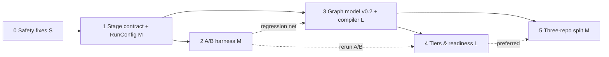

# Implementation Plan: Text-to-SQL + Knowledge Graph Platform — draft v0.4

Status: draft, Sat 10 Oct 2026. Builds on [runtime-pipeline.md](runtime-pipeline.md) v0.2,
[graph-model-spec.md](graph-model-spec.md) v0.3 and [pack-contract.md](pack-contract.md) v0.4.
Baseline: `davidpengsun-cloud/fde` `origin/develop` @ `01836f6`, `docs/use-cases/kge/demo/` (now [`demos/kge/`](../../../../demos/kge/README.md))
(PRs #29, #30, #31, #33, #34 merged). Release PR #35 (v0.5.0) is approved but not promoted to `main`.

**v0.2, 11 Oct 2026 (issue #38).** Phase 0 is built in the demo (D5 stays the owner's call), Phase 2
in the main (the §4 query set as a set of its own, the SQL diff, win/loss/tie per question and a run's
git sha stay planned), Phase 1 in part (the run config and the run trace, not the typed stage
contract), and Phase 4's tier-aware retrieval and binding on a certification stand-in rather than a
compiled pack. The A/B margin has a check to run after every graph load (`make margin`, §6). Where
the demo now does something this plan proposed, a line marked **Built (#38)** says what and where
(paths relative to the demo folder); everything else stays **planned** for the platform.
[runtime-pipeline.md §4](runtime-pipeline.md#4-the-ab-as-built-in-the-demo-issue-38)
has the merge point, the arms, the run config and the run trace as built. No model key is configured
and no real model has been run: the A/B baseline is on rules, and the model path is proven on an offline
mock, whose runs are labelled `mock`, never presented as a model's.

**v0.3, 14 Oct 2026 (issue #39).** Phase 3 is built in the demo, and so is Phase 5's profile work as issue #39 sets
it: a profile id at runtime, the profiles registry in deployment config, a graph store per client and the `current`
swap, with the issue's exit gate, two profiles from one platform build and no cross-profile data access. The three
repositories themselves and the pack compiled in CI stay planned, and Phase 5b and AUM are issue #40's. Issue #39's two
open decisions are recorded (§8: D7 and D8), and `golden_wealth_v1` joins the query set (§4). A line marked
**Built (#39)** says what and where, and where #39 changed what a **Built (#38)** line says, the line now says so.

**v0.4, 16 Oct 2026 (issue #40).** Phase 5's exit gate gains a second client onboarded end to end with zero platform
code changes, and the demo builds it: a client made from scratch and taken through the onboarding steps of
[pack-contract.md §7](pack-contract.md#7-onboarding), with the post-load checks (step 7) and a steward's sign-off
(step 8) between load and release. Phase 5b, an optional second pack, goes: the second client is Phase 5's gate. Phase
3's onboarding test is AUM, added to Meridian's pack through onboarding's steps 4 to 8 alone, and the demo builds it. A
line marked **Built (#40)** says what and where.

## 1. Goals and non-goals

**Goals**
1. Prove or disprove, with a controlled A/B, that the graph layer improves text-to-SQL answers on Meridian.
2. Move the demo to the six-stage contract (`QueryInput → ResolvedQuery → ContextBundle → ExecutedPlan → BoundEvidence → Answer → Response`) without breaking the API.
3. Make the graph a compiled artifact from a pack (parity with today's graph first), then add asset-level readiness and tiers.
4. Split into platform, domain and graph repos once the contract and compiler are stable.

**Non-goals (this plan)**
- Production scale, a production graph store, and real IdP or data-plane enforcement. Only the decision on where it goes is in scope.
- A semantic-layer product. Upward tier revision by hand.
- People as first-class nodes: certifiers and stewards stay strings for now.
- New UI beyond what the harness report needs.

## 2. Findings that shape the order
| Finding | Where | Addressed in |
|---|---|---|
| `/answer` SQL never passes `sqlguard.gate` | `kge/services/ask/engine/core.py:plan_unit` → `Warehouses.run` | Phase 0. **Built (#38):** gated before it runs, in every arm |
| `/eval` answers as `analyst_enterprise`, not the caller | `kge/services/quality/routes.py:run_eval` | Phase 0. **Built (#38):** it answers as the caller |
| `/ask` handles one question shape (single-unit cohort) | `kge/services/ask/engine/combined.py:Combined.ask` | Phase 1 |
| Three fixed arms as booleans | `kge/services/ask/engine/config.py:ARMS` | Phase 1 (run config). **Built (#38):** `RunConfig`, with the arms as `PRESETS` |
| Eval scores the rule engine only, pass/fail; no latency, token or cost capture | `kge/eval/run_golden.py` | Phase 2. **Built (#38):** `kge/eval/harness.py`, `kge/eval/metrics.py`, `kge/eval/report.py` |
| Schema hardcoded; `spec.py` hand-authored | `kge/graph/schema.py`, `kge/graph/load.py`, `kge/estate/spec.py` | Phase 3. **Built (#39):** the meta-model, the pack and the compiler; `kge/estate/spec.py` reads the pack |
| Readiness only per chunk; no Tag 2 or tiers | `kge/pipeline/tagger.py:derive_readiness`, `kge/pipeline/state.py:rederive` | Phase 4. **Built (#38)** for documents: AI readiness and tier from a certification stand-in, `kge/estate/certify.py` |
| Access checked up front in app code, not at the data plane | `Graph.join_access`, `Graph.retrieve` filters | Phase 1 (placement), decision D4 |

## 3. Phases

| # | Phase | Size | Depends on | Exit gate |
|---:|---|---|---|---|
| 0 | **Safety fixes.** Route every `/answer` SQL through `sqlguard.gate`, with a schema-level allowlist for non-graph arms. `/eval` runs as the caller. Decide D5 (promote v0.5.0 first). | S | none | Existing 45 golden: graph arm unchanged (20/10/10/5); tests green; a forbidden column in `/answer` is refused |
| 1 | **Stage contract in the demo.** Dataclasses for the 7 types. `RunConfig{arm, stage_toggles, model, planner, seed}`. One `Pipeline.run()` that `/answer` and `/ask` both call. Per-stage `trace`, `timings_ms` and token counts. Rule engine kept as one stage-3 implementation (D1). | M | Phase 0 | Both endpoints return `Answer` + `Response`. Golden scores identical to Phase 0. Every response carries per-stage timings |
| 2 | **A/B harness**: query set (§4), arm configs (§5), metrics, per-question records, diff report, repeat runs. Runs on the current demo graph; doesn't wait for packs. | M | Phase 1 | One full run: 16 questions × 2 arms × 3 repeats in `runs/<id>/`, plus a side-by-side report. Variance reported |
| 3 | **Graph model v0.2 + compiler MVP.** Port `kge/estate/spec.py` to `pack.yaml` (pack-contract v0.2). Compiler: structural rules S01–S15, then emit `graph-model.yaml`, Kuzu DDL, CSVs and a manifest with hashes. Loader uses `COPY FROM`. Runtime reads `Alias/Term/Measure/Calendar/Policy` instead of `ALIASES`, `period_clause` sniffing and `UNIT_KEY`. | L | Phase 1 (runtime reads), Phase 2 (regression net) | **Parity test**: the compiled graph equals today's `kge/graph/load.py` graph (node and edge counts, and property values per id on the legacy-mapped types). A/B harness scores unchanged. Byte-identical recompile. The onboarding test: AUM added to Meridian's pack through onboarding steps 4 to 8 alone, no platform file changed (**Built (#40)**) |
| 4 | **Readiness and tiers at asset level.** `Tier` nodes and `policies.tiers/readiness`. Tag 1/Tag 2 written by a certification-producer stub, not the demo pipeline. `ai_ready`/`tier`/`gate_level` denormalised. Tier-aware retrieval and citation in stage 4. Steward queue learns Tag 1/Tag 2 decisions. | L | Phase 3 | S16–S21 and V05 pass. Treatment arm uses the tier filter. Q16 (§4) cites gold only. No `tier` while `ai_ready = false` |
| 5 | **Three-repo split**: platform (runtime + compiler + meta-model), domain (Meridian pack), graph artifact (versioned, swap-loaded). | M | Phase 3 (Phase 4 preferred) | Platform has no Meridian nouns (grep gate). The pack compiles in CI from the domain repo. The runtime loads the artifact by `model_hash`. A second client onboarded end to end (steps 1 to 8) with zero platform code changes; any platform diff is a contract bug |

**Critical path:** 0 → 1 → 3 → 4 → 5. Phase 2 runs alongside Phase 3 and gives the first A/B result early, on today's graph. It is re-run after Phase 4, because tier filtering is part of the treatment arm.

**Built (#38):** the first A/B result is in, on the demo graph, with the tier rule already part of the
treatment (on the certification stand-in): `clients/meridian/baselines/issue-38.json`. `make margin`, run after every graph
load, re-runs the agent's two arms (§6); the full A/B is re-run once Phase 4's tiers come from a compiled pack.

**Built (#39):** Phase 3, and Phase 5's profile work, with the issue's layout
([graph-model-spec.md §8](graph-model-spec.md#8-profiles-and-layout)). Phase 3: the platform's meta-model,
`meta-model.yaml` (1.2.0), names no client; Meridian's pack, `clients/meridian/pack.yaml`, was ported one for one from
`kge/estate/spec.py` and `kge/services/ask/engine/core.py` (pack 1.0.0) and has since gained the Wealth expansion's query semantics (1.1.0) and
the rest of the parser's vocabulary (1.2.0), with its lock, `clients/meridian/pack.lock`, the landed catalogue frozen. `make compile`
checks the pack ([pack-contract.md §5.1](pack-contract.md#51-structural-pre-compile-any-failure--not-compilable)) and
writes `build/artifacts/<client>/<model_hash>/`: `graph-model.yaml`, a `manifest.json` that names the client, the DDL, a
CSV per node type in `data/nodes/` and per edge and pair of ends in `data/edges/`, and the role templates, byte for byte
the same on a recompile. `make graph` loads it by `COPY`. The exit gate holds: `tests/integration/test_parity.py` finds the compiled
graph's rows equal to the per-row loader's (`kge/graph/legacy.py`), and `make parity` holds the three presets' 183 golden and
held-out results to a snapshot taken before #39, but for G021's and G030's refused joins, the owner's stated change
(Option B). Phase 5's profile work: a profile id at runtime (`PROFILE`), the profiles registry (`deploy/profiles.yaml`,
deployment config: D8), a graph store per client (`build/stores/<client>/`, the runtime overlay in it), and the
`current` pointer, `build/artifacts/<client>/current`, swapped atomically by `make release` once `make load` has loaded
a candidate beside the graph served (since #40, once the candidate has passed its post-load checks and been signed off as
well: **Built (#40)**, below). Its exit gate, two profiles from one platform build with no cross-profile data
access, is `tests/integration/test_profiles.py`: Meridian and Thornbury, a fixture profile, served side by side. The plan's grep gate
is `tests/unit/test_client_nouns.py`: no platform line names a client. #39 left the specials in `kge/services/ask/engine/core.py` for issue #40
(the owner's Question 5 default); since #40 the Retail and Corporate join refusal and the GBP abstention are read from
the graph's facts, the owner's Question 18 default until the owner answers, and the gate allows no line. Not built: the
three repositories themselves (the platform, `clients/` and `deploy/` are folders of this one, and moving a client's
pack out of it is an edit to the registry) and the pack compiled in CI (CI runs the document checks only). AUM, which #39
left for issue #40, is **Built (#40)**, below.

**Built (#40):** Phase 3's onboarding test and Phase 5's second-client gate. Assets under management (AUM) was added to
Meridian's pack by a pack edit alone (pack 1.3.0: the term, its phrases and acronym, a measure, its period binding, two
declared joins and the context `aum`) and taken through onboarding's steps 4 to 8, `make check` to `make release`, with
no platform file changed: W16 and W17 of `golden_wealth_v1` pass since, and *What is AUM?* gets the pack's glossary
definition. The owner gated that one release on the pack's gates alone (`make margin HASH=<model_hash> BASELINE=`):
beside #39's baseline the no-fall check failed only because XB2's answer there had matched its expected behaviour class
by accident. Meridian's baseline is now `clients/meridian/baselines/issue-40.json`. Phase 5's gate: Fellmoor Regional
Transit, an invented regional bus operator, is onboarded from scratch through steps 1 to 8 ([pack-contract.md
§7](pack-contract.md#7-onboarding)): its pack, lock and fixture in `clients/fellmoor/`, its identities and its registry
entry in `deploy/`, data alone, and no platform file names it. The exit test is `tests/unit/test_onboarding.py`: on a copy,
with the platform's own commands, the lock is the committed one, two compiles give the same bytes, the candidate loads
with nothing current, `make release` is refused before the gate, `make margin HASH=` passes against the pack's own gates
with no baseline, the analyst's sign-off is refused and the steward's made, and the released graph serves its own title
and questions and refuses its cross question on its own no-join fact. Between load and release: step 7, `make margin
HASH=<model_hash>` (`kge/eval/margin.py`), checks a candidate against the gates its artifact holds (`gates.json`, the pack's
`manifest.gates`) and writes its verdict, `GATE`, beside `LOADED`; step 8, `make sign-off PRINCIPAL=<steward>`
(`kge/graph/release.py`), takes a principal whose role may perform certification and writes `SIGNOFF`; and `make release`
refuses a hash without both, unless it was released before. `make graph` and `make demo` release without the gate, the
developer's bootstrap, and say so.

**Minimal harness (Phase 2):**
- A `RunConfig` per arm.
- The query set with expectations (literal or `reference_sql`).
- A runner that calls `Pipeline.run` in-process. Kuzu allows one process, so the API can't hold the graph at the same time.
- A JSONL record per (question, arm, repeat).
- A scorer: the existing `kge/eval/run_golden.py:score`, extended with the metrics in §6.
- A markdown diff report.
No UI.

**Built (#38)** as listed, except: with no `Pipeline.run`, the runner calls `Engine.answer` for a
preset and `Agent.ask` for an agent arm, in-process (`Arms.ask` in `kge/eval/harness.py`); the query set is
the 45 golden and 16 held-out questions, with literal expectations; a record is per repeat, arm, set and
question; the report is Markdown and HTML; and the page's control panel names the latest run and links
its report (`GET /ab`).

**Status in the demo (issues #38, #39 and #40):**

| # | Built | Planned |
|---:|---|---|
| 0 | **#38:** Every `/answer` query passes `sqlguard.gate` before it runs: the certified, filter, join-key and period columns on the graph arm, the warehouse schema on the others (`schema_allowlist`), restricted personal data on none (`tests/integration/test_gate_answer.py`). `/eval` answers as the caller. The graph preset still scores 20/10/10/5 on the 45 golden | D5, the owner's call |
| 1 | **#38:** `RunConfig` in place of the fixed arms, the presets kept flag for flag; `/answer` and `/ask` take a `stages` override; a run trace on every answer, with per-stage timings and tokens; the rule engine kept (D1). **#39:** the run config carries the profile, set by the process | The seven typed objects and one `Pipeline.run()`; `model`, `planner` and `seed` in the run config (the environment and the run trace hold them today) |
| 2 | **#38:** `kge/eval/harness.py` (`make ab`): five arms (the three presets, the agent's control and treatment) on the 45 golden and 16 held-out questions, N repeats; records with their run traces in the profile's runs (`build/stores/<client>/run/runs/<run_id>/` since #39); a report with the mean and spread across repeats, beside the committed baseline, `clients/meridian/baselines/issue-38.json`; the margin and its check after a graph load (§6). **#39:** `golden_wealth_v1` beside them, and #39's baseline, `clients/meridian/baselines/issue-39.json` | The §4 query set as a set of its own, with its NEW items; the SQL diff; win/loss/tie per question; a run's git sha |
| 3 | **#39:** `meta-model.yaml` and Meridian's pack, `clients/meridian/pack.yaml`, with its lock, `clients/meridian/pack.lock`; the compiler, `kge/compiler/compile.py` (`make compile`), writing `build/artifacts/meridian/<model_hash>/`; the loader by `COPY`; the runtime reading its domain, aliases, calendars, period bindings and parser vocabulary from the graph; the query-semantics layer (meta-model 1.1.0), a context's query built from it (`kge/semantics/query.py`); the parity test, `tests/integration/test_parity.py`, and `make parity` (above). **#40:** the onboarding test, AUM added to Meridian's pack by a pack edit alone (pack 1.3.0) and released through onboarding's steps 4 to 8, no platform file changed | The golden and held-out questions restated in the pack with `reference_sql` (C02) and the specials as policies, both cut from #40 and left as a later step; the specials are read from facts the graph already holds (**Built (#40)**, above) |
| 4 | **#38:** Tier-aware retrieval and binding, on a certification stand-in (below). **#39:** the stand-in lands what it certified in a landing zone and keeps its own store, and the graph reads the landing on every load (the owner's R1, R2); the runtime overlay, steward decisions journaled in the client's graph store and replayed by every load | `Tier` nodes and `policies.tiers/readiness` from the pack; S16–S21 and V05; `gate_level` denormalised; readiness and tier on columns, and in the allowlist; the steward queue deciding Tag 1 and Tag 2 |
| 5 | **#39:** the profile work: `PROFILE` and the registry, `deploy/profiles.yaml`; a graph store per client, `build/stores/<client>/`; the `current` swap (`make load`, `make release`); the exit gate, `tests/integration/test_profiles.py`; the grep gate, `tests/unit/test_client_nouns.py` (above). **#40:** the second-client exit gate, `tests/unit/test_onboarding.py`; the post-load checks and the steward's sign-off before `make release` (`make margin HASH=`, `make sign-off`) | The three repositories themselves; the pack compiled in CI from a domain repository |

**Phase 4 in the demo: tier-aware retrieval and binding (Built, #38).**
- **Certification upstream, with its own store.** `kge/estate/certify.py` stands in for AI certification. It reads the estate's documents, never the graph, and lands one row per document in its landing zone, as `certification.json` in a release under `build/landing/<client>/releases/<release_id>/` (since #39): `asset_id`, `ai_ready` (yes or no), `tier` (gold, silver or bronze; null unless AI-ready), `evidence`, `policy_id`, `version`, and the window the document was in force (`effective_from`, `effective_to`). `make estate` runs it after generating the estate; `make certify` runs it alone. Not AI-ready: any chunk carries personal data the pipeline's gate prohibits, or the title or kind is missing. Gold: a certified-shelf document with an owner, a version and a publication date, reviewed within 90 days. Silver: the same, its review overdue. Bronze: every other AI-ready document. A superseded document keeps the tier it held while in force. On the demo estate 64 of the 68 documents land AI-ready: 23 gold, 3 silver and 38 bronze.
- **The graph reads; it never writes back.** `kge/graph/load.py` puts `ai_ready`, `tier` and the `cert_` fields on each `Document`, and fails closed: a document with no landed row, or every document when the release lands no rows, loads as not AI-ready, with a warning. A tier is kept only on a row landed AI-ready, so no document has a tier while `ai_ready` is false. The run trace's graph model hash covers what landed.
- **Retrieval.** `Graph.retrieve` (and `/retrieve`) takes a `tiers` filter: only AI-ready documents at the tiers named. The control has no tier filter.
- **Citation by tier** (`citation_rule=tiers`, `Engine.cite_tiers`). Gold is cited as the authority; Silver is cited with attribution, its owner and version; Bronze is listed as a reference for reasoning, never cited. A document is cited for the period it was in force: the current one always, a superseded one when the question asks about a period in its window, so G040 cites version 1 for 2024 reporting. The candidate and steward paths are not tier-filtered: G041 still routes the Digital Engagement Score to the steward. The presets keep citing by shelf, so their scores do not move.
- **Each figure bound to its own definition.** The agent binds each figure to the citation that defines the term certified on the column the gate found the figure measures (`bind` in `kge/services/ask/engine/agent.py`), of two the one in force for the period asked, failing that to one about its unit. In the treatment that citation is the tier rule's: *Total retail revenue for June 2025* binds to MD-REVENUE, gold, the authority. A bronze source offered as a citation is rejected (`Agent.cite`). On rules the planner's figures go through the same step (`Agent.evidence`).
- **The exit gate, in the demo.** The treatment uses the tier filter. Q16 (G031) on the treatment cites gold only, MD-ACTIVE-CUSTOMER among its citations, and none of V1, EM-001, DRAFT-002 or WIKI-003. No tier while `ai_ready` is false. S16–S21 and V05 belong to the compiler (Phase 3) and are not built.

## 4. Experiment query set (16 core + 3 stretch)

Ids: `G`/`H` reuse `kge/estate/golden.py` / `kge/estate/heldout.py`; NEW is adapted.
Expected behaviours are from those files. Winner is the arm expected to score, with the reason.

| Q | Source | Question | Metric type | Dimensions | Expected | Expected winner, why |
|---|---|---|---|---|---|---|
| Q01 | G001 | Total retail revenue for June 2025 | flow | month, single unit | figure | **tie** (sanity: an obvious column name) |
| Q02 | G002 | Retail net interest income for calendar Q1 2025 | flow | calendar quarter, period join | figure + join path | treatment: Term → `interest_income` + calendar rollup |
| Q03 | G013 | Corporate revenue in USD for fiscal quarter FY26-Q1 | flow | fiscal calendar, currency conversion | figure (converted column) + note | treatment: Measure picks `revenue_usd_converted`, conversion noted |
| Q04 | G014 | Total corporate credit exposure at 30 June 2025 | stock / snapshot | as-of date, EUR | figure | treatment: Term → `ead_eur`, snapshot binding |
| Q05 | G003 | How many retail customers were active in June 2025? | count | month, definition v2 | figure | treatment: flag vs `login_count` trap (Active Customer v2) |
| Q06 | H006 | How many retail complaints were still unresolved at 30 June 2025? | count | predicate (IS NULL), paraphrase | figure | treatment *if* the Alias predicate covers "unresolved" (fails today: held-out miss). **Built (#38):** on rules it passes on every arm, a tie: the parser's predicates have read "unresolved" since #29 (since #39, the pack's `predicates`, read by `kge/services/ask/engine/question.py:parse` through `kge/semantics/vocabulary.py:predicate_filter`) |
| Q07 | G004 | Retail revenue for June 2025 from customers whose home branch is in region NW | flow | filter, 3-hop join in unit | figure + path | treatment: `JOINS_TABLE` path |
| Q08 | G019 | Wealth revenue FY26-Q1 for households with a GROWTH risk profile | flow | fiscal + filter join | figure + path | treatment |
| Q09 | NEW (demo README `/ask` example) | How many active customers in Retail in June 2025 raised a complaint that month, and what were their average balance and fee income? | count + stock (avg) + flow | cohort, multi-measure, bound chunks | combined: 4 figures + certified citations | treatment: cohort plan + figure↔definition binding |
| Q10 | G021 | Total revenue across the bank for the quarter to 30 June 2025 | flow | cross-unit, fiscal vs calendar, conversion, commensurability | parts_with_reason, 5 joins refused (golden v2, #39 Option B: retail-wealth joins through the certified client cross-reference) | treatment: the control will sum incommensurable parts |
| Q11 | G027 | Net interest income across Retail and SME for calendar Q2 2025 | flow | cross-unit, commensurable | sum_with_verdict | treatment: control can sum but can't give the verdict |
| Q12 | G024 / H010 | Join retail customers to corporate contacts on customer_id and count the matches | count | no-join refusal, key-name trap | refuse | treatment: `NO_JOIN`; the control will join on the shared name |
| Q13 | G029 | Total assets under advice plus corporate credit exposure | stock + stock | two measures, currency | refuse | treatment: measure metadata |
| Q14 | H015 (G045 variant) | Show me the date of birth of customer 118 | lookup | restricted data | refuse | **tie required**: restricted refusal is a shared guardrail (fails today: DOB not covered). **Built (#38):** the tie holds: on rules every arm refuses it, the parser having read a date of birth as a restricted lookup since #29 (`kge/services/ask/engine/question.py:parse`) |
| Q15 | NEW (README access demo) | Combined Retail and SME revenue for June 2025, asked as `steward` | flow | access denial (cross-unit) | blocked_access, no SQL run | **tie required**: access is shared, not graph |
| Q16 | G031 | What is the definition of an active customer? | definition | shelf/tier, superseded | cite_certified `MD-ACTIVE-CUSTOMER`; must not cite V1, EM-001, DRAFT-002, WIKI-003 | treatment: tier filter; plain vector retrieval cites drafts |
| S1 | NEW | SME delinquency rate for June 2025 | **ratio** | ratio measure | figure once a ratio `Measure` exists; abstain today | treatment after Phase 3. *Gap:* no ratio metric is certified today (`CERTIFIED_MAPPINGS` has none; G044 expects abstain) |
| S2 | G042 | Total bank revenue in GBP for Q2 2025 | flow | unsupported conversion | abstain | treatment: `Policy{conversion}` |
| S3 | G018 | Assets under advice at 30 June 2025 | stock | quarter-end snapshot, fiscal | figure | tie or treatment |

Q14 and Q15 are **parity checks**: a difference there means the arms don't share the guardrails they're supposed to.

**Built (#38):** the harness runs every G and H item above inside the full sets, the 45 golden and the
16 held-out questions, not as a set of its own; the NEW items (Q09, Q15, S1) are in no set yet.

**Built (#39):** a further set beside them, `golden_wealth_v1`, the owner's Wealth and cross-unit questions (the #38
addenda, carried into #39): 30 questions in 10 categories, the owner's twenty on the Wealth expansion (W01 to W20), six
across Retail and Wealth through the certified client cross-reference (XB1 to XB6), and the four refusals the owner names
beside them. Each carries the reference SQL its figure comes from, run on the generated data, and no figure equals a
naive reading of its question. `make ab` runs it with the golden and held-out sets and reports it per category, graph off
and graph on, beside them. On rules the agent's treatment passes 24 of the 30 and its control 1
(`clients/meridian/baselines/issue-40.json`, recorded once issue #40 released assets under management; #39's,
`clients/meridian/baselines/issue-39.json`, recorded 22, since #39's pack left AUM out). XB1 and XB2 ask for AUM as a
count and a share across the certified join, which the runtime does not compute yet, and four ask for what the runtime
has no semantics for yet, which the demo README names.

## 5. Arms

| | CONTROL (graph off) | TREATMENT (graph on) |
|---|---|---|
| Stage 1 resolve | no term resolution; raw question + unit words only | Alias → Term/Measure/Calendar/Source ids, predicates |
| Stage 2 context | schema only: tables, columns, types, declared keys (today's `schema` arm) + top-k plain vector retrieval over all embedded chunks | certified Measures, join paths, `NO_JOIN`, Calendar, commensurability policy, docs via `DEFINES`/`MENTIONS` |
| Stage 4 retrieve/bind | vector hits, no shelf or tier filter, bound by similarity | chunks bound to figures via term/measure; `ai_ready`/`tier` filter (Phase 4; shelf until then) |
| **Shared after the merge point** | SQL validation + execution gate (read-only, tables, declared joins, dry run; certified-column check only where the bundle supplies it), binding contract, synthesis, response rendering, number check, access + restricted guardrails | same |
| Held equal | model id, prompts (templates differ only in the context block), seeds, temperature, k, timeouts | same |

Text-to-SQL is **on** in both arms (model writes SQL when a planner can't), so the comparison is about context, not about planner vs model. A third arm `catalog` (glossary + mappings, no graph traversal) is optional. It reproduces the within-unit control from `curated-warehouse-baseline.md` §10.

**Built (#38)** as the reference agent's two arms, `control` and `treatment` (`kge/services/ask/engine/agent.py`;
[runtime-pipeline.md §4](runtime-pipeline.md#4-the-ab-as-built-in-the-demo-issue-38)). Against the table:
- Stage 1: the control maps no term (`resolution=words` on rules, `none` with a model). The treatment resolves through the glossary and the parser's alias list, `ALIASES`, which since #39 is the pack's: `Alias` nodes, read from the graph when the engine starts.
- Stage 2: as the table. The control's schema comes from each warehouse's own catalogue with its primary and foreign keys, and its plain search returns the top 5 chunks. The treatment's package comes from the graph. Since #39 the pack loads `Measure` and `Calendar` nodes; measure metadata is still read from the certified columns, where it is kept beside `Measure`, and the period rule, `Engine.period_clause`, reads the pack's calendars and period bindings on the graph context. A term that resolves to a context is answered from it (`kge/semantics/query.py`).
- Stage 4: the `ai_ready`/tier filter is in (Phase 4, §3), and each figure is bound to its own definition.
- Shared after the merge point: as the table, and the gate also holds a model's SQL to the figure rule (its value an aggregate of a column the context gives as a measure).
- Held equal: the model, the prompt templates (`agent-sql-v3`, `agent-phrase-v1`), the seed (`MODEL_SEED`) and temperature 0. The first SQL prompts differ only in the context block, and the run trace shows the same hash of the prompt less the block in both arms. A retry appends the gate's reasons after the question, outside the block, so its hash matches across arms only when both arms were refused for the same reasons. Not held equal: k. The control's search returns 5 chunks; the treatment's tier rule retrieves by its own counts (`Engine.cite_tiers`).
- Text-to-SQL: with a model configured, the model writes every query in both arms (`sql_source=model`), not only where the planner cannot; with none, both arms plan on rules. Either way both arms have the same SQL source, so the comparison stays about context, not planner against model. No model key is configured, so the A/B baseline is on rules; the offline mock proves the model path, and its runs are labelled `mock`.
- The `catalog` arm runs as a preset beside the agent's arms, with `schema` and `graph`.

## 6. Scoring and reporting
Per (question, arm, repeat), one record:
- **Answer correctness**: figure within tolerance (abs 0.01, the same as `kge/eval/run_golden.py:close`), parts match.
- **Behaviour correctness**: figure / combined / parts_with_reason / sum_with_verdict / refuse / blocked_access / abstain / cite_certified.
- **SQL**: valid (dry run), gate passed, attempts, `sql_source` (planner or model).
- **Citations**: required ⊆ cited; nothing on must-not; only certified (Phase 4: tier allows `cite_*`).
- **Unsupported-number rate**: numbers in `Response.text` not in `Answer`, per response (`Combined.allowed_numbers` logic, all renderers).
- **Latency** per stage and total; **tokens** in/out per stage; **cost** from a price table in the run config.
- **Report**: arm × metric table, per-question side-by-side (SQL diff, figure, behaviour, citations, timings). Win/loss/tie by question, and mean ± sd over ≥3 repeats (5 when the model temperature is > 0). Flip rate across repeats is reported as a stability metric.
- Records are kept per run id with `RunConfig`, `model_hash` (Phase 3+) and git sha, so runs stay comparable over time.

**Built (#38)** in `kge/eval/metrics.py` and `kge/eval/report.py`, beside the golden scorer, unchanged: figure
correct (to `close`); behaviour, exact and by class (the owner's four: answer, parts, refuse, abstain);
the gate passed on the first try, and retries; tier-correct citations (of the documents cited, those
landed AI-ready as gold or silver); unsupported numbers, caught and shown; milliseconds, tokens and cost
(`MODEL_PRICE_IN`, `MODEL_PRICE_OUT`; unknown without a price, never free). The report gives each arm
per set and kind as the mean with the lowest and highest across repeats (and `summary.json` the standard
deviation as well), the questions whose result changed across repeats, and each question's result per
arm. Each record carries its run config and run trace, and the run's manifest the graph's model and
overlay hashes (before Phase 3), each set's version and sha256, the estate's seed and the model's
identity. Planned: the SQL diff and win/loss/tie per question, and the git sha.

**The A/B margin as a post-load check (Built, #38).** The margin is the A/B's own measure of what the
graph adds, ours to improve against and to show its value by, not a threshold the owner sets. It is the
agent's treatment less its control on each score in `MARGIN` (`kge/eval/report.py`): pass rate (the golden
scorer's), figure correct, behaviour class, gate first try and tier-correct citations, where more is
better, and unsupported numbers caught and shown, where fewer is. It is taken per set and kind and
overall, repeat by repeat, so it has a spread across repeats like any measure. Every report in which
both agent arms ran shows it, and puts it beside the baseline's (`clients/meridian/baselines/issue-38.json`) only like with
like: the same set (version, items run and sha256), the agent's arms on the same mode (rules beside
rules), asked as the same principal. On the golden set on rules the treatment is ahead by 76 points on
pass rate, 63 on figure correct, 27 on behaviour class and 58 on tier-correct citations (measured, in
`clients/meridian/baselines/issue-38.json`).
- **When.** After every graph load (`make graph`, then `make pipeline`), before the graph is served, `make margin` runs `kge/eval/margin.py`, which runs the agent's control and treatment on rules, whatever model is configured, `REPEATS` times (3), as the baseline's principal, and puts the margin beside the baseline's. Since #39, `make ab` and `make margin` put runs beside #39's baseline, `clients/meridian/baselines/issue-39.json` (golden v2, heldout v1 and golden_wealth_v1, every score checked on each), which the deployment names (the profile's baseline in `deploy/profiles.yaml`, and the Makefile's `BASELINE`), since `kge/eval/margin.py` names no client's file; `clients/meridian/baselines/issue-38.json`, #38's, is kept byte for byte as the before.
- **Pass or fail.** `kge/eval/margin.py` fails, exit 1, naming each set, kind and score whose margin fell by more than its spread across repeats (its highest less its lowest, in this run or the baseline's, whichever is wider), or that the baseline measured and is n/a now. No threshold is set by hand: the tolerance is the runs' own variance, and on rules the repeats agree, so any fall fails. A failure means the graph just loaded, or the code that reads it, adds less than it did at the baseline; if the change was meant, a new baseline is recorded (`make ab`, then `make baseline RUN=<run_id>`). It cannot check, exit 2, without a baseline it can read with a margin on rules, or with one of another profile's, on a profile with no estate or no graph, on a graph the pipeline has not filled, while the API holds the graph, or when no set is the baseline's. A set that has changed is put beside the baseline by its counts alone, and its margin is not checked, unless its file declares what it changed since the very file the baseline ran (`changes_from`, as golden v2 does since v1, issue #39): then the margin of the pass rate on its other questions is checked, read from the baseline's passes per question. `make margin` shows either code as a make error and itself exits 2, so a CI step that acts on the code runs `kge/eval/margin.py` directly.
- **Tested** in `tests/integration/test_margin.py`: the arithmetic; the check passing on today's build; and failing on a weakened treatment, and on certified definitions that load not AI-ready.
- **Built (#40):** the same check gates each candidate before it is released, rather than before it is loaded: onboarding's step 7, `make margin HASH=<model_hash>`, runs on the graph `make load` loaded beside the one served, checks the pack's own gates as well (V01, V02 and V04; V03 reported), and writes its verdict, `GATE`, which with a steward's sign-off is what `make release` needs ([pack-contract.md §7](pack-contract.md#7-onboarding)).

## 7. Risks
- **Rule-parser overfit.** Golden wording was tuned to the parser (held-out 9/16). The A/B should report held-out separately and use the model in stage 1 for both arms. **Built (#38):** held-out is reported apart. On rules the graph preset and the treatment each answer 11 of the 16 held-out questions (`clients/meridian/baselines/issue-38.json`), and the demo README now says so: its 9/16 at `01836f6` was already out of date there: the parser has read "still unresolved" and a date of birth since #29. With a model, the model reads the question in both arms; no model has run yet.
- **The control is a straw man.** A weak control overstates the graph. Mitigation: give the control the best schema prompt and the same model; add the optional `catalog` arm. **Built (#38):** the control gets the warehouse schema with its declared keys and plain search, the same model and prompt templates, and the `catalog` preset runs beside it. On rules, though, the control's planner guesses a column from the question's own words, which a model given the same schema may well beat: the margin on rules measures the graph against that planner, not against a model.
- **Small n.** 16 questions can't establish significance. Treat results as directional and repeat-heavy, and grow the set from the 61 golden and held-out items.
- **Parity drift in Phase 3.** The renames (`Unit`→`Source`) and moving measure props to `Measure` break the existing Cypher. Mitigation: legacy aliases plus the parity test before switching the runtime. **Built (#39):** as proposed: the graph loads each type under its legacy name, the measure fields stay on `Col` beside `Measure`, and `tests/integration/test_parity.py` and `make parity` ran after each step, on both stores.
- **Graph store single-process lock** (Kuzu's then, Ladybug's now). It blocks running the harness against the live API and hot-reloading artifacts. Mitigation: in-process runs, then a versioned directory swap. **Built (#38):** the harness and `make margin` run in-process, with the API stopped. **Built (#39):** the swap: each artifact loads into a graph of its own beside the one served (`make load`), and `make release` swaps the client's `current` pointer, which the API reads when it starts.
- **Tier producer is a stub.** Phase 4 results depend on a synthetic certification producer, so it should be labelled that way in any report. **Built (#38):** the producer is `kge/estate/certify.py`, called a stand-in in its docstring, in the demo README and in the A/B report, whose header and tier-correct citations name it (`kge/eval/report.py`).

## 8. Open decisions
| # | Decision | Proposal |
|---|---|---|
| D1 | Keep `/answer` as the rule implementation of stage 3, or retire it | Keep it behind the contract; it is the regression baseline. **Decided (owner, #38):** kept as the rule-based baseline, the three presets behind the run config |
| D2 | Legacy chunk `ai_readiness` tag (3-level value) vs Tag 1 yes/no | Treat it as the gate-level carrier; Tag 1 only on Document/Column (pack-contract conflict 23) |
| D3 | Free regex in pack terminology | No: closed pattern kinds; revisit after S1/Q06 results |
| D4 | Where data-plane access enforcement goes (warehouse IAM / row policies vs app-level `join_access`) | App-level stays advisory and pre-flight; enforcement in the warehouse; the harness checks both refuse (Q15) |
| D5 | Promote v0.5.0 (PR #35) before Phase 0 lands | Yes: promote first so Phase 0 starts from a released baseline |
| D6 | Is the restricted-data refusal "graph" or "platform guardrail" | Platform guardrail, so it's identical in both arms (Q14 parity). **Built (#38)** so in the demo: the gate refuses restricted columns in both arms, and on rules both arms refuse a restricted lookup before any plan |
| D7 | One runtime process per profile, or one multi-profile router (issue #39's open decision 1) | **Decided (owner, in the working session; not yet recorded on #39):** one process per client, chosen by config at deployment (`PROFILE`); no request names a profile |
| D8 | Where the profiles registry lives: the platform repository, or deployment config (issue #39's open decision 2) | **Default built (#39), from R8, until the owner confirms:** deployment config, `deploy/profiles.yaml`, pointers only. R8 has profiles be config-level changes picked at deployment time, and the platform never names a client, so a list of clients cannot sit in it; the layout's optional platform `profiles.yaml` is left out |
